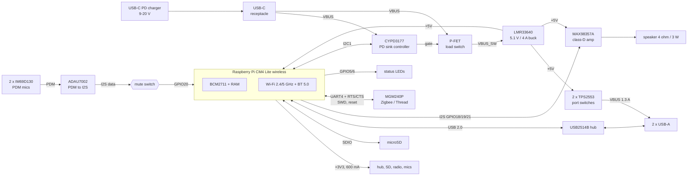
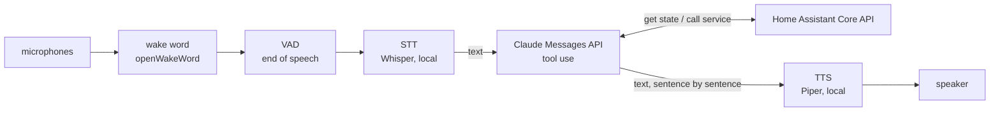

# VoxHub CM4 - a Home Assistant voice hub with Claude inside

A single-board computer for home automation that runs **Home Assistant OS** and works as a
**Claude-based voice assistant**: it listens for a wake word, transcribes the request locally, lets Claude
answer and control the home through tool use, and speaks the reply.

Everything in this repository is generated from code - schematic, PCB, enclosure, OS image and add-on.

| | |
|---|---|
|  |  |
| carrier with CM4 + heat sink (component side) | enclosure, rear view: USB-C PD in, 2 x USB-A, microSD |

> **Status: revision A, design complete, not yet built.** ERC and DRC pass, the OS image builds and the add-on's
> test-suite passes, but no hardware exists yet. Read [DECISIONS.md](DECISIONS.md) ("Open items") before ordering boards.
> Progress is tracked in [TODO.md](TODO.md).

## System overview

| Function | Implementation |
|---|---|
| Compute | Raspberry Pi **Compute Module 4 Lite, wireless** (BCM2711 4x A72, 4 GB) - official HAOS target `rpi4-64` |
| Wi-Fi / Bluetooth | on the CM4: 2.4 + 5 GHz 802.11ac, Bluetooth 5.0 |
| Storage | microSD (push-push socket, card power switched by the module) |
| USB | 2 x USB-A 2.0 host (stacked), USB2514B hub, 1.3 A current-limited per port, ESD protected |
| Microphones | 2 x Infineon IM69D130 PDM MEMS (bottom port), ADAU7002 PDM-to-I2S, hardware mute switch |
| Speaker | MAX98357A I2S class-D, 3.2 W into 4 ohm, JST-PH header, 40 mm speaker in the enclosure |
| Zigbee / Thread | Silicon Labs MGM240P (EFR32MG24, +20 dBm) on UART4, flashable in-system |
| Power | USB-C PD sink (CYPD3177): negotiates 9-20 V, then 5.1 V / 4 A buck (LMR33640) |
| UI | green + blue status LEDs, red mute LED (hard-wired), mute slider on top |
| PCB | 100 x 74 mm, 4 layers, 1.6 mm, parts on one side + one switch on the other |
| Enclosure | 158.8 x 79.2 x 28 mm, two printed parts, no supports |

### Block diagram



### Voice pipeline



Only the transcribed text (plus tool results) leaves the device.

### GPIO map (CM4)

| GPIO | Function | Notes |
|---|---|---|
| 2 / 3 | I2C1 SDA / SCL | CYPD3177 PD controller (HPI, 0x08) |
| 5 / 6 | LED green / blue enable | active high, N-FET drivers, 10k pull-downs |
| 8 / 9 / 10 / 11 | UART4 TX / RX / CTS / RTS | Zigbee module PA06 / PA05 / PA08 / PA07 |
| 14 / 15 | UART0 TX / RX | debug header (DNP) |
| 16 | amplifier SD_MODE | high = on (left channel) |
| 18 / 19 / 20 / 21 | I2S BCLK / LRCLK / DIN / DOUT | DIN passes through the mute switch |
| 22 / 23 | SWDIO / SWCLK of the radio | in-system flashing |
| 24 / 25 | radio nRESET / bootloader strap | 10k pull-ups on the board |
| 27 | mute sense | high = muted |

## Power budget

5 V rail (buck output 5.1 V), worst case = everything at its maximum simultaneously:

| Load | Typical | Peak | Basis |
|---|---|---|---|
| CM4 (SoC, RAM, Wi-Fi) | 3.5 W | 7.0 W | CM4 datasheet: 1.4 A typical maximum at 5 V |
| 3.3 V loads via the CM4 regulator (hub 70/150 mA, microSD 50/200 mA, radio 10/160 mA, mics + converter 3 mA, LEDs 5 mA) | 0.14 A -> 0.5 W | 0.52 A -> 1.9 W | 3.3 V budget 600 mA; 90 % converter efficiency |
| USB-A ports | 0.5 W | 5.0 W | 2 x 500 mA (hardware limit 1.3 A per port) |
| Speaker amplifier | 0.3 W | 3.6 W | 3.2 W output at 90 % efficiency; speech averages far less |
| LEDs, pull-ups | 0.05 W | 0.1 W | |
| **5 V rail total** | **4.9 W (0.95 A)** | **17.6 W (3.45 A)** | buck rated 4 A |
| Buck + switch losses | 0.5 W | 1.9 W | 92 % at 9 V in, P-FET 70 mOhm, inductor 60 mOhm |
| **At the USB-C connector** | **5.4 W** | **19.5 W** | 9 V: 0.6 A typ / 2.17 A peak - 20 V: 0.27 A typ / 0.98 A peak |

- The PD controller requests **>= 2 A at 9-20 V** (18 W at 9 V). Realistic operation (no bus-powered disks, speech
  rather than sine waves) stays below 12 W. The theoretical simultaneous peak of 19.5 W exceeds an 18 W contract by 8 %:
  use a **27 W or larger** charger (9 V/3 A, or anything offering 12/15/20 V at >= 2 A) if both USB ports feed
  500 mA devices.
- 3.3 V budget: 520 mA peak of the 600 mA the CM4 can supply.
- Chargers without a 9-20 V PD profile are rejected safely: the load switch stays open, the buck stays in UVLO (< 7 V)
  and the red PD-FAULT LED lights.

## Thermal estimate (SoC)

Assumptions: 25 C room, module mounted component-side down in the vented enclosure, 14 x 14 x 6 mm heat sink on the BCM2711
(36 K/W on its own in free convection), heat also spreading through the module PCB and the two mezzanine connectors.
Effective module-level thermal resistance derived from published CM4 measurements (bare module on the IO board:
~25 K rise idle at ~2 W, ~55-60 K at full load): about **12 K/W bare, ~9.5-10 K/W with the heat sink in this enclosure**.

| Operating point | Module power | Estimated SoC temperature | Comment |
|---|---|---|---|
| Idle (HAOS, add-ons idle) | 2.0 W | 25 + 2.0 x 10 = **45 C** | |
| Voice assistant active (wake word on one core, Whisper bursts) | 3.5 W | **60 C** | normal operation |
| All four cores loaded continuously | 6.5 W | 90 C -> **throttles at 80 C** | firmware limits to roughly 5.5 W; only during updates / long local STT |

Conclusion: fine without a fan for the intended workload (LLM in the cloud). For sustained local inference fit the taller
15 x 15 x 9.5 mm heat sink (there is 9 mm of headroom under the module) or add a 30 mm fan to the base vents.
Other parts at peak load: buck IC ~1.1 W (junction about +45 K), inductor 0.7 W, P-FET 0.33 W - all uncritical.
These are estimates, not measurements - verify with `vcgencmd measure_temp` on the first prototype.

## Repository layout

| Path | Contents |
|---|---|
| [`hardware/`](hardware/README.md) | KiCad 9 project (generated), generator scripts, schematic PDF, BOM, Gerbers, drill, pick-and-place, DXF, renders, fab + assembly notes |
| [`enclosure/`](enclosure/README.md) | parametric CadQuery source, STL / 3MF / STEP, renders |
| [`os/`](os/README.md) | HAOS board definition, device tree overlay, `build-image.sh` |
| [`assistant/`](assistant/README.md) | Home Assistant add-on: wake word -> STT -> Claude -> TTS |
| [`DECISIONS.md`](DECISIONS.md) | every design decision with its reasoning, blocked downloads, open items |
| [`TODO.md`](TODO.md) | progress checklist |

## How to build everything

Prerequisites: Linux, Docker, Python >= 3.10, Java >= 21 (only for re-running the autorouter).

```bash
# 1. Hardware: schematic -> ERC -> netlist -> placement -> autoroute -> DRC -> fabrication outputs
docker pull kicad/kicad:9.0
SKIP_ROUTE=1 hardware/build.sh all      # re-uses the checked-in autorouter session (reproduces the committed board, ~25 min)
# to autoroute again: wget -P hardware https://github.com/freerouting/freerouting/releases/download/v2.0.1/freerouting-2.0.1.jar
#                     hardware/build.sh all

# 2. Enclosure: STL / 3MF / STEP + renders
pip install cadquery
python3 enclosure/voxhub_enclosure.py enclosure
xvfb-run -a python3 enclosure/render.py

# 3. OS image (latest official HAOS + VoxHub configuration)
sudo apt install git curl xz-utils fdisk mtools device-tree-compiler
os/build-image.sh repack --wifi-ssid "MyWifi" --wifi-psk "secret"
#    -> os/output/haos_voxhub-cm4-<version>.img.xz

# 4. Assistant add-on: tests
pip install -r assistant/requirements-dev.txt
(cd assistant && python3 -m pytest -q)
```

Then: order the PCB (see `hardware/README.md`), print `enclosure/voxhub_shell.3mf` and `voxhub_base.3mf`, flash the image,
add this repository as an add-on repository in Home Assistant and install **VoxHub Assistant** (`assistant/README.md`).

## Verification summary

| Check | Result | Evidence |
|---|---|---|
| ERC (kicad-cli 9.0.9) | 0 errors, 0 warnings | `hardware/outputs/erc.rpt` |
| Netlist equals the code model | all 152 components / 94 nets match pin by pin | `hardware/gen/model_netlist.json` vs. KiCad netlist |
| DRC with schematic parity (kicad-cli 9.0.9) | 0 violations, 0 unconnected pads, 0 parity issues; 5 cosmetic checks waived (10 warnings, each explained in `hardware/README.md`) | `hardware/outputs/drc.rpt`, `drc_waived_checks_enabled.rpt` |
| Footprints vs. datasheets | table in `DECISIONS.md` section 9 | |
| PCB render | kicad-cli 3D renders | `hardware/outputs/render_*.png` |
| Enclosure fit | 0 mm^3 interference PCB assembly vs. printed parts; visual check in the section renders | `enclosure/voxhub_enclosure.py`, `enclosure/renders/` |
| Power budget / thermal estimate | above | |
| Sourcing | every BOM line Active at check time; ICS-43434, PCM12, PESD24VL1BA, GRM31CR6YA106 were replaced after the check found them EOL/obsolete | `hardware/outputs/bom.csv`, DECISIONS.md |
| OS image | built from HAOS 18.5, verified | `os/README.md` |
| Assistant | 86 unit tests pass | `assistant/tests/` |

## License

See [LICENSE](LICENSE). KiCad library parts (symbols, footprints, 3D models under `hardware/3dmodels`) are
CC-BY-SA 4.0 with the KiCad library exception.
