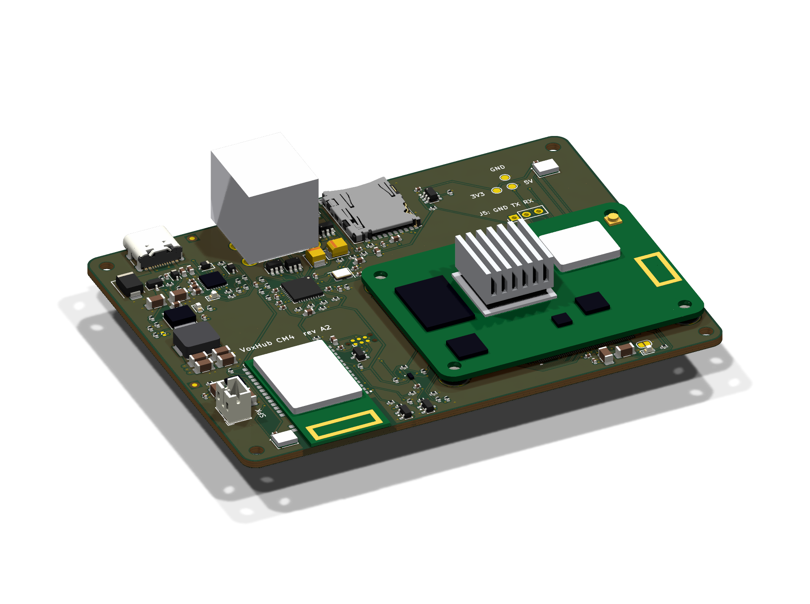
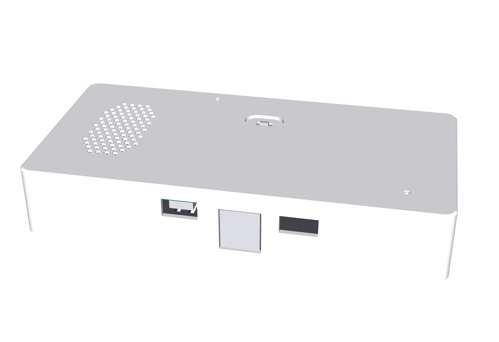
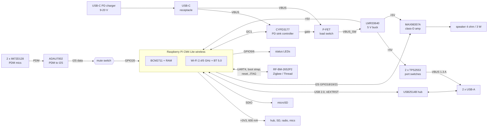
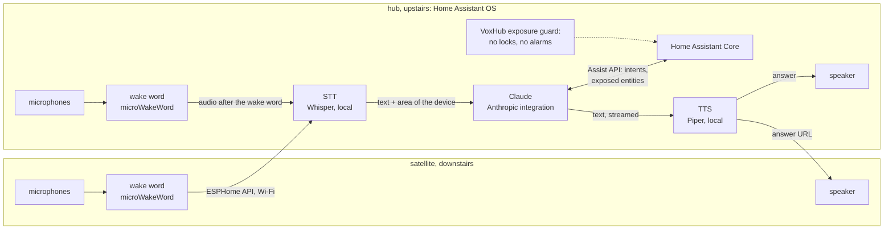

# VoxHub CM4 - a Home Assistant voice hub with Claude inside

A single-board computer for home automation that runs **Home Assistant OS** and works as a
**Claude-based voice assistant**: it listens for a wake word, transcribes the request locally, lets Claude
answer and control the home through tool use, and speaks the reply.

**Two identical boards, one Home Assistant for the whole house.** Board 1, the **hub** (upstairs), runs Home
Assistant OS, the Zigbee coordinator and the Claude pipeline. Board 2, the **satellite** (downstairs), runs no Home
Assistant: it gives the hub its wake word, microphones, speaker, mute switch and LEDs over Wi-Fi, and its radio
runs Zigbee router firmware that extends the mesh to the ground floor. Every request of both devices goes through
Claude, knows which room it came from, and is answered on the speaker of the device that heard it.

Everything in this repository is generated from code - schematic, PCB, enclosure, OS image and add-on.

| | |
|---|---|
|  |  |
| carrier with CM4 + heat sink (component side) | enclosure, rear view: USB-C PD in, 2 x USB-A, microSD |

**Showcase animation (shows revision A1, not re-rendered for A2 or A3):** [`media/voxhub_showcase.mp4`](media/voxhub_showcase.mp4) (1080p60, 21 s: closed device, exploded
view, orbit, reassembly, turntable) - rendered with Blender from the STEP files of this repository, see [`media/`](media/README.md).


> **Status: revision A3, ready to order fully assembled from JLCPCB, not yet built.** Every part is in stock in
> JLCPCB's assembly library (read live on 2026-11-21, the date stored in `hardware/gen/sourcing_jlc.json`), ERC and DRC
> pass against JLCPCB's design rules under KiCad 10.0.8, the order files are in [`fab/jlcpcb/`](fab/jlcpcb). Two lines
> are thin and have no alternate: ADAU7002ACBZ-R7 (63 pieces) and RF-BM-2652P2 (126 pieces), 2 of each are needed for
> two boards - reserve them first as the order guide says. No line is below twice the need. Nothing has to be soldered
> by hand: order the boards, print the enclosure, plug in the CM4, screw it together. No hardware exists yet - read the
> findings N-1 to N-6 in the top section and the "Open items" at the end of [DECISIONS.md](DECISIONS.md) first.
>
> Revision A3 is the board of revision A2 with the same placement, nets and routing. Changed: values and part numbers
> (44 instead of 53 BOM lines), three parts replaced after the stock check of 2026-11-20 (USB hub on tape and reel,
> stacked USB-A connector, microphones), two land patterns, and the project is now a KiCad 10 project. The reasons are
> in the top section of [DECISIONS.md](DECISIONS.md), "Revision A3".
>
> | Step | Document |
> |---|---|
> | 1. Order 5 PCBs, 2 of them assembled | [`fab/ORDER_GUIDE.md`](fab/ORDER_GUIDE.md) - every option to click, cost estimate |
> | 2. Buy everything that is not on the board | [`fab/SHOPPING_LIST.md`](fab/SHOPPING_LIST.md) - EU shops, part numbers, prices |
> | 3. Print, test, assemble, flash the radio | [`fab/ASSEMBLY_AND_TEST.md`](fab/ASSEMBLY_AND_TEST.md) |
> | 4. Hub + satellite: Claude pipeline, satellite SD card, pairing, rooms, Zigbee router, tests from both rooms | [`fab/ASSEMBLY_AND_TEST.md`, chapter 7](fab/ASSEMBLY_AND_TEST.md#7-two-devices-hub-and-satellite) |

## System overview

| Function | Implementation |
|---|---|
| Compute | Raspberry Pi **Compute Module 4 Lite, wireless** (BCM2711 4x A72, 4 GB) - official HAOS target `rpi4-64` |
| Wi-Fi / Bluetooth | on the CM4: 2.4 + 5 GHz 802.11ac, Bluetooth 5.0 |
| Storage | microSD (push-push socket, card power switched by the module) |
| USB | 2 x USB-A 2.0 host (stacked), USB2514B hub, 1.3 A current-limited per port, ESD protected |
| Microphones | 2 x Infineon IM72D128V01 PDM MEMS (bottom port, 72 dB(A) SNR), ADAU7002 PDM-to-I2S, hardware mute switch |
| Speaker | MAX98357A I2S class-D, 3.2 W into 4 ohm, JST-PH header, enclosed 3 W speaker with JST-PH plug in the enclosure |
| Zigbee / Thread | RF-star RF-BM-2652P2 (TI CC2652P, +20 dBm) on UART4, flashed from the CM4 with one command |
| Power | USB-C PD sink (CYPD3177): negotiates 9-20 V, then a 5 V buck converter (LMR33640, a 4 A regulator; the budget below uses 3.45 A) |
| UI | green + blue status LEDs, red mute LED (hard-wired), mute slider on top |
| PCB | 100 x 74 mm, 4 layers, 1.6 mm (JLC04161H-3313), parts on one side + mute switch and three status LEDs on the other |
| Enclosure | 158.8 x 79.2 x 28 mm, two printed parts, no supports |

### Block diagram



### Voice pipeline (hub + satellite)



Both devices run Linux Voice Assistant 1.1.18 (`assistant/voxhub_satellite` on the hub, `os/satellite` on the
satellite). Audio stays in the house; only the transcribed request, Claude's instructions, the names and areas of
the devices you expose and the results of Claude's tool calls go to Anthropic. The single-device VoxHub Assistant
add-on, the assistant of revisions A1 and A2, still exists for a hub without a satellite; since version 0.1.1 it
removes the constant level that one of the two new microphones puts into its data (`assistant/README.md`).

### GPIO map (CM4)

| GPIO | Function | Notes |
|---|---|---|
| 2 / 3 | I2C1 SDA / SCL | CYPD3177 PD controller (HPI, 0x08) |
| 5 / 6 | LED green / blue enable | active high, N-FET drivers, 2.2k gate pull-downs (they hold the LEDs dark against the boot-time pull-ups of the SoC) |
| 8 / 9 | UART4 TX / RX | radio module DIO12 (RX) / DIO13 (TX), 115200 baud, no flow control |
| 10 / 11 | UART4 CTS / RTS | wired to DIO18 / DIO19, not used by the standard firmware |
| 7 / 17 | JTAG TDI / TDO of the radio | DIO17 / DIO16, recovery flashing only |
| 14 / 15 | UART0 TX / RX | debug header (DNP) |
| 16 | amplifier SD_MODE | high = on (left channel) |
| 18 / 19 / 20 / 21 | I2S BCLK / LRCLK / DIN / DOUT | DIN passes through the mute switch |
| 22 / 23 | JTAG TMS / TCK of the radio | recovery flashing only |
| 24 / 25 | radio reset / boot-loader strap | GPIO24 **high = reset** (open-drain FET on RESET, 100k pull-down); GPIO25 low at reset = ROM serial boot loader (DIO15, 2.2k pull-up) |
| 27 | mute sense | high = muted |

## Power budget

5 V rail (regulator output 5.02 V nominal, 4.86 .. 5.17 V over tolerance: Vref +-1.5 %, two 1 % resistors; up to
5.23 V at light load, where the regulator's light-load mode adds about 1 %), worst case = everything at its maximum
simultaneously. The figures were corrected against the data sheets in revision A3
([DECISIONS.md](DECISIONS.md), N-3); the loss rows are estimates from the manufacturer's curves, nothing is measured.

| Load | Typical | Peak | Basis |
|---|---|---|---|
| CM4 (SoC, RAM, Wi-Fi) | 3.5 W | 7.0 W | CM4 datasheet: 1.4 A typical maximum at 5 V |
| 3.3 V loads via the CM4 regulator (hub 95/110 mA, microSD 50/200 mA, radio 10/85 mA, mics + converter 3 mA, pull-ups 5 mA) | 0.163 A -> 0.6 W | 0.403 A -> 1.5 W | 3.3 V budget 600 mA; 90 % converter efficiency; hub: data sheet figures with two ports in use; radio: CC2652P at +20 dBm |
| USB-A ports | 0.5 W | 5.0 W | 2 x 500 mA (hardware limit 1.3 A per port) |
| Speaker amplifier | 0.3 W | 3.7 W | 3.2 W output at about 86 % efficiency (data sheet curve for 4 ohm at 5 V); speech averages far less |
| LEDs, pull-ups | 0.05 W | 0.1 W | |
| **5 V rail total** | **4.95 W (0.99 A)** | **17.3 W (3.45 A)** | regulator rated 4 A |
| Regulator, inductor and load switch losses | 0.28 W (9 V in) to 0.47 W (20 V in) | 2.26 W (9 V in) to 2.33 W (20 V in) | TI's efficiency curves, interpolated for 9 V and 20 V input, with the 54 mOhm inductor of this board. Regulator and inductor: 0.26 W (9 V) / 0.47 W (20 V) at 1 A, 1.98 W / 2.27 W at 3.45 A (89.7 % / 88.4 % efficiency). Load switch at 60 mOhm: 0.02 W typical and 0.28 W peak at 9 V, below 0.01 W and 0.06 W at 20 V |
| **At the USB-C connector** | **5.23 to 5.42 W** | **19.56 to 19.63 W (about 19.6 W)** | 9 V: 0.58 A typ / 2.17 A peak - 20 V: 0.27 A typ / 0.98 A peak |

- The PD controller requests **>= 2 A at 9-20 V** (18 W at 9 V). Realistic operation (no bus-powered disks, speech
  rather than sine waves) stays below 12 W. The theoretical simultaneous peak of about 19.6 W exceeds an 18 W contract
  by 9 %: use a **27 W or larger** charger (9 V/3 A, or anything offering 12/15/20 V at >= 2 A) if both USB ports feed
  500 mA devices.
- 3.3 V budget: 403 mA peak (163 mA typical) of the 600 mA the CM4 can supply.
- The 3.45 A of the budget are covered with 0.29 A of reserve when every tolerance is against it (worst-case inductor
  peak 4.51 A at 20 V input against a minimum current limit of 4.8 A). At the regulator's rated 4 A that corner would be
  5.06 A: the stage is not a guaranteed 4 A supply at 20 V input (DECISIONS.md, N-4).
- Chargers without a 9-20 V PD profile are rejected safely: the load switch stays open, the regulator behind it only
  starts when its input is above 7.39 V typical (7.08 to 7.69 V; it stops again at 6.79 V typical), and the red PD-FAULT
  LED lights.

## Thermal estimate (SoC)

Assumptions: 25 C room, module mounted component-side down in the vented enclosure, 14 x 14 x 7 mm heat sink on the BCM2711
(36 K/W on its own in free convection), heat also spreading through the module PCB and the two mezzanine connectors.
Effective module-level thermal resistance derived from published CM4 measurements (bare module on the IO board:
~25 K rise idle at ~2 W, ~55-60 K at full load): about **12 K/W bare, ~9.5-10 K/W with the heat sink in this enclosure**.

| Operating point | Module power | Estimated SoC temperature | Comment |
|---|---|---|---|
| Idle (HAOS, add-ons idle) | 2.0 W | 25 + 2.0 x 10 = **45 C** | |
| Voice assistant active (wake word on one core, Whisper bursts) | 3.5 W | **60 C** | normal operation |
| All four cores loaded continuously | 6.5 W | 90 C -> **throttles at 80 C** | firmware limits to roughly 5.5 W; only during updates / long local STT |

Conclusion: fine without a fan for the intended workload (LLM in the cloud). For sustained local inference fit the taller
15 x 15 x 9.5 mm heat sink (there are 12.9 mm between the SoC and the base plate, so about 3 mm stay free under it) or add a 30 mm fan to the base vents.
These are estimates, not measurements - verify with `vcgencmd measure_temp` on the first prototype.

Other hot parts (DECISIONS.md, N-2). At the theoretical peak of the power budget the regulator U2 dissipates 1.34 W
(9 V input) to 1.63 W (20 V input) according to TI's efficiency curves, the inductor 0.64 W and the load switch Q1
about 0.3 W at a 9 V contract. A conduction model of the board copper (cooling coefficient 10 W/m2K assumed on both
faces, 50 C around the board) gives for the regulator junction:

| Load | Regulator junction in the model | Comment |
|---|---|---|
| Typical (4.95 W on the 5 V rail) | about 76 C | model input: 0.5 W in the regulator |
| Realistic maximum, 12 W (2.4 A) | about 95 to 105 C | regulator loss about 0.7 to 1.0 W |
| Theoretical peak, 17.3 W (3.45 A) | about 135 to 145 C | above the 125 C rating; thermal shutdown at 165 C |

The theoretical peak can therefore not be held continuously inside the closed enclosure. With a charger that only
offers 9 V the load switch Q1 is the next hot spot (about 0.3 to 0.4 W in a SOT-23 beside the regulator); the 30 W
charger of the shopping list negotiates 15 V, which keeps Q1 cool. All of this is a model, and its result depends
strongly on the assumed cooling coefficient: with the 1.1 W regulator loss that the A2 documents assumed it gives
124.5 C at 10 W/m2K and 114 to 151 C between 15 and 5 W/m2K. Measure the regulator, the inductor and Q1 on the first
board.

## Repository layout

| Path | Contents |
|---|---|
| [`hardware/`](hardware/README.md) | KiCad 10 project (generated, native KiCad 10 files), generator scripts, definition of the build image, schematic PDF, BOM, Gerbers, drill, pick-and-place, DXF, renders, fab + assembly notes |
| [`fab/`](fab/ORDER_GUIDE.md) | JLCPCB order package (`jlcpcb/`: Gerbers, BOM, CPL, placement report), order guide, shopping list, assembly and test guide |
| [`tools/`](tools/flash_zigbee.sh) | `flash_zigbee.sh --role hub\|satellite`: writes the Zigbee coordinator (hub), the Zigbee router (satellite) or the Thread firmware to the radio module from the CM4; `test/`: radio simulator and test runner |
| [`enclosure/`](enclosure/README.md) | parametric CadQuery source, STL / 3MF / STEP, renders |
| [`os/`](os/README.md) | HAOS board definition, device tree overlay, `build-image.sh` (hub); [`os/satellite/`](os/satellite/README.md): SD card image of the satellite |
| [`assistant/`](assistant/README.md) | Home Assistant add-ons: **VoxHub Satellite** (hub side of the two-device system, exposure guard) and **VoxHub Assistant** (single device) |
| [`media/`](media/README.md) | showcase animation (MP4), still of the exploded view, Blender script and helpers |
| [`DECISIONS.md`](DECISIONS.md) | every design decision with its reasoning, the datasheet verification table, sourcing decisions, open items |
| [`TODO.md`](TODO.md) | progress checklist |

## How to build everything

Prerequisites: Linux, Python >= 3.10, `zip`, Docker, Java >= 21 (only for re-running the autorouter), `xvfb` for the
enclosure renders (`sudo apt install zip xvfb`). The hardware build runs KiCad 10 (10.0.8 was used) in the project
image `voxhub-kicad:10.0`: `hardware/build.sh` builds that image itself from `hardware/docker/Dockerfile` when it is
missing (the official KiCad 10 image plus numpy and shapely). Without Docker: KiCad 10 installed natively and
`KICAD_NATIVE=1` - the `kicad-cli` on the PATH must be version 10, and the Python that imports `pcbnew` also needs
`numpy` and `shapely`.

```bash
# 1. Hardware: schematic -> ERC -> netlist -> placement -> autoroute -> DRC -> fabrication outputs -> fab/jlcpcb
#    the first run builds the Docker image voxhub-kicad:10.0 (or: export KICAD_NATIVE=1 with kicad-cli 10 on the PATH)
SKIP_ROUTE=1 hardware/build.sh all      # re-uses the checked-in autorouter session (same copper as the committed board, ~4 min)
# to autoroute again (not run under KiCad 10, see hardware/README.md):
#                     wget -P hardware https://github.com/freerouting/freerouting/releases/download/v2.0.1/freerouting-2.0.1.jar
#                     hardware/build.sh all
# to refresh stock and prices: python3 hardware/gen/jlc_lookup.py refresh hardware/gen/sourcing_jlc.json

# 2. Enclosure: STL / 3MF / STEP + renders
pip install cadquery
python3 enclosure/voxhub_enclosure.py enclosure
xvfb-run -a python3 enclosure/render.py

# 3. OS image (latest official HAOS + VoxHub configuration)
sudo apt install git curl xz-utils fdisk mtools device-tree-compiler
os/build-image.sh repack --wifi-ssid "MyWifi" --wifi-psk "secret"
#    -> os/output/haos_voxhub-cm4-<version>.img.xz

# 3b. Satellite image (Raspberry Pi OS Lite + Linux Voice Assistant, about 30 minutes)
sudo apt install qemu-user-static binfmt-support parted e2fsprogs openssl
sudo os/satellite/build-satellite-image.sh --wifi-ssid "MyWifi" --wifi-psk "secret-password" --hub 192.168.1.10 --room Downstairs
#    -> os/output/voxhub-satellite-2026-10-06-lva1.1.18.img.xz

# 4. Add-ons: tests (VoxHub Satellite and VoxHub Assistant), container test of VoxHub Satellite (Docker)
pip install -r assistant/requirements-dev.txt
(cd assistant && python3 -m pytest -q)
assistant/tests/container/run_addon_test.sh

# 4b. Radio flashing script against the simulated radio (about 17 minutes)
sudo apt install python3-serial python3-intelhex
sudo tools/test/run_flash_tests.sh

# 5. Showcase animation (Blender 4.2 - 4.5, headless; a little over 3 hours on 4 CPU cores; board textures from the same KiCad 10 image)
pip install cadquery pymupdf pillow numpy && sudo apt install ffmpeg
BLENDER=/path/to/blender media/build_showcase.sh
```

Then: order the boards (`fab/ORDER_GUIDE.md`), buy the rest (`fab/SHOPPING_LIST.md`), print `enclosure/voxhub_shell.3mf` and
`voxhub_base.3mf`, test and assemble (`fab/ASSEMBLY_AND_TEST.md`), flash the image, flash the radio (`tools/flash_zigbee.sh`),
add this repository as an add-on repository in Home Assistant
(`https://github.com/geilevideossos-gamedev/fable-sbc-test`, without a branch name) and install **VoxHub
Satellite**; for the second board
write the satellite image and follow `fab/ASSEMBLY_AND_TEST.md`, chapter 7.

The two-device version is in the branch `main`; the branch `claude/gallant-hamilton-kojnjj` that earlier versions of
this file named no longer exists - an add-on repository that was added with `#claude/gallant-hamilton-kojnjj` at the
end of its address has to be removed and added again. Hardware revision A3 and version 0.1.1 of the VoxHub Assistant
add-on are in the branch `claude/zen-babbage-20rn9n` until it is merged into `main`. The code of the VoxHub Satellite
add-on is the same in both branches.

### Editing in KiCad 10 on Windows

Open `hardware/voxhub.kicad_pro` with KiCad 10 (the files were written with 10.0.8). The project is self-contained:
symbols and footprints come from the project libraries `hardware/voxhub.kicad_sym` and `hardware/voxhub.pretty`
(every footprint of the board is in there), the 3D models from `hardware/3dmodels`; nothing is taken from the
libraries of the KiCad installation. The files are native KiCad 10 files: saving them from both KiCad 10 editors left
them byte-identical in the test on Linux (DECISIONS.md, K-2). Nothing was tested on Windows itself (K-10); at the first
start KiCad shows its own setup wizard once. A Windows checkout keeps the LF line endings of the KiCad files and the
scripts (`.gitattributes`).

Schematic and board are generated. `hardware/build.sh all` writes the six schematic files, `voxhub.kicad_sym`,
`voxhub.pretty`, `voxhub.kicad_pcb` and `voxhub.kicad_pro` again, so a manual edit survives only until the next
`build.sh all`; a change that is to stay belongs into `hardware/gen/`. `hardware/build.sh outputs` does not generate
schematic or board: it checks the board as it is on disk and regenerates the fabrication files (Gerbers, drill,
positions, JLCPCB BOM and CPL) from it. It also puts `hardware/gen/project_settings.json` back as `voxhub.kicad_pro`
(rules changed in KiCad's Board Setup are lost) and takes `hardware/outputs/bom.csv` from the generator's part list,
not from an edited schematic.

The build scripts need Docker and a Linux shell; on Windows that means WSL or Git Bash, and neither was tested
(K-10). Fabrication files must come from `build.sh`, not from KiCad's Plot dialog with the settings stored in the
board file: those have no Protel file extensions and do not subtract the solder mask from the silkscreen. Details:
[`hardware/README.md`](hardware/README.md#opening-and-editing-in-kicad-10).

## Cost summary

**Parts on the board**, JLCPCB prices read live on 2026-11-21 (USD, without tax, PCB, assembly fees and shipping).
Line by line: [`hardware/outputs/bom.csv`](hardware/outputs/bom.csv).

| Group | Lines | Placements | 1 board | per board at 100 |
|---|---|---|---|---|
| ICs and radio module (RF-BM-2652P2 alone: 8.66 / 7.46) | 8 | 11 | 21.34 | 15.86 |
| Connectors, slide switch, SMT spacers | 7 | 11 | 8.23 | 6.14 |
| Inductor, crystal, microphones | 3 | 4 | 6.57 | 4.34 |
| Capacitors | 9 | 49 | 2.79 | 2.22 |
| Diodes, LEDs, transistors | 8 | 14 | 0.77 | 0.63 |
| Resistors | 9 | 47 | 0.05 | 0.05 |
| **PCB assembly parts** | **44 (+2 DNP)** | **136** | **39.75** | **29.24** |

The group sums are quantity x unit price of the file, rounded so that each column adds up to the total of the file
(the unrounded sum of "Inductor, crystal, microphones" at 100 is 4.3459).

**Everything else for one device**, EU shops, prices including VAT (EUR) as read on 2026-11-20; no price had changed
since the first reading on 2026-11-12.
Line by line: [`hardware/outputs/bom_system.csv`](hardware/outputs/bom_system.csv) and [`fab/SHOPPING_LIST.md`](fab/SHOPPING_LIST.md).

| Item | EUR |
|---|---|
| Raspberry Pi CM4 Lite 4 GB wireless (CM4104000) | 105.83 |
| microSD card 64 GB, endurance type | 28.90 |
| USB-C PD charger 30 W and cable | 22.38 |
| Speaker with JST-PH plug, heat sink, screws, feet, foam | 18.39 |
| Shipping of two parcels to Austria | 12.90 |
| **One device without the board** | **188.40** |

**Hub + satellite** (the satellite with a 1 GB module, CM4101000, 50.82 EUR, and a 32 GB card): **286.90 EUR**
delivered for both devices without the boards, 66.01 EUR less than two hubs - [`fab/SHOPPING_LIST.md`, section
8](fab/SHOPPING_LIST.md#8-two-device-system-satellite-variant-and-combined-basket-hub--satellite).

**The JLCPCB order** (5 PCBs, 2 of them assembled on both sides, parts, shipping, import VAT) is estimated in
[`fab/ORDER_GUIDE.md`](fab/ORDER_GUIDE.md). For the parts alone,
[`hardware/outputs/order_cost.json`](hardware/outputs/order_cost.json) computes 79.49 USD for the parts of two boards
and 84.78 USD with the minimum and loss quantities of JLCPCB's parts data (a calculation, not a quote).

- The parts of one board cost 39.75 USD at JLCPCB. Revision A2 cost 41.78 USD on 2026-11-12, the DigiKey parts of
  revision A1 74.79 USD. The radio module alone costs 8.66 USD (6.63 USD on 2026-11-12; the DigiKey module of A1 cost
  11.47 USD), the PDM-to-I2S converter 2.47 USD (3.91 USD on 2026-11-12).
- Thin stock at JLCPCB on 2026-11-21: ADAU7002ACBZ-R7 (63) and RF-BM-2652P2 (126); neither has an alternate. The
  order guide says how to reserve them. The three lines that had run low by 2026-11-20 were replaced (DECISIONS.md,
  F-1 to F-3): the USB hub is ordered on tape and reel (USB2514BT-I/M2), the stacked USB-A connector is the Jing
  Extension 907-112A1022D10200, the microphones are IM72D128V01. The BOM names the old parts as alternates. Details
  in [DECISIONS.md](DECISIONS.md), "Final stock and price check" and section 10.
- In a Standard PCBA order JLCPCB charges the feeder fee (1.53 USD in its price list of 22 Oct 2026) per part type,
  Basic and Extended alike, so a Basic part saves nothing; what counts is the number of different part numbers: 44
  BOM lines, 42 of them placed by machine (J6 and J7 are soldered by hand). Revision A2 had 53 lines and 51
  machine-placed part types; 9 feeders less are 13.77 USD (DECISIONS.md, C-1). By library type the 44 lines are
  13 Basic, 1 Preferred Extended and 30 Extended.

## Verification summary

| Check | Result | Evidence |
|---|---|---|
| ERC (kicad-cli 10.0.8) | 0 errors, 0 warnings | `hardware/outputs/erc.rpt` |
| Netlist equals the code model | 150 components / 100 nets / 512 connected pins: KiCad's netlist of the A3 schematic equals the code model pin by pin (compared for this revision, not a step of the build); schematic parity 0 issues | `hardware/gen/model_netlist.json`, `hardware/outputs/drc.rpt` |
| DRC with schematic parity and JLCPCB's rules (kicad-cli 10.0.8) | 0 violations, 0 unconnected pads, 0 parity issues; two library-comparison checks waived (4 warnings, explained in `hardware/README.md`) | `hardware/outputs/drc.rpt`, `drc_waived_checks_enabled.rpt`, `hardware/voxhub.kicad_dru` |
| Current paths | narrowest copper of every high-current path measured: all as wide as designed (1.2 to 1.6 mm on the main path; narrower only at the 0.6 mm contact pads and tracks of the USB-C connector, the 0.6 mm pin pads of the regulator and the 0.8 mm supply tracks of the USB-A ports) | `hardware/outputs/power_paths.txt` |
| Vias and pads | no via in or touching a pad other than the exposed pad of an IC | `hardware/outputs/via_in_pad.txt` |
| USB 2.0 | upstream pair coupled, 0.14 / 0.16 mm = 89.96 ohm in JLCPCB's impedance calculator; pad-to-pad skew 0.00 / 0.00 / 0.00 mm (upstream / port 1 / port 2), limit 3.8 mm; no vias, no stubs | `hardware/outputs/usb_impedance.txt`, `routing_stats.txt`, DECISIONS.md section 6a |
| CM4 socket strips | no copper of another net in Hirose's restricted strips | `hardware/outputs/df40_strips.txt` |
| Assembly data | 136 of 136 placements fitted to JLCPCB's own footprint of the part (position, rotation, polarity), the two hand-soldered connectors included | `fab/jlcpcb/placement_report.csv` |
| Parts vs. datasheets | one row per part with its source and verdict in `DECISIONS.md` section 9; the values and parts changed in revision A3 were checked against the manufacturer data sheets before they went into the generator (C-2 to C-7, C-12, F-1 to F-3) | [`DECISIONS.md` section 9](DECISIONS.md#9-footprint--pin-out-verification-against-the-datasheets) and decision logs |
| PCB render | kicad-cli 3D renders | `hardware/outputs/render_*.png` |
| Enclosure fit | part dimensions from the manufacturer drawings; 0 mm^3 interference PCB assembly vs. printed parts | `enclosure/voxhub_enclosure.py`, `enclosure/README.md` |
| Power budget / thermal estimate | above; corrected in revision A3; calculation and model, nothing measured | `DECISIONS.md` N-2 to N-4 |
| Sourcing | every BOM line in stock in JLCPCB's assembly library on 2026-11-21; two lines below 200 pieces (ADAU7002ACBZ-R7 63, RF-BM-2652P2 126), none below twice the need of two boards; DigiKey data of 2026-11-11 as the second source | `hardware/outputs/bom.csv`, `bom_summary.json`, `order_cost.json`, `hardware/gen/sourcing_jlc.json` |
| Radio flashing | one command; run end to end against a simulated radio with the real flashing tool, dry run in this repository; not on hardware | `tools/flash_zigbee.sh`, `fab/ASSEMBLY_AND_TEST.md` |
| OS image | repack image built from HAOS 18.5 and verified; from-source build (`build-image.sh full`) ran to the end on the ninth attempt, image inspected; not booted (no hardware) | `os/README.md` |
| Assistant | 88 unit tests of VoxHub Assistant pass (139 tests in the folder together with the 51 of VoxHub Satellite) | `assistant/tests/` |
| Two-device system: architecture | read in the Home Assistant source (2026.11.1): the Anthropic integration + Assist API cover tool use, room awareness and per-device answers, not a hard lock / alarm rule - hence the exposure guard | `DECISIONS.md` S-1 to S-5 |
| Hub add-on VoxHub Satellite | 51 unit tests (guard, bridge, LEDs, mute switch, launcher, options); image built from the official LVA 1.1.18 image and run against PulseAudio with a real ESPHome API client: 7 / 7 checks, LVA only on 127.0.0.1, gain unchanged after a restart; not on Home Assistant OS | `assistant/voxhub_satellite`, `assistant/tests/` |
| Satellite image | built once, 31 / 31 checks of the finished image (overlays, settings, services, update origins, LVA and VoxHub modules start, offline radio flashing dry run) and 7 / 7 in the runtime test (PipeWire, LVA and the LED / mute bridge inside the emulated image, driven by an ESPHome API client); not booted (no hardware) | `os/satellite/`, `os/README.md` |
| Radio roles | coordinator and router written into a simulated radio with the real cc2538-bsl, router detection by CRC over the programmed ranges, rejoin, refusals: 55 checks pass; not on hardware | `tools/test/` |

## License

See [LICENSE](LICENSE). KiCad library parts (the symbols and footprints copied into `hardware/gen/stock`,
`hardware/voxhub.kicad_sym` and `hardware/voxhub.pretty`, 3D models under `hardware/3dmodels`) are
CC-BY-SA 4.0 with the KiCad library exception.
