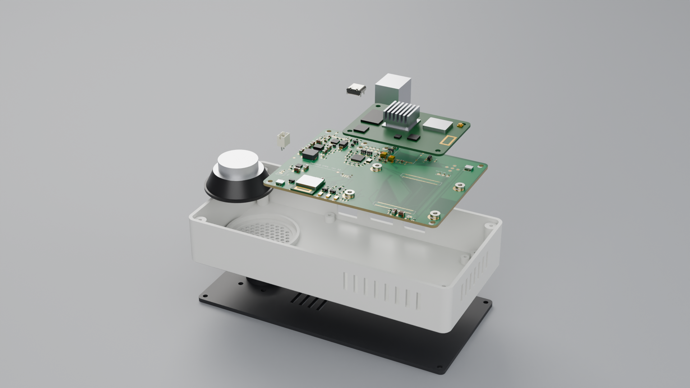
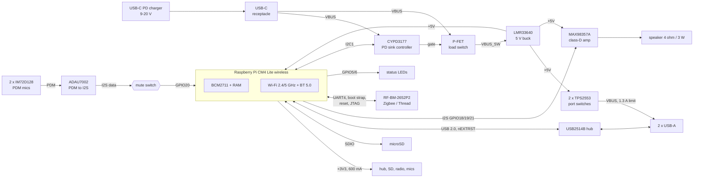
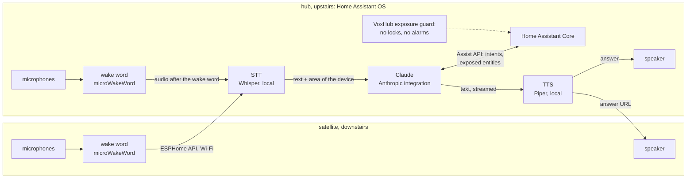

# VoxHub CM4 - a Home Assistant voice hub with Claude inside

A single-board computer for home automation that runs **Home Assistant OS** and works as a
**Claude-based voice assistant**: it listens for a wake word, transcribes the request locally, lets Claude
answer and control the home through tool use, and speaks the reply.

**Two identical boards, one Home Assistant for the whole house.** Board 1, the **hub** (upstairs), runs Home
Assistant OS, the Zigbee coordinator and the Claude pipeline. Board 2, the **satellite** (downstairs), runs no Home
Assistant: it gives the hub its wake word, microphones, speaker, mute switch and LEDs over Wi-Fi, and its radio
runs Zigbee router firmware that extends the mesh to the ground floor. Every request of both devices goes through
Claude, knows which room it came from, and is answered on the speaker of the device that heard it.

Everything in this repository is generated from code - schematic, PCB, enclosure, OS image and add-on.

| | |
|---|---|
|  |  |
| carrier with CM4 + heat sink (component side) | enclosure, rear view: USB-C PD in, 2 x USB-A, microSD |

**Showcase animation (shows revision A1, not re-rendered for A2 or A3):** [`media/voxhub_showcase.mp4`](media/voxhub_showcase.mp4) (1080p60, 21 s: closed device, exploded
view, orbit, reassembly, turntable) - rendered with Blender from the STEP files of this repository, see [`media/`](media/README.md).



> **Status: revision A3. The order package is ready to order after the checks of the order guide; no board has been
> built and nothing has been measured.** The package is ordered fully assembled from JLCPCB. The checks are those
> that [`fab/ORDER_GUIDE.md`](fab/ORDER_GUIDE.md) asks for on the day of the order: the stock of the parts on that
> day, the price boxes of the order form, and JLCPCB's parts list and placement preview, which lie behind the login
> and could not be opened from here. Every part was in stock in JLCPCB's assembly library on 2026-11-21 at
> 18:53 UTC, in the last of three reads (`hardware/gen/sourcing_jlc.json` stores the date), ERC and DRC pass
> against JLCPCB's design rules under
> KiCad 10.0.8, and the order files are in [`fab/jlcpcb/`](fab/jlcpcb). Two lines are thin and have no alternate:
> ADAU7002ACBZ-R7 (63 pieces) and RF-BM-2652P2 (126 pieces), 2 of each are needed for two boards - reserve them
> first as the order guide says. No line is below twice the need. No soldering is planned: order the boards, print
> the enclosure, plug in the CM4, screw it together. One place may need a soldering iron after all: the four SMT
> spacers get less solder paste than their data sheet suggests (calculated), so their joints are to be looked at on
> the first boards ([`hardware/README.md`](hardware/README.md), assembly notes). Read the findings N-1 to N-6 and
> the review results in the top section and the "Open items" at the end of [DECISIONS.md](DECISIONS.md) before you
> order.
>
> Revision A3 is the board of revision A2 with the same placement, nets and routing. Changed: values and part numbers
> (44 instead of 53 BOM lines), three parts replaced after the stock check of 2026-11-20 (USB hub on tape and reel,
> stacked USB-A connector, microphones), three land patterns with their solder paste apertures (for two of them the
> paste was corrected in the second part of review round 1), and
> the project is now a KiCad 10 project that can also be edited by hand
> ([Editing in KiCad 10 on Windows](#editing-in-kicad-10-on-windows)). The reasons are in the top section of
> [DECISIONS.md](DECISIONS.md), "Revision A3".
>
> The first part of review round 1 (2026-11-21, four independent reviewers on the changed areas, no high finding)
> changed two things on the board before the order. R41, the series resistor of the microphone clock, is now
> 75 ohm: the new microphones allow 3.6 V on any pin, the old ones allowed 4.0 V, and the earlier value had been
> sized for the old ones. In the simulation the clock now peaks at 3.41 V nominal and at 3.53 / 3.54 V in the fast
> corner at a 3.30 V rail; at the 3.3825 V top of the rail tolerance the fast corner is 3.62 / 3.63 V without track
> loss (the verifier's model with track loss: 3.55 V). Driver and input data are assumptions, so the clock has to
> be measured on the first boards (R-1; DECISIONS.md, open item 12). And the ground ring of the microphone land
> pattern now starts 0.21 mm from the sound hole, so that no copper of the board is closer than 0.2 mm to a
> non-plated hole (R-2). The other results are corrections of the documents and of the software; the power and
> thermal sections below carry them.
>
> The second part of review round 1 (2026-11-21) was an independent test of the build tooling, an independent
> review of the order package and a second check of two software findings. It changed three more things. The solder
> paste apertures of the four spacers and of the two microphone rings now lie inside their lands: they had been left
> as in revision A2 when the lands were narrowed, and 7.98 mm2 of paste lay on solder mask. After the change the
> Gerber files show no paste outside a mask opening (measured in the files). The guard that keeps
> `hardware/build.sh` from overwriting manual edits now also stops when its record is missing or incomplete, when a
> step was interrupted and when KiCad has the project open; the test had found two high problems there, and a
> second independent test of the fixes found no high or medium problem. And the default microphone gain of the
> VoxHub Assistant add-on is 32 instead of 1.0 (calculated and simulated; it has to be set on the first board).
> Still open in this session: review round 2, which is the last round, and a final stock read of every BOM line
> ([TODO.md](TODO.md)).
>
> | Step | Document |
> |---|---|
> | 1. Order 5 PCBs, 2 of them assembled | [`fab/ORDER_GUIDE.md`](fab/ORDER_GUIDE.md) - every option to click, cost estimate |
> | 2. Buy everything that is not on the board | [`fab/SHOPPING_LIST.md`](fab/SHOPPING_LIST.md) - EU shops, part numbers, prices |
> | 3. Print, test, assemble, flash the radio | [`fab/ASSEMBLY_AND_TEST.md`](fab/ASSEMBLY_AND_TEST.md) |
> | 4. Hub + satellite: Claude pipeline, satellite SD card, pairing, rooms, Zigbee router, tests from both rooms | [`fab/ASSEMBLY_AND_TEST.md`, chapter 7](fab/ASSEMBLY_AND_TEST.md#7-two-devices-hub-and-satellite) |

## System overview

| Function | Implementation |
|---|---|
| Compute | Raspberry Pi **Compute Module 4 Lite, wireless** (BCM2711 4x A72, 4 GB) - official HAOS target `rpi4-64` |
| Wi-Fi / Bluetooth | on the CM4: 2.4 + 5 GHz 802.11ac, Bluetooth 5.0 |
| Storage | microSD (push-push socket, card power switched by the module) |
| USB | 2 x USB-A 2.0 host (stacked), USB2514B hub, 500 mA per port in the power budget, each port current-limited at about 1.3 A (short-circuit protection, not an allowance), ESD protected |
| Microphones | 2 x Infineon IM72D128V01 PDM MEMS (bottom port, 72 dB(A) SNR), ADAU7002 PDM-to-I2S, hardware mute switch |
| Speaker | MAX98357A I2S class-D, 3.2 W into 4 ohm, JST-PH header, enclosed 3 W speaker with JST-PH plug in the enclosure |
| Zigbee / Thread | RF-star RF-BM-2652P2 (TI CC2652P, +20 dBm) on UART4, flashed from the CM4 with one command |
| Power | USB-C PD sink (CYPD3177): negotiates 9-20 V, then a 5 V buck converter (LMR33640, a 4 A regulator; the budget below uses 3.45 A) |
| UI | green + blue status LEDs, red mute LED (hard-wired), mute slider on top |
| PCB | 100 x 74 mm, 4 layers, 1.6 mm (JLC04161H-3313), parts on one side + mute switch and three status LEDs on the other |
| Enclosure | 158.8 x 79.2 x 28 mm, two printed parts, no supports |

### Block diagram



### Voice pipeline (hub + satellite)



Both devices run Linux Voice Assistant 1.1.18 (`assistant/voxhub_satellite` on the hub, `os/satellite` on the
satellite). Audio stays in the house; only the transcribed request, Claude's instructions, the names and areas of
the devices you expose and the results of Claude's tool calls go to Anthropic. The single-device VoxHub Assistant
add-on, the assistant of revisions A1 and A2, still exists for a hub without a satellite.

The two software paths treat the microphones differently. Nothing in the two points below was tested on hardware;
the figures are calculated or simulated.

- **Constant level of one microphone.** The microphone of the right channel (MK2) puts a constant level of
  typically -40 dBFS into its data. Linux Voice Assistant, the path of the two-device system, passes that level
  on as long as its automatic gain and its noise suppression are off. In a simulation with the test recordings of
  its wake word library the level made no difference from 60 dBSPL at the microphone. For quieter speech (45 to
  55 dBSPL) the wake word was found 4 to 14 percentage points less often with the level: at microphone gain 4 in
  73 % instead of 78 % of the attempts at 55 dBSPL and in 58 % instead of 62 % at 50 dBSPL. Home Assistant's voice
  detection gave the same result with and without the level. If the wake word is not heard well, raise the
  microphone gain first (default 4 on both devices; gain 8 gave 88 % at 55 dBSPL with the level), then try
  *Mic Auto Gain* or *Mic Noise Suppression* (`assistant/voxhub_satellite/DOCS.md`, section "Microphones").
  The VoxHub Assistant add-on removes the level with a filter since version 0.1.1.
- **Microphone gain of the VoxHub Assistant add-on.** Its default is 32 since the second part of review round 1;
  it was 1.0. The microphones deliver -36 dBFS at 94 dBSPL (read from the data sheets), so speech of 60 dBSPL is
  about 7.3 counts rms in the 16-bit capture (calculated), and the add-on counts a 20 ms frame as speech only
  above 120 counts after the gain. With the earlier default the add-on heard the wake word and then logged
  "No speech heard" in the simulation, unless the speech reached about 90 dBSPL; this was the same on revision A2.
  With recorded speech, requests were recorded and understood from about 60 dBSPL at gain 32 and from about
  55 dBSPL at gain 64 (simulated). The gain has to be set on the first board: raise it to 64 if requests are
  missed or cut short, lower it to 16 if loud speech close to the hub is misunderstood. An installation that was
  configured with an earlier version may keep its stored gain (`assistant/README.md`, "Troubleshooting").

### GPIO map (CM4)

| GPIO | Function | Notes |
|---|---|---|
| 2 / 3 | I2C1 SDA / SCL | CYPD3177 PD controller (HPI, 0x08) |
| 5 / 6 | LED green / blue enable | active high, N-FET drivers, 2.2k gate pull-downs (they hold the LEDs dark against the boot-time pull-ups of the SoC) |
| 8 / 9 | UART4 TX / RX | radio module DIO12 (RX) / DIO13 (TX), 115200 baud, no flow control |
| 10 / 11 | UART4 CTS / RTS | wired to DIO18 / DIO19, not used by the standard firmware |
| 7 / 17 | JTAG TDI / TDO of the radio | DIO17 / DIO16, recovery flashing only |
| 14 / 15 | UART0 TX / RX | debug header (DNP) |
| 16 | amplifier SD_MODE | high = on (left channel) |
| 18 / 19 / 20 / 21 | I2S BCLK / LRCLK / DIN / DOUT | DIN passes through the mute switch |
| 22 / 23 | JTAG TMS / TCK of the radio | recovery flashing only |
| 24 / 25 | radio reset / boot-loader strap | GPIO24 **high = reset** (open-drain FET on RESET, 100k pull-down); GPIO25 low at reset = ROM serial boot loader (DIO15, 2.2k pull-up) |
| 27 | mute sense | high = muted; the internal pull-down of the SoC is switched on in the OS configuration (DECISIONS.md, R-3) |

## Power budget

5 V rail (regulator output 5.02 V nominal, 4.86 .. 5.17 V over tolerance: Vref +-1.5 %, two 1 % resistors; up to
5.23 V at light load, where the regulator's light-load mode adds about 1 %), worst case = everything at its maximum
simultaneously. The figures were corrected against the data sheets in revision A3
([DECISIONS.md](DECISIONS.md), N-3); the loss rows are estimates from the manufacturer's curves, nothing is measured.

| Load | Typical | Peak | Basis |
|---|---|---|---|
| CM4 (SoC, RAM, Wi-Fi) | 3.5 W | 7.0 W | CM4 datasheet: 1.4 A typical maximum at 5 V |
| 3.3 V loads via the CM4 regulator (hub 95/110 mA, microSD 50/200 mA, radio 10/85 mA, mics + converter 3 mA, pull-ups 5 mA) | 0.163 A -> 0.6 W | 0.403 A -> 1.5 W | 3.3 V budget 600 mA; 90 % converter efficiency; hub: data sheet figures with two ports in use; radio: CC2652P at +20 dBm |
| USB-A ports | 0.5 W | 5.0 W | 2 x 500 mA, both ports together about 1 A (the 1.3 A limit per port is short-circuit protection, not an allowance) |
| Speaker amplifier | 0.3 W | 3.7 W | 3.2 W output at about 86 % efficiency (data sheet curve for 4 ohm at 5 V); speech averages far less |
| LEDs, pull-ups | 0.05 W | 0.1 W | |
| **5 V rail total** | **4.95 W (0.99 A)** | **17.3 W (3.45 A)** | regulator rated 4 A |
| Regulator, inductor and load switch losses | 0.28 W (9 V in) to 0.47 W (20 V in) | 2.26 W (9 V in) to 2.33 W (20 V in) | TI's efficiency curves, interpolated for 9 V and 20 V input, with the 54 mOhm inductor of this board. Regulator and inductor: 0.26 W (9 V) / 0.47 W (20 V) at 1 A, 1.98 W / 2.27 W at 3.45 A (89.7 % / 88.4 % efficiency). Load switch at 60 mOhm, its on-resistance limit at 25 C: 0.02 W typical and 0.28 W peak at 9 V, below 0.01 W and 0.06 W at 20 V. At operating temperature the load switch dissipates 0.4 to 0.6 W at the 9 V peak; the totals of this table use the 25 C figure |
| **At the USB-C connector** | **5.23 to 5.42 W** | **19.56 to 19.63 W (about 19.6 W)** | 9 V: 0.58 A typ / 2.17 A peak - 20 V: 0.27 A typ / 0.98 A peak |

- The PD controller requests **>= 2 A at 9-20 V** (18 W at 9 V). Realistic operation (no bus-powered disks, speech
  rather than sine waves) stays below 12 W. The theoretical simultaneous peak of about 19.6 W exceeds an 18 W contract
  by 9 %.
- **Charger** (corrected in review round 1; DECISIONS.md, R-5). For loads above about 12 W on the 5 V rail - both USB
  ports feeding 500 mA devices and a busy module are 13.9 W - the charger must offer a fixed **12 V, 15 V or 20 V
  profile of at least 2 A**: in practice 30 W or more, or a 27 W unit with 12 V / 2.25 A. A charger whose highest
  profile of 2 A or more is 9 V is for loads up to about 12 W only, also when it is a 27 W unit with 3 A at 9 V: on
  a 9 V contract the load switch Q1 comes too close to its 150 C limit above that ("Other hot parts" below). The
  30 W charger of the shopping list negotiates 15 V.
- 3.3 V budget: 403 mA peak (163 mA typical) of the 600 mA the CM4 can supply.
- The 3.45 A of the budget are covered with 0.29 A of reserve when every tolerance is against it (worst-case inductor
  peak 4.51 A at 20 V input against a minimum current limit of 4.8 A). At the regulator's rated 4 A that corner would be
  5.06 A: the stage is not a guaranteed 4 A supply at 20 V input (DECISIONS.md, N-4).
- The budget counts both USB-A ports together at about 1 A (2 x 500 mA). The 1.3 A limit per port (1.19 to 1.39 A)
  is short-circuit protection, not an allowance: with both ports at their limit the 5 V rail is asked for 4.1 to
  4.5 A without the amplifier and 4.8 to 5.2 A with it, the regulator runs in current limit and the module restarts.
  Restarts with USB devices that draw more than 500 mA are not cured by a larger charger.
- Chargers without a 9-20 V PD profile are rejected safely: the load switch stays open, the regulator behind it only
  starts when its input is above 7.39 V typical (7.08 to 7.69 V; it stops again at 6.79 V typical), and the red PD-FAULT
  LED lights.
- Under load on a 9 V contract the regulator has little margin to its turn-off threshold (DECISIONS.md, C-4, R-6).
  It stops at up to 7.08 V with the typical 100 mV hysteresis, the only figure its data sheet gives, and at up to
  7.26 V if the hysteresis is 70 mV. The lowest valid voltage of a 9 V contract is 7.30 V at the socket, and Q1 and
  the copper take another 0.2 to 0.3 V. That leaves no margin at the theoretical peak, 0.34 V or more at 12 W and
  about 0.75 V in the static corner. The result would be a restart loop, not damage; it is possible on 9 V contracts
  with long or thin cables, from about 0.5 ohm loop resistance. Test 4 of
  [`fab/ASSEMBLY_AND_TEST.md`](fab/ASSEMBLY_AND_TEST.md) checks it: on the 20 W charger (9 V contract) with the
  module under load, VBUS_SW at C8 / C9 must stay above about 7.5 V.

## Thermal estimate (SoC)

Assumptions: 25 C room, module mounted component-side down in the vented enclosure, 14 x 14 x 7 mm heat sink on the BCM2711
(36 K/W on its own in free convection), heat also spreading through the module PCB and the two mezzanine connectors.
Effective module-level thermal resistance derived from published CM4 measurements (bare module on the IO board:
~25 K rise idle at ~2 W, ~55-60 K at full load): about **12 K/W bare, ~9.5-10 K/W with the heat sink in this enclosure**.

| Operating point | Module power | Estimated SoC temperature | Comment |
|---|---|---|---|
| Idle (HAOS, add-ons idle) | 2.0 W | 25 + 2.0 x 10 = **45 C** | |
| Voice assistant active (wake word on one core, Whisper bursts) | 3.5 W | **60 C** | normal operation |
| All four cores loaded continuously | 6.5 W | 90 C -> **throttles at 80 C** | firmware limits to roughly 5.5 W; only during updates / long local STT |

Conclusion: fine without a fan for the intended workload (LLM in the cloud). For sustained local inference fit the taller
15 x 15 x 9.5 mm heat sink or add a 30 mm fan to the base vents.
These are estimates, not measurements - verify with `vcgencmd measure_temp` on the first prototype.

Room under the heat sink, calculated from the enclosure model (`enclosure/voxhub_enclosure.py`), no part measured.
Two numbers describe it. 12.8 mm is the distance from the top face of the processor to the inside of the base
plate: 18.0 mm from the component side of the carrier to the base plate, minus 1.5 mm stacking height of the
sockets, 1.2 mm module board and 2.5 mm that the model reserves for the processor (its data sheet height is
2.378 +-0.11 mm). 5.8 mm is the air that stays between the 7 mm heat sink of the shopping list and the base plate
(12.8 - 7.0 mm). Under the taller 9.5 mm heat sink 3.3 mm stay free.

Other hot parts (DECISIONS.md, N-2; figures corrected in review round 1, R-5). At the theoretical peak of the power
budget the regulator U2 dissipates 1.34 W (9 V input) to 1.63 W (20 V input) according to TI's efficiency curves and
the inductor 0.64 W. The curves give losses at a junction of about 70 C; at the junction temperature the model
predicts, the regulator loses about 1.6 to 1.9 W (TI Fig. 9-4). A conduction model of the board copper (cooling
coefficient 10 W/m2K assumed on both faces, 50 C around the board) gives for the regulator junction:

| Load | Regulator junction in the model | Comment |
|---|---|---|
| Typical (4.95 W on the 5 V rail) | about 76 C | model input: 0.5 W in the regulator |
| Realistic maximum, 12 W (2.4 A) | about 100 to 113 C | regulator loss about 0.7 to 1.0 W by the efficiency curves, more at this junction temperature |
| Theoretical peak, 17.3 W (3.45 A) | about 150 to 165 C | above the 125 C rating and at or above the 150 C absolute maximum; the regulator is expected to cycle through its thermal shutdown (165 C off, 148 C on) |

The theoretical peak can therefore not be held continuously inside the closed enclosure.

On a 9 V contract the load switch Q1 (AO3401A in a SOT-23 beside the regulator) is the limiting part, and it has no
thermal protection. It dissipates 0.14 to 0.22 W at 12 W and 0.4 to 0.6 W at the theoretical peak (0.28 W only with
the on-resistance limit at 25 C). The same model, run again on the A3 board, gives for its junction:

| Contract | Load on the 5 V rail | Q1 junction in the model |
|---|---|---|
| 9 V | 12 W (realistic maximum) | about 100 to 120 C |
| 9 V | 13.9 W (both USB ports at 500 mA, busy module, no sine tone) | about 115 to 150 C |
| 9 V | 17.3 W (theoretical peak) | above the 150 C absolute maximum |
| 12 V | 17.3 W | 128 to 144 C |
| 15 V | 17.3 W | 116 to 124 C |
| 20 V | 17.3 W | 110 to 113 C |

A part at its on-resistance limit reaches the 150 C absolute maximum on a 9 V contract at about 14 to 15 W (at about
13 W with the poorest cooling the model assumes). So on a 9 V contract keep the 5 V rail at or below about 12 W; the
30 W charger of the shopping list negotiates 15 V. All of this is a model for 50 C around the board, and its result
depends strongly on the assumed cooling coefficient: with the 1.1 W regulator loss that the A2 documents assumed it
gives 124.5 C at 10 W/m2K and 114 to 151 C between 15 and 5 W/m2K. Measure the regulator, the inductor and Q1 on the
first board - Q1 on a 9 V contract (the 20 W charger of the test kit) at about 12 W, and do not hold the full peak on
9 V.

## Repository layout

| Path | Contents |
|---|---|
| [`hardware/`](hardware/README.md) | KiCad 10 project (generated, native KiCad 10 files), generator scripts with the guard against overwriting manual edits, KiCad jobset, definition of the build image, schematic PDF, BOM, Gerbers, drill, pick-and-place, DXF, renders, fab + assembly notes |
| [`fab/`](fab/ORDER_GUIDE.md) | JLCPCB order package (`jlcpcb/`: Gerbers, BOM, CPL, placement report), order guide, shopping list, assembly and test guide |
| [`tools/`](tools/flash_zigbee.sh) | `flash_zigbee.sh --role hub\|satellite`: writes the Zigbee coordinator (hub), the Zigbee router (satellite) or the Thread firmware to the radio module from the CM4; `test/`: radio simulator and test runner |
| [`enclosure/`](enclosure/README.md) | parametric CadQuery source, STL / 3MF / STEP, renders |
| [`os/`](os/README.md) | HAOS board definition, device tree overlay, `build-image.sh` (hub); [`os/satellite/`](os/satellite/README.md): SD card image of the satellite |
| [`assistant/`](assistant/README.md) | Home Assistant add-ons: **VoxHub Satellite** (hub side of the two-device system, exposure guard) and **VoxHub Assistant** (single device) |
| [`media/`](media/README.md) | showcase animation (MP4), still of the exploded view, Blender script and helpers |
| [`DECISIONS.md`](DECISIONS.md) | every design decision with its reasoning, the datasheet verification table, sourcing decisions, open items |
| [`TODO.md`](TODO.md) | progress checklist |

## How to build everything

Prerequisites: Linux, Python >= 3.10, `zip`, Docker, Java >= 21 (only for re-running the autorouter), `xvfb` for the
enclosure renders (`sudo apt install zip xvfb`). The hardware build runs KiCad 10 (10.0.8 was used) in the project
image `voxhub-kicad:10.0`: `hardware/build.sh` builds that image itself from `hardware/docker/Dockerfile` when it is
missing (the official KiCad 10 image plus numpy and shapely). Without Docker: KiCad 10 installed natively and
`KICAD_NATIVE=1` - the `kicad-cli` on the PATH must be version 10, and the Python that imports `pcbnew` also needs
`numpy` and `shapely`.

```bash
# 1. Hardware: schematic -> ERC -> netlist -> placement -> autoroute -> DRC -> fabrication outputs -> fab/jlcpcb
#    the first run builds the Docker image voxhub-kicad:10.0 (or: export KICAD_NATIVE=1 with kicad-cli 10 on the PATH)
SKIP_ROUTE=1 hardware/build.sh all      # re-uses the checked-in autorouter session (same copper as the committed board, ~4 min)
#    close KiCad first: the step stops while KiCad has the project open (the reason is in hardware/README.md)
#    it stops and names the files if a generated project file was edited in KiCad or by hand; then either
#                     hardware/build.sh outputs                        (fabrication files from the project as it is), or
#                     OVERWRITE=1 SKIP_ROUTE=1 hardware/build.sh all   (discards the manual edits and regenerates)
#    Ctrl-C ends the running step and its container; a generating step that was cut short then needs OVERWRITE=1
# to autoroute again (not run under KiCad 10, see hardware/README.md):
#                     wget -P hardware https://github.com/freerouting/freerouting/releases/download/v2.0.1/freerouting-2.0.1.jar
#                     hardware/build.sh all
# to refresh stock and prices: python3 hardware/gen/jlc_lookup.py refresh hardware/gen/sourcing_jlc.json

# 2. Enclosure: STL / 3MF / STEP + renders
pip install cadquery
python3 enclosure/voxhub_enclosure.py enclosure
xvfb-run -a python3 enclosure/render.py

# 3. OS image (latest official HAOS + VoxHub configuration)
sudo apt install git curl xz-utils fdisk mtools device-tree-compiler
os/build-image.sh repack --wifi-ssid "MyWifi" --wifi-psk "secret"
#    -> os/output/haos_voxhub-cm4-<version>.img.xz

# 3b. Satellite image (Raspberry Pi OS Lite + Linux Voice Assistant, about 30 minutes)
sudo apt install qemu-user-static binfmt-support parted e2fsprogs openssl
sudo os/satellite/build-satellite-image.sh --wifi-ssid "MyWifi" --wifi-psk "secret-password" --hub 192.168.1.10 --room Downstairs
#    -> os/output/voxhub-satellite-2026-10-06-lva1.1.18.img.xz

# 4. Add-ons: tests (VoxHub Satellite and VoxHub Assistant), container test of VoxHub Satellite (Docker)
pip install -r assistant/requirements-dev.txt
(cd assistant && python3 -m pytest -q)
assistant/tests/container/run_addon_test.sh

# 4b. Radio flashing script against the simulated radio (about 17 minutes)
sudo apt install python3-serial python3-intelhex
sudo tools/test/run_flash_tests.sh

# 5. Showcase animation (Blender 4.2 - 4.5, headless; a little over 3 hours on 4 CPU cores; board textures from the same KiCad 10 image)
pip install cadquery pymupdf pillow numpy && sudo apt install ffmpeg
BLENDER=/path/to/blender media/build_showcase.sh
```

Then: order the boards (`fab/ORDER_GUIDE.md`), buy the rest (`fab/SHOPPING_LIST.md`), print `enclosure/voxhub_shell.3mf` and
`voxhub_base.3mf`, test and assemble (`fab/ASSEMBLY_AND_TEST.md`), flash the image, flash the radio (`tools/flash_zigbee.sh`),
add this repository as an add-on repository in Home Assistant
(`https://github.com/geilevideossos-gamedev/fable-sbc-test`, with nothing after the address) and install **VoxHub
Satellite**; for the second board
write the satellite image and follow `fab/ASSEMBLY_AND_TEST.md`, chapter 7.

This revision of the repository holds the two-device version, hardware revision A3, the OS configuration with the
pull-down of the mute input (DECISIONS.md, R-3) and version 0.1.1 of the VoxHub Assistant add-on. Home Assistant
reads an add-on repository in the state its address leads to, which need not be this revision: if the add-on store
offers VoxHub Assistant as version 0.1.0, it reads an older state, in which the microphone gain default is still
1.0. The code of the VoxHub Satellite add-on is the one of the two-device version of 2026-11-12; since then only
its documentation and one option text changed. An add-on repository that was added with `#` and a name at the end
of its address, as earlier versions of this file described, has to be removed and added again without that
ending.

### Editing in KiCad 10 on Windows

The hardware project can be edited by hand in KiCad 10; the build keeps generated files and manual edits apart
(DECISIONS.md, K-11 to K-15 and the second part of review round 1, R-8 and following). Everything below was
measured with KiCad 10.0.8 on Linux only, in automated runs with the KiCad windows driven by scripts on a virtual
display. Nothing was run on Windows, and no person worked in a KiCad window. The exact texts the build prints, the
limits and the full list of what is untested are in
[`hardware/README.md`](hardware/README.md#editing-the-project-by-hand-kicad-10).

- **Install.** KiCad 10 (the files were written with 10.0.8) and Git for Windows: that is enough to open, edit and
  save the project and to make fabrication files with the jobset. Only `hardware/build.sh` needs more: WSL2 with
  Docker (Docker Desktop with WSL integration, or Docker inside the distribution) and `zip` and `python3` inside WSL,
  the script started from the WSL shell. Git Bash instead of WSL is a second choice: Git for Windows has no `zip`.
- **Open** `hardware/voxhub.kicad_pro`. At the first start KiCad shows its own setup wizard once. The project is
  self-contained: symbols and footprints come from the project libraries `hardware/voxhub.kicad_sym` and
  `hardware/voxhub.pretty` (every footprint of the board is in there), the 3D models from `hardware/3dmodels`;
  nothing is taken from the libraries of the KiCad installation. The files are native KiCad 10 files: a save from
  the schematic editor and from the board editor that changed nothing left them byte-identical (K-2). A Windows
  checkout keeps the LF line endings of the KiCad files and the scripts (`.gitattributes`); KiCad on Windows is
  expected to save with CR LF, which Git and the build accept.
- **Close KiCad before a build step that generates files.** Schematic, libraries, board and project file are
  generated: `hardware/build.sh sch`, `pcb`, `route` and `all` write them again. These steps stop while KiCad has
  the project open (they look for KiCad's lock files in `hardware/`). The reason: a file that is saved while the
  step writes that same file is lost without a message. These moments add up to 66.7 s of a 229 s build
  (measured), and the guard cannot see such a save.
- **When a build step refuses to overwrite.** If one of the generated files was saved from KiCad with a change or
  edited by hand, the step stops before it writes anything and names the files, for example
  `changed  power.kicad_sch`. It also stops when its record `hardware/gen/generated.sha256` has no line for a file
  (`not recorded`) and when its last run was interrupted (`unfinished`). Then there are two ways on.
  `hardware/build.sh outputs` keeps the edits and makes the fabrication files from the project as it is.
  `OVERWRITE=1 hardware/build.sh <step>` discards the edits and regenerates the files. A change that is to stay for
  good belongs in `hardware/gen/`. Ctrl-C ends a running step and its container; a generating step that was cut
  short says `unfinished` on its next run.
- **Fabrication files after a manual edit.** In KiCad, without Docker: double-click `voxhub.kicad_jobset` in the
  project tree of the project manager and press *Generate All Destinations*. It runs ERC and DRC and writes the
  schematic PDF, Gerbers, drill files, position file and STEP into `hardware/outputs/` and the Gerber archive
  `fab/jlcpcb/gerbers.zip`. It does not stop on a violation: use the files only when the first destination is not
  marked red. With WSL: `hardware/build.sh outputs`; its DRC stops the run on any violation, and only this step
  writes the JLCPCB BOM and CPL (`fab/jlcpcb/`), which are needed again when a part was moved, added or removed.
  The JLCPCB BOM names each part by the field `MPN` of its footprint and does not read the value: when you change
  a value in KiCad, change the field `MPN` of the symbol as well (it is hidden; use a part number that
  `hardware/gen/sourcing_jlc.json` lists), otherwise the old part stays in the order files without a message. A
  new part needs that field too: without it the step ends with a `PROBLEM:` line and exit code 1.
  It never writes a project file and may run while KiCad is open.
  *File > Plot* writes the same Gerbers as the build, because the board file stores the plot settings; take the
  drill files from the jobset or from the build, not from the drill dialog with its defaults.
  `hardware/outputs/bom.csv` and the order cost come from the generator's part list, not from an edited schematic.
- **Who owns the files.** The build container runs as root and gives the files under `hardware/` and `fab/` back to
  the owner of `hardware/` at the end of every call (tested on Linux with a user that is not root). Whether the
  checkout should lie inside WSL2 or on a Windows drive was not tested.
- **How it was tested, and what was not.** The package was tested by its author, then by an independent test (two
  high, one medium and eight low problems, all fixed or decided on 2026-11-21) and by a second independent test of
  the fixes (no high or medium problem), all on Linux. Not tested on Windows: anything. Not KiCad's editors, not a
  save with CR LF, not the jobset, not `hardware/build.sh` under WSL2 or Git Bash (K-10; DECISIONS.md, open
  item 8). A first build and a first KiCad session on Windows are therefore among the owner's first checks
  ([TODO.md](TODO.md)).

## Cost summary

**Parts on the board**, JLCPCB prices read live on 2026-11-21 at 09:57 UTC (USD, without tax, PCB, assembly fees
and shipping). Line by line: [`hardware/outputs/bom.csv`](hardware/outputs/bom.csv).

The part prices were read twice. The first read began on 2026-11-20 and ended on 2026-11-21 at 00:07 UTC; this file
calls it the read of 2026-11-20. The second read is the one of 2026-11-21, 09:57 UTC, and every part price and
every total in this file comes from it. The time is that of the end of the read; the sourcing file stores the date
only. A third read at the end of the session, on 2026-11-21 from 18:52 to 18:53 UTC, was made for the stock: no
price had changed since 09:57 UTC, no line was below twice the need, and the stock columns of the sourcing file,
of `bom.csv` and of `order_cost.csv` are from it (DECISIONS.md, F-6).

| Group | Lines | Placements | 1 board | per board at 100 |
|---|---|---|---|---|
| ICs and radio module (RF-BM-2652P2 alone: 8.68 / 7.48) | 8 | 11 | 21.39 | 15.89 |
| Connectors, slide switch, SMT spacers | 7 | 11 | 8.25 | 6.15 |
| Inductor, crystal, microphones | 3 | 4 | 6.59 | 4.36 |
| Capacitors | 9 | 49 | 2.80 | 2.22 |
| Diodes, LEDs, transistors | 8 | 14 | 0.76 | 0.63 |
| Resistors | 9 | 47 | 0.05 | 0.05 |
| **PCB assembly parts** | **44 (+2 DNP)** | **136** | **39.84** | **29.30** |

The group sums are quantity x unit price of the file, rounded so that each column adds up to the total of the file
(the unrounded sums of "Diodes, LEDs, transistors" at 1 and of "ICs and radio module" at 100 are 0.7655 and
15.8960). JLCPCB's USD prices are about 0.24 % higher on almost every line than in the read of 2026-11-20
(exchange rate).

**Everything else for one device**, EU shops, prices including VAT (EUR) as read on the shop pages on 2026-11-20; no
price had changed since the first reading on 2026-11-12.
Line by line: [`hardware/outputs/bom_system.csv`](hardware/outputs/bom_system.csv) and [`fab/SHOPPING_LIST.md`](fab/SHOPPING_LIST.md).

| Item | EUR |
|---|---|
| Raspberry Pi CM4 Lite 4 GB wireless (CM4104000) | 105.83 |
| microSD card 64 GB, endurance type | 28.90 |
| USB-C PD charger 30 W and cable | 22.38 |
| Speaker with JST-PH plug, heat sink, screws, feet, foam | 18.39 |
| Shipping of two parcels to Austria | 12.90 |
| **One device without the board** | **188.40** |

**Hub + satellite** (the satellite with a 1 GB module, CM4101000, 50.82 EUR, and a 32 GB card): **286.90 EUR**
delivered for both devices without the boards, 66.01 EUR less than two hubs - [`fab/SHOPPING_LIST.md`, section
8](fab/SHOPPING_LIST.md#8-two-device-system-satellite-variant-and-combined-basket-hub--satellite).

**The JLCPCB order** (5 PCBs, 2 of them assembled on both sides, parts, shipping, import VAT) is estimated in
[`fab/ORDER_GUIDE.md`](fab/ORDER_GUIDE.md), section 8; the total of the order is quoted only there. For the parts
alone, [`hardware/outputs/order_cost.json`](hardware/outputs/order_cost.json) computes 79.68 USD for the parts of two
boards, 83.22 USD with JLCPCB's minimum quantities and 84.99 USD with its minimum and loss quantities (a calculation
from JLCPCB's parts data of 2026-11-21, 09:57 UTC, not a quote). The prices of the order form (PCB, assembly fees,
shipping) were not read again with the parts on 2026-11-21 at 09:57 UTC; the order guide says when each of them
was read.

- The parts of one board cost 39.84 USD at JLCPCB. Revision A2 cost 41.78 USD on 2026-11-12, the DigiKey parts of
  revision A1 74.79 USD. The radio module alone costs 8.68 USD (6.63 USD on 2026-11-12; the DigiKey module of A1 cost
  11.47 USD), the PDM-to-I2S converter 2.48 USD (3.91 USD on 2026-11-12).
- Thin stock at JLCPCB on 2026-11-21 (18:53 UTC, the same as at 09:57 UTC): ADAU7002ACBZ-R7 (63) and RF-BM-2652P2
  (126); neither has an
  alternate. The order guide says how to reserve them. The three lines that had run low by 2026-11-20 were replaced
  (DECISIONS.md, F-1 to F-3): the USB hub is ordered on tape and reel (USB2514BT-I/M2), the stacked USB-A connector
  is the Jing Extension 907-112A1022D10200, the microphones are IM72D128V01. The BOM names the old parts as
  alternates. Details in [DECISIONS.md](DECISIONS.md), "Final stock and price check" and section 10.
- In a Standard PCBA order JLCPCB charges the feeder fee (1.53 USD in its price list of 22 Oct 2026) per part type,
  Basic and Extended alike, so a Basic part saves nothing; what counts is the number of different part numbers: 44
  BOM lines, 42 of them placed by machine (J6 and J7 are soldered by hand). Revision A2 had 53 lines and 51
  machine-placed part types; 9 feeders less are 13.77 USD (DECISIONS.md, C-1). By library type the 44 lines are
  12 Basic, 2 Preferred Extended (the 49.9k and the 75 ohm resistor) and 30 Extended.

## Verification summary

| Check | Result | Evidence |
|---|---|---|
| ERC (kicad-cli 10.0.8) | 0 errors, 0 warnings | `hardware/outputs/erc.rpt` |
| Netlist equals the code model | 150 components / 100 nets / 512 connected pins: KiCad's netlist of the A3 schematic equals the code model pin by pin (compared for this revision, not a step of the build); schematic parity 0 issues | `hardware/gen/model_netlist.json`, `hardware/outputs/drc.rpt` |
| DRC with schematic parity and JLCPCB's rules (kicad-cli 10.0.8) | 0 violations, 0 unconnected pads, 0 parity issues; every check is an error except three ignored ones, two of them library-comparison checks that are waived (4 warnings, explained in `hardware/README.md`). One distance that KiCad's DRC did not report was found by the check for the order guide and corrected on 2026-11-21: the microphone ground ring against its sound hole (DECISIONS.md, R-2) | `hardware/outputs/drc.rpt`, `drc_waived_checks_enabled.rpt`, `hardware/voxhub.kicad_dru` |
| Solder paste against solder mask | no paste outside a mask opening on either side (0.000 mm2), measured in the Gerber files on 2026-11-21 with two independent Gerber readers, after the paste apertures of the four spacers and of the two microphone rings had been moved inside their narrowed lands (before: 7.98 mm2 of paste on solder mask on the component side). Nothing in the build makes this comparison: the fault had passed ERC, DRC and every gate. The spacers now get 51 to 62 % of the paste volume their data sheet suggests (calculated for a 0.10 to 0.12 mm stencil; revision A2: 64 to 77 %) | `hardware/README.md` (fabrication and assembly notes), `DECISIONS.md` (review round 1, second part) |
| Current paths | narrowest copper of every high-current path measured: all as wide as designed (1.2 to 1.6 mm on the main path; narrower only at the 0.6 mm contact pads and tracks of the USB-C connector, the 0.6 mm pin pads of the regulator and the 0.8 mm supply tracks of the USB-A ports) | `hardware/outputs/power_paths.txt` |
| Vias and pads | no via in or touching a pad other than the exposed pad of an IC | `hardware/outputs/via_in_pad.txt` |
| USB 2.0 | upstream pair coupled, 0.14 / 0.16 mm = 89.96 ohm in JLCPCB's impedance calculator; pad-to-pad skew 0.00 / 0.00 / 0.00 mm (upstream / port 1 / port 2), limit 3.8 mm; no vias, no stubs | `hardware/outputs/usb_impedance.txt`, `routing_stats.txt`, DECISIONS.md section 6a |
| CM4 socket strips | no copper of another net in Hirose's restricted strips | `hardware/outputs/df40_strips.txt` |
| Assembly data | 136 of 136 placements fitted to JLCPCB's own footprint of the part (position, rotation, polarity), the two hand-soldered connectors included | `fab/jlcpcb/placement_report.csv` |
| Parts vs. datasheets | one row per part with its source and verdict in `DECISIONS.md` section 9; the values and parts changed in revision A3 were checked against the manufacturer data sheets before they went into the generator (C-2 to C-7, C-12, F-1 to F-3; the VBUS_MIN divider R1 / R2 = 12k / 2.2k was checked only in review round 1, R-6) and again by four independent reviewers on 2026-11-21 (review round 1, first part: no high finding; R41 changed to 75 ohm, the other findings are corrections of the documents and the software, R-1 to R-7) | [`DECISIONS.md` section 9](DECISIONS.md#9-footprint--pin-out-verification-against-the-datasheets) and decision logs |
| PCB render | kicad-cli 3D renders | `hardware/outputs/render_*.png` |
| Enclosure fit | part dimensions from the manufacturer drawings; 0 mm^3 interference PCB assembly vs. printed parts | `enclosure/voxhub_enclosure.py`, `enclosure/README.md` |
| Power budget / thermal estimate | above; corrected in revision A3 and again in review round 1 (temperatures of the regulator and of the load switch, charger advice, USB port budget); calculation and model, nothing measured | `DECISIONS.md` N-2 to N-4, R-5, R-6 |
| Editing by hand in KiCad 10 | overwrite guard, `build.sh outputs` on an edited project, jobset and Plot dialog compared with the files of the build: tested with KiCad 10.0.8 on Linux in automated runs (KiCad windows driven by scripts on a virtual display), first by their author, then by an independent test that found two high, one medium and eight low problems - all fixed or decided on 2026-11-21 - and by a second independent test of the fixes, which found no high or medium problem. In the second test the guard stopped the generating steps in 17 of 17 combinations of an edit (a changed, added or deleted file) and a step, in 8 of 8 runs with a missing or incomplete record and in 8 of 8 runs with KiCad's project manager open; a step that was cut short was reported as unfinished by the next run; `build.sh outputs` wrote none of the 47 project files. Left open and stated: a file saved while a step writes that same file is lost without a message (66.7 s of a 229 s build). Nothing on Windows, no `KICAD_NATIVE=1` outside the build container, no save from the symbol or footprint editor | `hardware/README.md`, `DECISIONS.md` K-11 to K-15 and review round 1, second part |
| Sourcing | every BOM line in stock in JLCPCB's assembly library on 2026-11-21 (third read, 18:53 UTC; prices of 09:57 UTC, unchanged in the third read); two lines below 200 pieces (ADAU7002ACBZ-R7 63, RF-BM-2652P2 126), none below twice the need of two boards; DigiKey data of 2026-11-11 as the second source | `hardware/outputs/bom.csv`, `bom_summary.json`, `order_cost.json`, `hardware/gen/sourcing_jlc.json` |
| Radio flashing | one command; run end to end against a simulated radio with the real flashing tool, dry run in this repository; not on hardware | `tools/flash_zigbee.sh`, `fab/ASSEMBLY_AND_TEST.md` |
| OS image | repack image built from HAOS 18.5 and verified; from-source build (`build-image.sh full`) ran to the end on the ninth attempt, image inspected; not booted (no hardware). These results are of 2026-11-12 or earlier: no image has been built or inspected with the pull-down of the mute input of 2026-11-21 (`gpio_pull=down`); the overlay source with it was compiled and applied to a device tree again (`os/README.md`, "Verification status") | `os/README.md` |
| Assistant | 93 tests of VoxHub Assistant pass (144 tests in the folder together with the 51 of VoxHub Satellite). Since review round 1 they also cover the capture path and the pipeline with the constant level of the new microphones (DECISIONS.md, R-4). One test came with the gain default of 32 in the second part of that round: a tone at the level of 60 dBSPL speech on top of the constant level is recorded at the default gain and not at gain 8. That test accepts any default from 17 to 64; it does not hold the value 32. All of this is simulation with synthetic signals, not a test with speech or on a board | `assistant/tests/` |
| Two-device system: architecture | read in the Home Assistant source (2026.11.1): the Anthropic integration + Assist API cover tool use, room awareness and per-device answers, not a hard lock / alarm rule - hence the exposure guard | `DECISIONS.md` S-1 to S-5 |
| Hub add-on VoxHub Satellite | 51 unit tests (guard, bridge, LEDs, mute switch, launcher, options); image built from the official LVA 1.1.18 image and run against PulseAudio with a real ESPHome API client: 7 / 7 checks, LVA only on 127.0.0.1, gain unchanged after a restart; not on Home Assistant OS | `assistant/voxhub_satellite`, `assistant/tests/` |
| Satellite image | built once, 31 / 31 checks of the finished image (overlays, settings, services, update origins, LVA and VoxHub modules start, offline radio flashing dry run) and 7 / 7 in the runtime test (PipeWire, LVA and the LED / mute bridge inside the emulated image, driven by an ESPHome API client); not booted (no hardware); built on 2026-11-12, before the pull-down of the mute input - no satellite image has been built with `gpio_pull=down` | `os/satellite/`, `os/README.md` |
| Radio roles | coordinator and router written into a simulated radio with the real cc2538-bsl, router detection by CRC over the programmed ranges, rejoin, refusals: 55 checks pass; not on hardware | `tools/test/` |

## License

See [LICENSE](LICENSE). KiCad library parts (the symbols and footprints copied into `hardware/gen/stock`,
`hardware/voxhub.kicad_sym` and `hardware/voxhub.pretty`, 3D models under `hardware/3dmodels`) are
CC-BY-SA 4.0 with the KiCad library exception.
