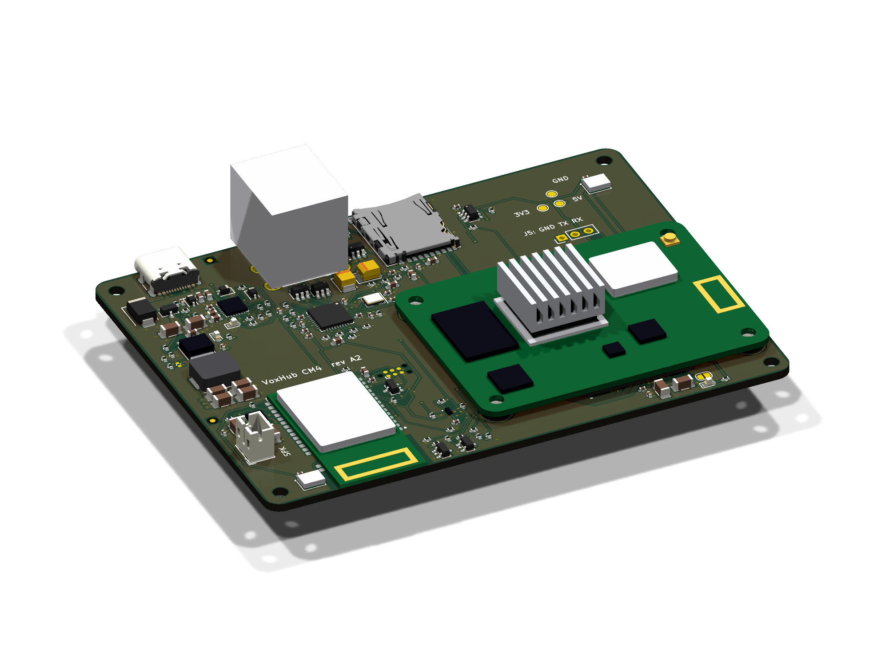
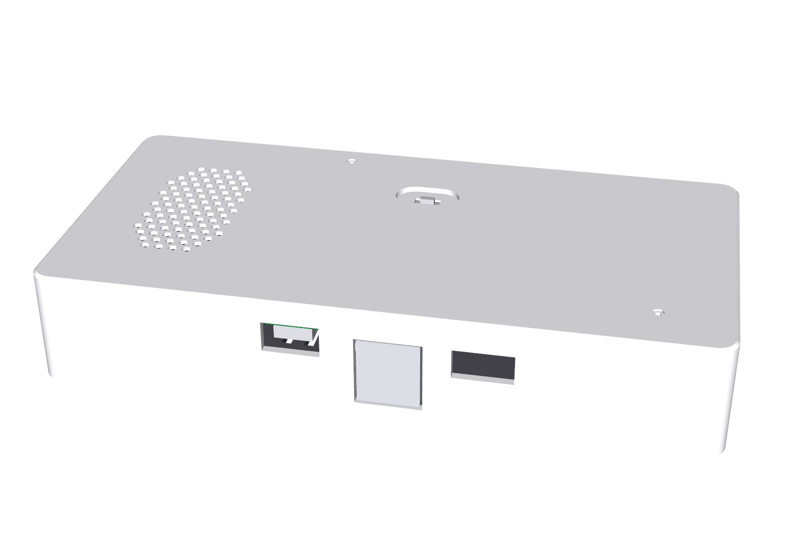
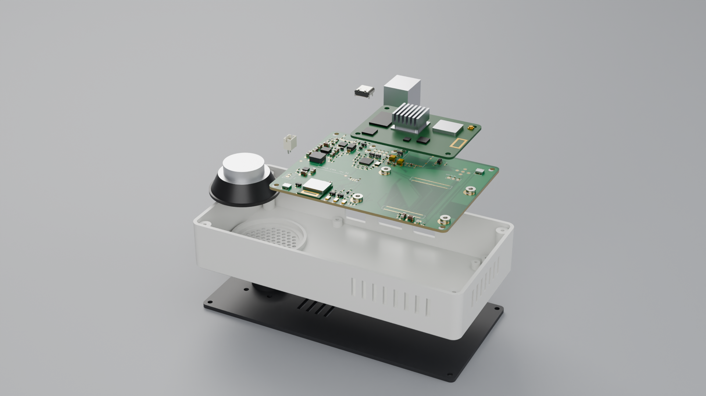
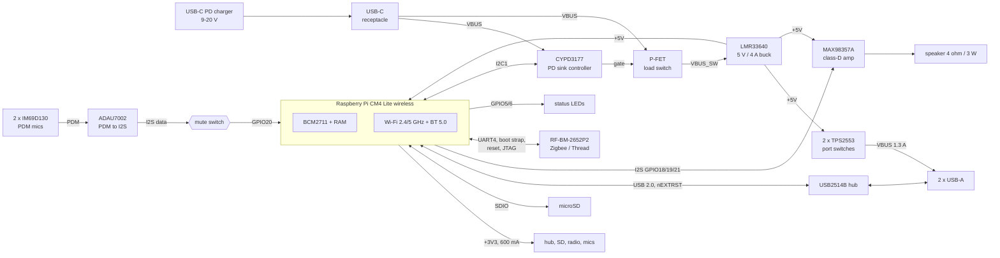
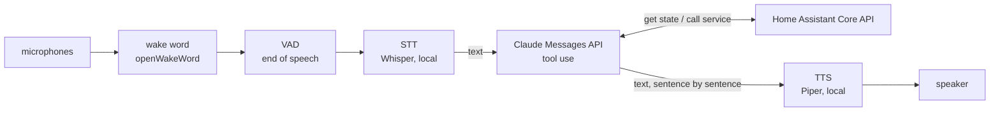

# VoxHub CM4 - a Home Assistant voice hub with Claude inside

A single-board computer for home automation that runs **Home Assistant OS** and works as a
**Claude-based voice assistant**: it listens for a wake word, transcribes the request locally, lets Claude
answer and control the home through tool use, and speaks the reply.

Everything in this repository is generated from code - schematic, PCB, enclosure, OS image and add-on.

| | |
|---|---|
|  |  |
| carrier with CM4 + heat sink (component side) | enclosure, rear view: USB-C PD in, 2 x USB-A, microSD |

**Showcase animation:** [`media/voxhub_showcase.mp4`](media/voxhub_showcase.mp4) (1080p60, 21 s: closed device, exploded
view, orbit, reassembly, turntable) - rendered with Blender from the STEP files of this repository, see [`media/`](media/README.md).



> **Status: revision A2, ready to order fully assembled from JLCPCB, not yet built.** Every part is in stock in
> JLCPCB's assembly library (checked live on 2026-11-12), ERC and DRC pass against JLCPCB's design rules, the order files
> are in [`fab/jlcpcb/`](fab/jlcpcb). Nothing has to be soldered by hand: order the boards, print the enclosure, plug in
> the CM4, screw it together. No hardware exists yet - read the "Open items" in [DECISIONS.md](DECISIONS.md) first.
>
> | Step | Document |
> |---|---|
> | 1. Order 5 PCBs, 2 of them assembled | [`fab/ORDER_GUIDE.md`](fab/ORDER_GUIDE.md) - every option to click, cost estimate |
> | 2. Buy everything that is not on the board | [`fab/SHOPPING_LIST.md`](fab/SHOPPING_LIST.md) - EU shops, part numbers, prices |
> | 3. Print, test, assemble, flash the radio | [`fab/ASSEMBLY_AND_TEST.md`](fab/ASSEMBLY_AND_TEST.md) |

## System overview

| Function | Implementation |
|---|---|
| Compute | Raspberry Pi **Compute Module 4 Lite, wireless** (BCM2711 4x A72, 4 GB) - official HAOS target `rpi4-64` |
| Wi-Fi / Bluetooth | on the CM4: 2.4 + 5 GHz 802.11ac, Bluetooth 5.0 |
| Storage | microSD (push-push socket, card power switched by the module) |
| USB | 2 x USB-A 2.0 host (stacked), USB2514B hub, 1.3 A current-limited per port, ESD protected |
| Microphones | 2 x Infineon IM69D130 PDM MEMS (bottom port), ADAU7002 PDM-to-I2S, hardware mute switch |
| Speaker | MAX98357A I2S class-D, 3.2 W into 4 ohm, JST-PH header, enclosed 3 W speaker with JST-PH plug in the enclosure |
| Zigbee / Thread | RF-star RF-BM-2652P2 (TI CC2652P, +20 dBm) on UART4, flashed from the CM4 with one command |
| Power | USB-C PD sink (CYPD3177): negotiates 9-20 V, then 5 V / 4 A buck (LMR33640) |
| UI | green + blue status LEDs, red mute LED (hard-wired), mute slider on top |
| PCB | 100 x 74 mm, 4 layers, 1.6 mm (JLC04161H-3313), parts on one side + mute switch and three status LEDs on the other |
| Enclosure | 158.8 x 79.2 x 28 mm, two printed parts, no supports |

### Block diagram



### Voice pipeline



Only the transcribed text (plus tool results) leaves the device.

### GPIO map (CM4)

| GPIO | Function | Notes |
|---|---|---|
| 2 / 3 | I2C1 SDA / SCL | CYPD3177 PD controller (HPI, 0x08) |
| 5 / 6 | LED green / blue enable | active high, N-FET drivers, 10k pull-downs |
| 8 / 9 | UART4 TX / RX | radio module DIO12 (RX) / DIO13 (TX), 115200 baud, no flow control |
| 10 / 11 | UART4 CTS / RTS | wired to DIO18 / DIO19, not used by the standard firmware |
| 7 / 17 | JTAG TDI / TDO of the radio | DIO17 / DIO16, recovery flashing only |
| 14 / 15 | UART0 TX / RX | debug header (DNP) |
| 16 | amplifier SD_MODE | high = on (left channel) |
| 18 / 19 / 20 / 21 | I2S BCLK / LRCLK / DIN / DOUT | DIN passes through the mute switch |
| 22 / 23 | JTAG TMS / TCK of the radio | recovery flashing only |
| 24 / 25 | radio reset / boot-loader strap | GPIO24 **high = reset** (open-drain FET on RESET, 100k pull-down); GPIO25 low at reset = ROM serial boot loader (DIO15, 2.2k pull-up) |
| 27 | mute sense | high = muted |

## Power budget

5 V rail (buck output 5.02 V nominal, 4.86 .. 5.17 V over tolerance: Vref +-1.5 %, two 1 % resistors), worst case =
everything at its maximum simultaneously:

| Load | Typical | Peak | Basis |
|---|---|---|---|
| CM4 (SoC, RAM, Wi-Fi) | 3.5 W | 7.0 W | CM4 datasheet: 1.4 A typical maximum at 5 V |
| 3.3 V loads via the CM4 regulator (hub 70/150 mA, microSD 50/200 mA, radio 10/85 mA, mics + converter 3 mA, pull-ups 5 mA) | 0.14 A -> 0.5 W | 0.44 A -> 1.6 W | 3.3 V budget 600 mA; 90 % converter efficiency; radio: CC2652P at +20 dBm |
| USB-A ports | 0.5 W | 5.0 W | 2 x 500 mA (hardware limit 1.3 A per port) |
| Speaker amplifier | 0.3 W | 3.6 W | 3.2 W output at 90 % efficiency; speech averages far less |
| LEDs, pull-ups | 0.05 W | 0.1 W | |
| **5 V rail total** | **4.9 W (0.98 A)** | **17.3 W (3.45 A)** | buck rated 4 A |
| Buck + switch losses | 0.5 W | 1.9 W | 92 % at 9 V in, P-FET 70 mOhm, inductor 54 mOhm |
| **At the USB-C connector** | **5.4 W** | **19.2 W** | 9 V: 0.6 A typ / 2.13 A peak - 20 V: 0.27 A typ / 0.96 A peak |

- The PD controller requests **>= 2 A at 9-20 V** (18 W at 9 V). Realistic operation (no bus-powered disks, speech
  rather than sine waves) stays below 12 W. The theoretical simultaneous peak of 19.2 W exceeds an 18 W contract by 7 %:
  use a **27 W or larger** charger (9 V/3 A, or anything offering 12/15/20 V at >= 2 A) if both USB ports feed
  500 mA devices.
- 3.3 V budget: 440 mA peak of the 600 mA the CM4 can supply.
- Chargers without a 9-20 V PD profile are rejected safely: the load switch stays open, the buck stays in UVLO (< 7 V)
  and the red PD-FAULT LED lights.

## Thermal estimate (SoC)

Assumptions: 25 C room, module mounted component-side down in the vented enclosure, 14 x 14 x 7 mm heat sink on the BCM2711
(36 K/W on its own in free convection), heat also spreading through the module PCB and the two mezzanine connectors.
Effective module-level thermal resistance derived from published CM4 measurements (bare module on the IO board:
~25 K rise idle at ~2 W, ~55-60 K at full load): about **12 K/W bare, ~9.5-10 K/W with the heat sink in this enclosure**.

| Operating point | Module power | Estimated SoC temperature | Comment |
|---|---|---|---|
| Idle (HAOS, add-ons idle) | 2.0 W | 25 + 2.0 x 10 = **45 C** | |
| Voice assistant active (wake word on one core, Whisper bursts) | 3.5 W | **60 C** | normal operation |
| All four cores loaded continuously | 6.5 W | 90 C -> **throttles at 80 C** | firmware limits to roughly 5.5 W; only during updates / long local STT |

Conclusion: fine without a fan for the intended workload (LLM in the cloud). For sustained local inference fit the taller
15 x 15 x 9.5 mm heat sink (there are 12.9 mm between the SoC and the base plate, so about 3 mm stay free under it) or add a 30 mm fan to the base vents.
Other parts at peak load: buck IC ~1.1 W (junction about +45 K), inductor 0.7 W, P-FET 0.33 W - all uncritical.
These are estimates, not measurements - verify with `vcgencmd measure_temp` on the first prototype.

## Repository layout

| Path | Contents |
|---|---|
| [`hardware/`](hardware/README.md) | KiCad 9 project (generated), generator scripts, schematic PDF, BOM, Gerbers, drill, pick-and-place, DXF, renders, fab + assembly notes |
| [`fab/`](fab/ORDER_GUIDE.md) | JLCPCB order package (`jlcpcb/`: Gerbers, BOM, CPL, placement report), order guide, shopping list, assembly and test guide |
| [`tools/`](tools/flash_zigbee.sh) | `flash_zigbee.sh`: writes the Zigbee (or Thread) firmware to the radio module from the CM4 |
| [`enclosure/`](enclosure/README.md) | parametric CadQuery source, STL / 3MF / STEP, renders |
| [`os/`](os/README.md) | HAOS board definition, device tree overlay, `build-image.sh` |
| [`assistant/`](assistant/README.md) | Home Assistant add-on: wake word -> STT -> Claude -> TTS |
| [`media/`](media/README.md) | showcase animation (MP4), still of the exploded view, Blender script and helpers |
| [`DECISIONS.md`](DECISIONS.md) | every design decision with its reasoning, the datasheet verification table, sourcing decisions, open items |
| [`TODO.md`](TODO.md) | progress checklist |

## How to build everything

Prerequisites: Linux, Python >= 3.10, `zip`, Java >= 21 (only for re-running the autorouter), `xvfb` for the
enclosure renders (`sudo apt install zip xvfb`), and KiCad 9 either as the Docker image `kicad/kicad:9.0` or installed
natively (`KICAD_NATIVE=1`; the Python that imports `pcbnew` also needs `numpy` and `shapely`).

```bash
# 1. Hardware: schematic -> ERC -> netlist -> placement -> autoroute -> DRC -> fabrication outputs -> fab/jlcpcb
docker pull kicad/kicad:9.0             # or: export KICAD_NATIVE=1
SKIP_ROUTE=1 hardware/build.sh all      # re-uses the checked-in autorouter session (reproduces the committed board, ~4 min)
# to autoroute again: wget -P hardware https://github.com/freerouting/freerouting/releases/download/v2.0.1/freerouting-2.0.1.jar
#                     hardware/build.sh all
# to refresh stock and prices: python3 hardware/gen/jlc_lookup.py refresh hardware/gen/sourcing_jlc.json

# 2. Enclosure: STL / 3MF / STEP + renders
pip install cadquery
python3 enclosure/voxhub_enclosure.py enclosure
xvfb-run -a python3 enclosure/render.py

# 3. OS image (latest official HAOS + VoxHub configuration)
sudo apt install git curl xz-utils fdisk mtools device-tree-compiler
os/build-image.sh repack --wifi-ssid "MyWifi" --wifi-psk "secret"
#    -> os/output/haos_voxhub-cm4-<version>.img.xz

# 4. Assistant add-on: tests
pip install -r assistant/requirements-dev.txt
(cd assistant && python3 -m pytest -q)

# 5. Showcase animation (Blender 4.2 - 4.5, headless; a little over 3 hours on 4 CPU cores)
pip install cadquery pymupdf pillow numpy && sudo apt install ffmpeg
BLENDER=/path/to/blender media/build_showcase.sh
```

Then: order the boards (`fab/ORDER_GUIDE.md`), buy the rest (`fab/SHOPPING_LIST.md`), print `enclosure/voxhub_shell.3mf` and
`voxhub_base.3mf`, test and assemble (`fab/ASSEMBLY_AND_TEST.md`), flash the image, flash the radio (`tools/flash_zigbee.sh`),
add this repository as an add-on repository in Home Assistant and install **VoxHub Assistant** (`assistant/README.md`).

## Cost summary

**Parts on the board**, JLCPCB prices of 2026-11-12 (USD, without tax, PCB, assembly fees and shipping).
Line by line: [`hardware/outputs/bom.csv`](hardware/outputs/bom.csv).

| Group | Lines | Placements | 1 board | per board at 100 |
|---|---|---|---|---|
| ICs and radio module (RF-BM-2652P2 alone: 6.63 / 5.56) | 8 | 11 | 20.85 | 15.11 |
| Connectors, slide switch, SMT spacers | 7 | 11 | 10.44 | 7.48 |
| Inductor, crystal, microphones | 3 | 4 | 6.48 | 4.23 |
| Capacitors | 11 | 49 | 2.78 | 2.21 |
| Diodes, LEDs, transistors | 9 | 14 | 1.18 | 0.96 |
| Resistors | 15 | 47 | 0.03 | 0.03 |
| **PCB assembly parts** | **53 (+2 DNP)** | **136** | **41.78** | **30.03** |

**Everything else for one device**, EU shops, prices of 2026-11-12 including VAT (EUR).
Line by line: [`hardware/outputs/bom_system.csv`](hardware/outputs/bom_system.csv) and [`fab/SHOPPING_LIST.md`](fab/SHOPPING_LIST.md).

| Item | EUR |
|---|---|
| Raspberry Pi CM4 Lite 4 GB wireless (CM4104000) | 105.83 |
| microSD card 64 GB, endurance type | 28.90 |
| USB-C PD charger 30 W and cable | 22.38 |
| Speaker with JST-PH plug, heat sink, screws, feet, foam | 18.39 |
| Shipping of two parcels to Austria | 12.90 |
| **One device without the board** | **188.40** |

**The JLCPCB order** (5 PCBs, 2 of them assembled on both sides, parts, shipping, import VAT) is estimated in
[`fab/ORDER_GUIDE.md`](fab/ORDER_GUIDE.md).

- The same JLCPCB parts cost 41.78 USD where the DigiKey parts of revision A1 cost 74.79 USD; the radio module alone
  went from 11.47 to 6.63 USD.
- Thin stock at JLCPCB on the day of the check: ADAU7002ACBZ-R7 (104), Wurth 61400826021 (116), RF-BM-2652P2 (126).
  The order guide says how to reserve them; the BOM names the alternates. Details in
  [DECISIONS.md, section 10](DECISIONS.md#10-sourcing-jlcpcb--lcsc-live-check-2026-11-12-digikey-2026-11-11-as-the-second-source).
- In a Standard PCBA order JLCPCB charges the same feeder fee for every part type, Basic or Extended, so the 32 Extended
  lines cost nothing extra compared with Basic parts; what counts is the number of BOM lines (53).

## Verification summary

| Check | Result | Evidence |
|---|---|---|
| ERC (kicad-cli 9.0.9) | 0 errors, 0 warnings | `hardware/outputs/erc.rpt` |
| Netlist equals the code model | 150 components / 100 nets; schematic parity 0 issues | `hardware/gen/model_netlist.json`, `hardware/outputs/drc.rpt` |
| DRC with schematic parity and JLCPCB's rules (kicad-cli 9.0.9) | 0 violations, 0 unconnected pads, 0 parity issues; two library-comparison checks waived (5 warnings, explained in `hardware/README.md`) | `hardware/outputs/drc.rpt`, `drc_waived_checks_enabled.rpt`, `hardware/voxhub.kicad_dru` |
| Current paths | narrowest copper of every high-current path measured: all as wide as designed (1.2 to 1.6 mm; the remaining necks are the 0.6 mm pads of the connector and of the regulator) | `hardware/outputs/power_paths.txt` |
| Vias and pads | no via in or touching a pad other than the exposed pad of an IC | `hardware/outputs/via_in_pad.txt` |
| USB 2.0 | upstream pair coupled, 0.14 / 0.16 mm = 89.96 ohm in JLCPCB's impedance calculator; pad-to-pad skew 0.00 / 0.00 / 0.00 mm (upstream / port 1 / port 2), limit 3.8 mm; no vias, no stubs | `hardware/outputs/usb_impedance.txt`, `routing_stats.txt`, DECISIONS.md section 6a |
| CM4 socket strips | no copper of another net in Hirose's restricted strips | `hardware/outputs/df40_strips.txt` |
| Assembly data | 135 of 136 placements fitted to JLCPCB's own footprint of the part (position, rotation, polarity); the last one is the hand-soldered USB-A connector | `fab/jlcpcb/placement_report.csv` |
| Parts vs. datasheets | 34 rows: 31 "verified against datasheet" with source (seven of them still read from distributor copies of the manufacturer PDF), 2 rows with shop dimensions only (speaker, heat sink), 1 row of generic passives / standard footprints not individually verified | `DECISIONS.md` section 9 and decision logs |
| PCB render | kicad-cli 3D renders | `hardware/outputs/render_*.png` |
| Enclosure fit | part dimensions from the manufacturer drawings; 0 mm^3 interference PCB assembly vs. printed parts | `enclosure/voxhub_enclosure.py`, `enclosure/README.md` |
| Power budget / thermal estimate | above | |
| Sourcing | every BOM line in stock in JLCPCB's assembly library on 2026-11-12 (three lines below 200 pieces); DigiKey data of 2026-11-11 as the second source | `hardware/outputs/bom.csv`, `hardware/gen/sourcing_jlc.json` |
| Radio flashing | one command; run end to end against a simulated radio with the real flashing tool, dry run in this repository; not on hardware | `tools/flash_zigbee.sh`, `fab/ASSEMBLY_AND_TEST.md` |
| OS image | repack image built from HAOS 18.5 and verified; from-source build (`build-image.sh full`) ran to the end on the ninth attempt, image inspected; not booted (no hardware) | `os/README.md` |
| Assistant | 86 unit tests pass | `assistant/tests/` |

## License

See [LICENSE](LICENSE). KiCad library parts (symbols, footprints, 3D models under `hardware/3dmodels`) are
CC-BY-SA 4.0 with the KiCad library exception.
