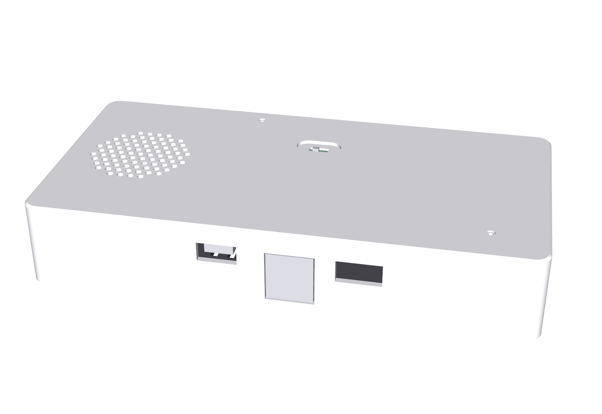
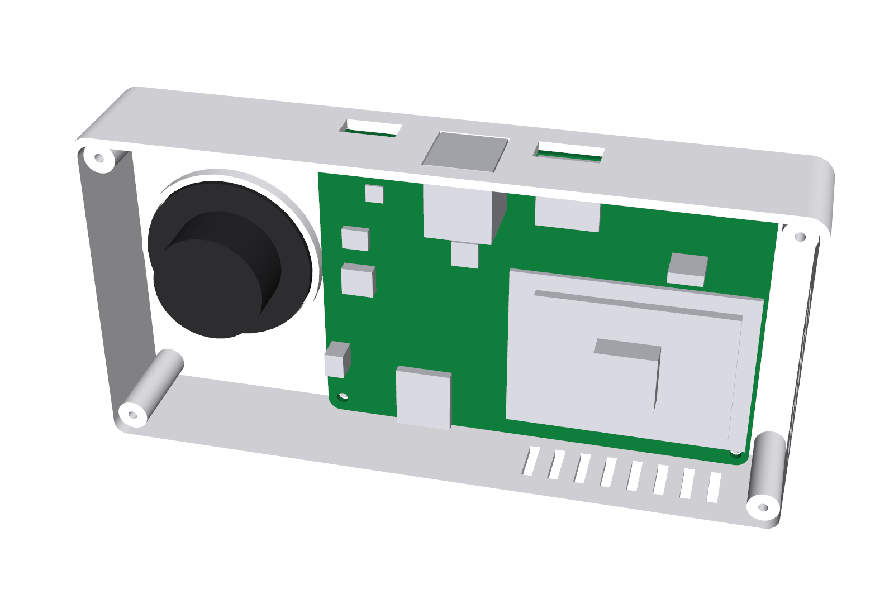

# Enclosure

Parametric CadQuery model of the VoxHub CM4 case: `voxhub_enclosure.py`.

| File | Purpose |
|---|---|
| `voxhub_enclosure.py` | the model; all dimensions are constants at the top, PCB-dependent positions come from `../hardware/gen/placement.json` |
| `voxhub_shell.{stl,3mf,step}` | top + walls, **already oriented for printing** (top face on the bed) |
| `voxhub_base.{stl,3mf,step}` | bottom plate, oriented for printing (outside face on the bed) |
| `voxhub_assembly.step` | shell + base + PCB assembly stand-in + speaker, for checking in any CAD tool |
| `render.py`, `renders/` | off-screen renders (closed, open, cross-sections, transparent top view) |

## Concept

- Outer size **158.8 x 79.2 x 28.0 mm**, 2.0 mm walls, 5 mm corner radius.
- The PCB hangs **component side down** on four bosses under the top plate (4 mm gap); the CM4 and its heat sink
  face the vented base. The speaker sits beside the PCB and fires upwards through a hexagonal grille.
- Features that line up with the PCB (all taken from the placement file):
  - rear wall windows: USB-C (12.4 x 6.3), stacked USB-A (15.2 x 16.5), microSD slot (13.0 x 2.6);
  - two microphone chimneys: 5 mm tube from the top plate down to the PCB, 1.5 mm bore, total acoustic path
    1.6 (PCB) + 4.0 + 2.0 = 7.6 mm;
  - three LED light pipes above the reverse-mount LEDs, closed by a 0.4 mm skin that acts as a diffuser;
  - slot + finger dish for the mute slider (SW1 is on the PCB side that faces the top);
  - four PCB bosses (2.1 mm pilot for 2.5 mm thread-forming screws) and four base posts;
  - speaker locating ring (40.5 mm) + grille; a ring pedestal on the base clamps the speaker through a foam pad;
  - vents: base slots under the CM4 and the power stage, wall slots next to the CM4.

## Printing (Bambu Lab X1 / P1 / A1, 0.4 mm nozzle)

| Setting | Value |
|---|---|
| Material | PETG or PLA (PETG recommended: the buck area reaches ~60 C) |
| Layer height | 0.2 mm, first layer 0.2 mm |
| Walls / top-bottom | 3 walls, 4 top/bottom layers, 15 % gyroid |
| Supports | **none** |
| Orientation | as exported: shell upside down (smooth top from the PEI plate), base flat |
| Bed | both parts fit a 256 x 256 mm plate together |

Why no supports are needed: every boss, post, chimney and light pipe grows straight up from the top plate; the rear
connector windows are closed rectangles whose top edge is a bridge of at most 15.2 mm; the mute dish is a 1.2 mm deep,
8 mm wide recess in the first layers (bridged); grille and vent holes are vertical. The LED windows keep a 0.4 mm skin
(two layers) - use a light filament colour or print the first two layers in translucent material if the LEDs
should be clearly visible.

## Assembly

1. Stick 0.5 mm foam rings (5 mm OD / 2 mm ID) on the two microphone chimneys (acoustic seal).
2. Fit the CM4 on the carrier (4 x M2.5 x 5 into the SMT spacers), stick the heat sink on the SoC, insert the SD card.
3. Solder 80 mm leads to the speaker, crimp/plug the JST-PH housing; drop the speaker into its ring (cone down in
   print orientation, i.e. facing the grille).
4. Lay the PCB on the four bosses (component side towards you), make sure the mute slider enters its slot, fasten with
   4 x 2.5 x 6 mm thread-forming screws. Plug the speaker into J7.
5. Put the foam pad on the base pedestal, close the base, fasten with 4 x 2.5 x 8 mm screws, stick on the feet.

## Verification

- `voxhub_enclosure.py` intersects the PCB, the component keep-in solids (connectors, CM4 + heat sink, inductor,
  radio module, headers, mute switch) and the speaker with both printed parts and prints the interference volume:
  **0.000 mm^3** for all six pairs.
- `renders/fit_top_transparent.png`, `section_cm4.png` and `section_front_row.png` show the PCB inside the shell.

## Not verified / assumptions

The following dimensions come from distributor data or part-family knowledge, not from the manufacturer drawings
(which could not be downloaded): USB-A connector overhang (2.5 mm beyond the PCB edge), JS202011JCQN body height
(3.5 mm) and actuator height (2.0 mm), speaker frame diameter/depth (40.0 / 17.5 mm). All are parameters - measure the
real parts and adjust before printing in volume. A first test print for fit is expected.
