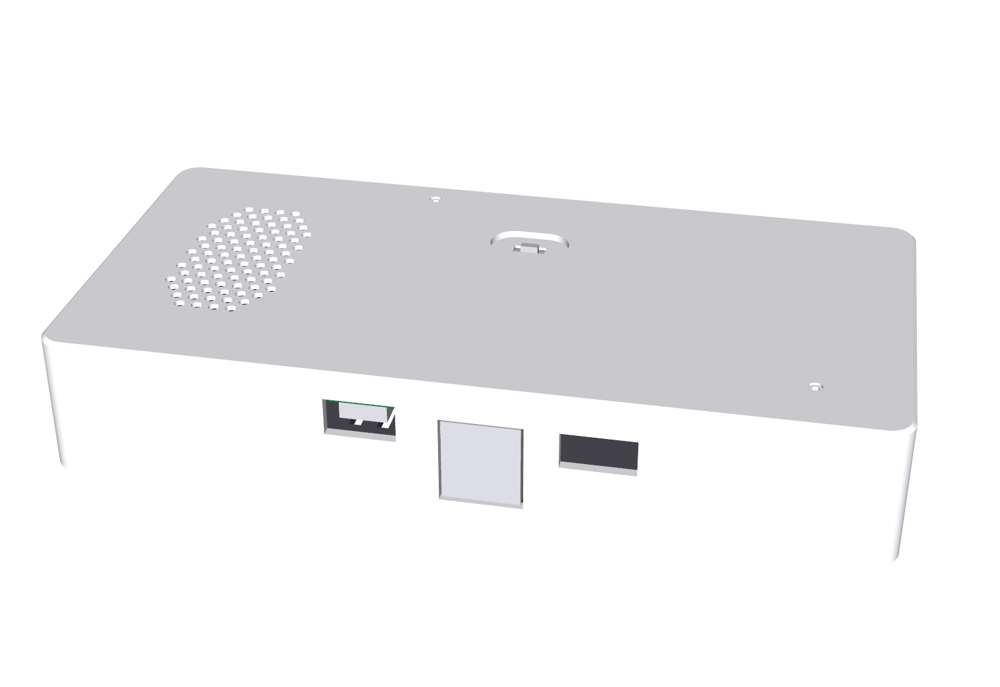
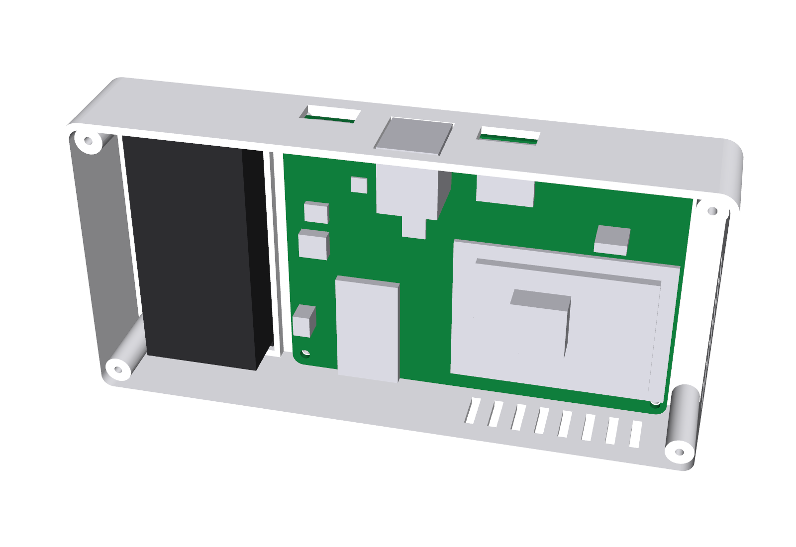

# Enclosure

Parametric CadQuery model of the VoxHub CM4 case: `voxhub_enclosure.py`.

| File | Purpose |
|---|---|
| `voxhub_enclosure.py` | the model; all dimensions are constants at the top, PCB-dependent positions come from `../hardware/gen/placement.json` |
| `voxhub_shell.{stl,3mf,step}` | top + walls, **already oriented for printing** (top face on the bed) |
| `voxhub_base.{stl,3mf,step}` | bottom plate, oriented for printing (outside face on the bed) |
| `voxhub_assembly.step` | shell + base + PCB assembly stand-in + speaker, for checking in any CAD tool |
| `render.py`, `renders/` | off-screen renders (closed, open, cross-sections, transparent top view) |

## Concept

- Outer size **158.8 x 79.2 x 28.0 mm**, 2.0 mm walls, 5 mm corner radius.
- The PCB hangs **component side down** on four bosses under the top plate (4 mm gap); the CM4 and its heat sink
  face the vented base. The speaker sits beside the PCB and fires upwards through a hexagonal grille.
- Features that line up with the PCB (all taken from the placement file):
  - rear wall windows: USB-C (13.4 x 7.5 - the plug overmould enters the wall), stacked USB-A (15.6 x 17.3),
    microSD (14.0 x 7.2 including the finger notch, centred on the card, not on the socket body);
  - two microphone chimneys: 5 mm tube from the top plate down to the PCB, 1.5 mm bore, total acoustic path
    1.6 (PCB) + 4.0 + 2.0 = 7.6 mm;
  - three LED light pipes (3 mm bores) over the status LEDs, which sit on the PCB side that faces the top; closed by a
    0.4 mm skin that acts as a diffuser;
  - slot (6.4 x 2.6 mm) + finger dish (16 x 10 x 1.4 mm) for the mute slider (SW1 is on the PCB side that faces the top);
    the slider stands 0.9..1.0 mm proud of the dish floor and stays 0.4..0.5 mm below the outer surface;
  - four PCB bosses and four base posts with 2.1 mm pilot holes: M2.5 machine screws form their own thread in them
    (thread-forming 2.5 mm screws for plastic work as well, but are hard to buy in small packs);
  - speaker: rectangular locating frame (71.3 x 31.9 mm inside, 3 mm high) for the 70.1 x 30.7 mm flange of the Adafruit
    3351 enclosed speaker, oblong grille (46 x 24 mm) with a 1 mm deep relief in front of the cone; a flat pedestal
    (40 x 18 mm) on the base clamps the back of the speaker box through a foam pad. The speaker comes with a JST-PH plug
    on a lead of about 50 cm - nothing is soldered;
  - vents: base slots under the CM4 and the power stage, wall slots next to the CM4.

## Printing (Bambu Lab X1 / P1 / A1, 0.4 mm nozzle)

| Setting | Value |
|---|---|
| Material | PETG or PLA (PETG recommended: the buck area reaches ~60 C) |
| Layer height | 0.2 mm, first layer 0.2 mm |
| Walls / top-bottom | 3 walls, 4 top/bottom layers, 15 % gyroid |
| Supports | **none** |
| Orientation | as exported: shell upside down (smooth top from the PEI plate), base flat |
| Bed | both parts fit a 256 x 256 mm plate together |

Why no supports are needed: every boss, post, chimney and light pipe grows straight up from the top plate; the rear
connector windows are closed rectangles whose top edge is a bridge of at most 15.6 mm (the strip of wall that bridges
the USB-A window is 3.4 mm high and 2.0 mm thick); the mute dish is a 1.4 mm deep,
10 mm wide recess in the first layers (bridged); the speaker relief is an open pocket on the inside; grille and vent holes are vertical. The LED windows keep a 0.4 mm skin
(two layers) - use a light filament colour or print the first two layers in translucent material if the LEDs
should be clearly visible.

## Assembly

The complete procedure with tests is in [`../fab/ASSEMBLY_AND_TEST.md`](../fab/ASSEMBLY_AND_TEST.md). In short:

1. Fit the CM4 on the carrier (4 x M2.5 x 5 into the SMT spacers), stick the heat sink on the SoC, insert the SD card.
2. Lay the shell upside down. Drop the speaker into its frame, cone towards the grille. Fold the lead into a loose
   bundle in the rear half of the speaker bay (the half with the USB sockets), away from the front wall: the radio
   antenna is at the front edge of the PCB.
3. The PCB cannot be lowered straight onto the bosses: the stacked USB-A connector overhangs the board edge by 2.5 mm and
   its flange reaches 1.9 mm into the rear wall. Hold the PCB component side towards you with the front edge raised,
   push the rear connectors (USB-A, USB-C, microSD) into their windows first, then swing the front edge down onto the four
   bosses. Make sure the mute slider enters its slot, fasten with 4 x M2.5 x 5. Plug the speaker into J7 (either way
   round: the amplifier output is bridge-tied).
4. Stick a 40 x 18 mm piece of 3 mm cellular rubber on the base pedestal, close the base, fasten with 4 x M2.5 x 8,
   stick the four 8 mm feet into their recesses.

Optional: 0.5 mm foam rings (5 mm outside, 2 mm hole) on the two microphone chimneys improve the acoustic seal. With the
closed speaker box they are not needed for a first build.

## Verification

- `voxhub_enclosure.py` intersects the PCB, the component keep-in solids (connectors, CM4 + heat sink, inductor,
  radio module, headers, mute switch) and the speaker with both printed parts and prints the interference volume:
  **0.000 mm^3** for all six pairs. The keep-in solid of the stacked USB-A connector is 14.6 x 17.3 x 16.2 mm (flange
  width x body depth x highest reading of the far flange lip).
- Both STL meshes are closed (every edge belongs to exactly two triangles).
- `renders/fit_top_transparent.png`, `section_cm4.png` and `section_front_row.png` show the PCB inside the shell.

## Dimensions checked against the manufacturer drawings

Revision A assumed three part dimensions; they were checked against the drawings on 2026-11-11 (sources in
DECISIONS.md section 9) and the constants at the top of `voxhub_enclosure.py` were updated. Revision A2 changed the
speaker and the heat sink. Revision A3 changed the stacked USB-A connector (DECISIONS.md, F-2): the drawings of the old
and the new part were compared on 2026-11-20, the far edge of the USB-A window was moved by 0.3 mm and the shell was
generated again. Nothing else in the shell changed (9.36 mm^3 of wall removed at that edge), and the base is unchanged:

| Part | Drawing says | Model |
|---|---|---|
| Jing Extension 907-112A1022D10200 (stacked USB-A since revision A3) | drawing A0 of 2021-03-10 (LCSC copy): shell 13.1 +-0.15 x 17.3 mm, 15.60 mm high; front flange 14.6 x 15.7 mm; +-0.25 mm on dimensions without a tolerance of their own. Not dimensioned, scaled from the drawing: flange lips 0.45 and 16.12 to 16.20 mm above the PCB, front face 2.50 to 2.55 mm beyond the PCB edge | window 15.6 x 17.3 mm: it ends 17.0 mm from the component side of the PCB (16.7 mm before revision A3). Clearance 0.50 mm per side (0.375 mm with the flange at +0.25 mm), 0.75 mm at the lip next to the PCB, 0.80 to 0.88 mm at the far lip (0.55 mm with the lip 0.25 mm further out; the old edge left 0.50 to 0.58 mm and 0.25 mm). The mouth ends 0.05 to 0.10 mm behind the outer wall face. Shell 2.40 mm from the base (2.15 mm at maximum material) |
| Wurth 61400826021 (stacked USB-A up to revision A2, now the alternate) | shell 13.1 x 17.0 mm, 15.34 mm high; front flange 14.5 +-0.2 x 15.5 +-0.2 with lips 0.45 and 15.95 mm above the PCB (scaled; 0.47 and 15.98 mm when the drawing was read again on 2026-11-20); front face 2.5 mm beyond the PCB edge | overhang 2.5 mm confirmed on 2026-11-11, window then 15.6 x 17.0 mm (was 15.2 x 16.5). In the window of revision A3: 0.55 mm per side (0.45 mm with the flange at +0.2 mm), 1.02 mm at the far lip (0.82 mm with the lip 0.2 mm further out); shell 2.66 mm from the base (2.41 mm at maximum material) |
| GCT USB4105-GF-A (USB-C) | shell 8.94 x 3.31 mm, ends flush with the PCB edge, i.e. 2.6 mm inside the wall | window 13.4 x 7.5 mm so that a 12.35 x 6.5 mm plug overmould can enter (was 12.4 x 6.3) |
| C&K JS202011JCQN (mute switch) | body 9.0 x 3.6 x 3.5 mm, actuator 1.5 x 1.5 mm, 2.0 mm high, 2 mm travel | `GAP_TOP` = 4.0 mm confirmed; dish 16 x 10 x 1.4 mm |
| Adafruit 3351 (speaker since revision A2) | maker's data sheet C5282-001 linked from the Adafruit product page: flange 70.11 x 30.72 mm (+-0.3), height 16.5 +-0.5 mm, box 66.1 mm long, holes 3.4 mm on 24.11 x 63.79 mm, cone opening 38.5 x 26.8 mm about 3 mm off centre, lead 500 mm leaving one short end 8 mm below the front face. The sheet names the plug "XH2.54-2P", Adafruit and BerryBase say JST-PH 2.0 mm (the photo shows a PH housing) | frame 71.3 x 31.9 mm (0.6 mm clearance per side), grille and relief long enough for the cone offset in either direction, pedestal top 18.5 mm below the top plate (16.5 mm speaker + 2.0 mm compressed foam) |
| Hirose DM3AT (microSD) | card centre 0.425 mm off the body centre; locked card 1.6 mm behind the outer wall face | window shifted by 0.425 mm; eject = push the card in by 0.8 mm with a fingernail |
| CM4 + heat sink | SoC 2.378 +-0.11 mm, centre 31.99 / 16.98 mm from the module edges; 1.5 mm stack | heat sink 14 x 14 x 7 mm in the fit model; 5.8 mm left under it |

Still to be checked on real parts: the plug of the speaker (it must be a JST-PH with 2.0 mm pitch to fit J7 - see the
table), the stacked USB-A connector (the heights of its flange lips and the distance from its pins to its front face are
scaled from the drawing, not dimensioned, and no sample was measured) and the C&K body (no tolerance in the drawing).
A first test print for fit is still the right next step. A USB-A window that is printed 0.3 mm small at its far edge
still leaves 0.25 mm when the flange lip is 0.25 mm further out than drawn.
