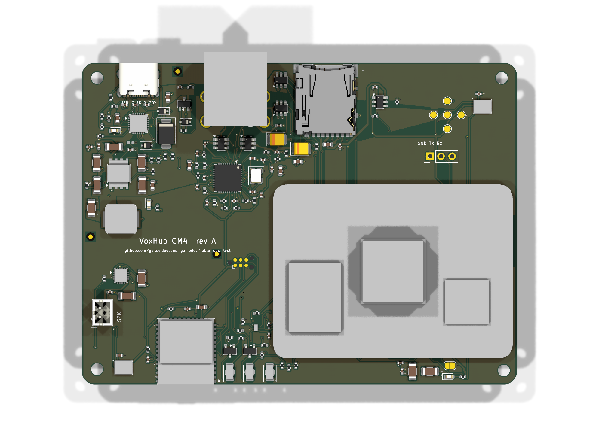

# Hardware: VoxHub CM4 carrier, revision A2

KiCad 9 project, **generated entirely from code** (`gen/`). Do not edit the `.kicad_sch` / `.kicad_pcb` files
by hand - change the generator and run `./build.sh`.

Revision A2 is the revision that is ordered fully assembled from JLCPCB. The order files are in
[`../fab/jlcpcb/`](../fab/jlcpcb), the ordering steps in [`../fab/ORDER_GUIDE.md`](../fab/ORDER_GUIDE.md), what changed
from A1 and why in the A2 log of [`../DECISIONS.md`](../DECISIONS.md).

## Contents

| Path | What |
|---|---|
| `voxhub.kicad_pro`, `voxhub.kicad_sch` + 5 sub-sheets, `voxhub.kicad_pcb` | the KiCad project |
| `voxhub.kicad_dru` | JLCPCB limits that KiCad's board setup cannot express (component holes, pad to pad) |
| `voxhub.kicad_sym`, `voxhub.pretty/` | project symbol / footprint libraries (generated) |
| `3dmodels/` | STEP models used by the footprints (KiCad library copies + simple stand-ins) |
| `gen/design.py` | **the circuit**: every part, value and net |
| `gen/kisch.py`, `gen/sexpr.py` | schematic writer |
| `gen/parts.py` | part catalogue: one entry per purchasable part |
| `gen/jlc_lookup.py`, `gen/sourcing_jlc.json`, `gen/jlc_footprints.json` | live lookups in JLCPCB's assembly library and at LCSC; the stored result (LCSC number, library type, stock, prices); JLCPCB's own footprints of every part |
| `gen/sourcing.py`, `gen/sourcing_live.json`, `gen/make_bom.py` | second sources, DigiKey data of 2026-11-11, system parts with their EU shop, BOM generator |
| `gen/make_footprints.py`, `gen/make_3dmodels.py` | project footprints and coloured stand-in models |
| `gen/prewire.py` | **hand-designed copper**: PD input, load switch, buck stage, USB port supplies, all six USB data lines; stack-up and USB geometry |
| `gen/build_pcb.py` | placement, silkscreen legends, pre-wired copper, power fan-out, keep-outs, DSN export, import, patch router, repair, USB length measurement |
| `gen/postroute.sh` | iterate DRC -> repair -> patch until clean |
| `gen/check_power.py`, `gen/check_df40.py` | build gates: narrowest copper of the high-current paths; foreign copper in the CM4 socket strips |
| `gen/jlc_impedance.py` | asks JLCPCB's impedance calculator for the USB geometry |
| `gen/make_jlc.py` | JLCPCB BOM, CPL and placement report |
| `gen/routed/voxhub.ses` | autorouter session (Freerouting 2.0.1) the committed board was built from |
| `gen/placement.json` | final part positions (also drives the enclosure model) |
| `outputs/` | reports and fabrication data (below) |

### `outputs/`

| File | Purpose |
|---|---|
| `voxhub_schematic.pdf` | schematic, 6 pages |
| `erc.rpt`, `drc.rpt` | kicad-cli reports: **0 ERC violations, 0 DRC violations, 0 unconnected, 0 parity issues** |
| `drc_waived_checks_enabled.rpt` | the same DRC with the two waived checks switched on (4 warnings, explained below) |
| `power_paths.txt` | narrowest copper of every high-current path against its requirement |
| `df40_strips.txt` | copper inside Hirose's restricted strips of the CM4 sockets (own net / other net) |
| `usb_impedance.txt` | USB track geometry in JLCPCB's impedance calculator |
| `routing_stats.txt` | track / via counts; USB lines: pad-to-pad length and skew, the pads each line runs through, copper that is not on that path; SD / I2S / PDM lengths |
| `gerbers/` + `voxhub_gerbers.zip` | Gerbers with Protel extensions: F / In1 / In2 / B copper, mask, paste, silk, Edge.Cuts; Excellon PTH + NPTH drill, drill maps, job file (`../fab/jlcpcb/gerbers.zip` is the same set without maps and job file) |
| `voxhub_pos.csv` | pick-and-place as KiCad exports it (both sides, DNP parts excluded); for JLCPCB use `../fab/jlcpcb/cpl_jlcpcb.csv` |
| `bom.csv`, `bom_summary.json` | PCB assembly BOM: MPN, LCSC number, JLCPCB library type, JLCPCB and LCSC stock, JLCPCB prices at 1 / 10 / 100 (live, 2026-11-12), DigiKey second source (2026-11-11), other alternates |
| `bom_system.csv` | module, speaker, heat sink, screws, SD card, charger with EU shop and price |
| `voxhub_outline.dxf`, `mechanical_positions.csv` | mechanical outline: board edge, mounting holes, CM4 holes / outline, microphone ports, connector envelopes |
| `voxhub_pcb.step` | 3D model of the assembled board |
| `pcb_layers/voxhub.pdf` | layer plots |
| `render_top.png`, `render_bottom.png`, `render_iso.png` | kicad-cli 3D renders |



## Rebuilding

```bash
docker pull kicad/kicad:9.0                # KiCad 9.0.9 was used
wget -P hardware https://github.com/freerouting/freerouting/releases/download/v2.0.1/freerouting-2.0.1.jar
SKIP_ROUTE=1 hardware/build.sh all         # schematic -> ERC -> netlist -> place -> import -> patch -> DRC -> outputs -> fab/jlcpcb
hardware/build.sh all                      # same, but re-runs the autorouter first (Java >= 21)
```

Single steps: `hardware/build.sh sch | pcb | route | outputs`.

| Environment variable | Meaning |
|---|---|
| `KICAD_IMAGE` | Docker image with KiCad 9 (default `kicad/kicad:9.0`). `shapely` is installed into the container with pip when it is missing |
| `KICAD_NATIVE=1` | use `kicad-cli` and `pcbnew` of the host instead of Docker. The build picks the first of `$KICAD_PYTHON`, `python3`, `python3.12`, `python3.11` that imports `pcbnew`, `numpy` and `shapely` |
| `FREEROUTING` | path of the Freerouting jar (default `hardware/freerouting-2.0.1.jar`) |
| `SKIP_ROUTE=1` | re-use the committed autorouter session |

The host needs `python3` and `zip` (the archives are packed on the host; the script checks for `zip` first), and
`docker` unless `KICAD_NATIVE=1` is set.

`SKIP_ROUTE=1` re-uses the committed autorouter session and reproduces the committed board exactly (the patch
router is deterministic). Freerouting 2.0.1 with one thread produced the same session in every run here, but that is not
guaranteed on another machine or JRE. Two quirks the build works around: it sometimes exits with an empty session file
after routing (the build starts it up to three times and checks the file), and it keeps a `freerouting.json` in the
temp directory (each run gets its own).

Scripts that are run by hand:

| Command | What it does |
|---|---|
| `python3 gen/jlc_lookup.py refresh gen/sourcing_jlc.json` | reads stock, library type and prices of every BOM line live from JLCPCB and LCSC |
| `python3 gen/jlc_lookup.py footprints gen/sourcing_jlc.json gen/jlc_footprints.json` | fetches JLCPCB's footprint of every LCSC part (needed after a part change) |
| `python3 gen/jlc_lookup.py search "<keyword>"`, `... code C12345` | search the assembly library; full record of one part |
| `python3 gen/jlc_impedance.py outputs/usb_impedance.txt` | USB geometry of `prewire.py` in JLCPCB's impedance calculator |
| `python3 gen/check_power.py voxhub.kicad_pcb outputs/power_paths.txt` | current-path widths (run by `build.sh outputs`) |
| `python3 gen/check_df40.py voxhub.kicad_pcb outputs/df40_strips.txt` | CM4 socket strips (run by `build.sh outputs`) |
| `python3 gen/make_jlc.py voxhub.kicad_pcb gen/sourcing_jlc.json gen/jlc_footprints.json ../fab/jlcpcb` | JLCPCB BOM, CPL, placement report (run by `build.sh outputs`) |

How the board is produced:

1. `design.py` writes the schematic; `kicad-cli sch erc` must pass; the KiCad netlist is compared pin by pin with the code model.
2. `build_pcb.py place`: fixed positions for connectors / ICs / mechanics and for the hand-placed power stage and USB parts,
   a greedy "nearest free spot to the pad it talks to" placer for the other passives; outline; keep-outs; silkscreen
   legends by an occupancy search; then the **pre-wired copper of `prewire.py`** (locked), the scripted fan-out of the
   remaining GND / +5V pads to the inner planes (never a via in or touching a lead pad), the fixed escape pattern of the
   WLCSP and the keep-out areas in the restricted strips of the CM4 sockets. The USB line lengths are measured and the
   lines locked.
3. Freerouting 2.0.1 routes the remaining signals on F.Cu / B.Cu (planes are declared as power layers; locked copper is fixed wiring).
4. `build_pcb.py finish`: import, widen necked tracks to 0.1 mm, GND and +5V planes, GND pours on both outer layers.
5. `postroute.sh`: the patch router (A* on a 0.05 mm grid with rip-up) joins whatever is still open and a DRC-driven
   repair removes offending copper, until `kicad-cli pcb drc` is clean. Locked copper is never touched.
6. `build.sh outputs`: the DRC gates everything; Gerbers, drill, STEP, renders; `stats` fails if a USB pair is more than
   3.8 mm apart or cannot be measured; `check_power.py` and `check_df40.py` fail on a narrow current path or on foreign
   copper in the socket strips; BOM; `make_jlc.py` fails if a rotation fit does not match.

## Fabrication notes

| Parameter | Value |
|---|---|
| Size | 100.0 x 74.0 mm, 3 mm corner radius, 1.6 mm, FR-4 |
| Layers | 4: F.Cu signal + GND pour / In1.Cu GND plane / In2.Cu +5 V plane / B.Cu signal + GND pour |
| Stack-up | **JLCPCB JLC04161H-3313**: 35 um copper / 0.0994 mm prepreg 3313 / 17.5 um copper / 1.265 mm core / 17.5 um copper / 0.0994 mm prepreg / 35 um copper (written into the board file) |
| USB 2.0 lines | upstream pair 0.14 mm wide, 0.16 mm gap: 89.96 ohm differential in JLCPCB's calculator; downstream lines 0.185 mm: 45.2 ohm each (`outputs/usb_impedance.txt`). With the 7628 default stack-up the same copper would be far off |
| Min. track / space | on the board: 0.12 mm track (patch-router fallback), 0.14 mm USB pair, 0.15 mm signals; net-class clearance 0.12 / 0.15 mm. Board rules = JLCPCB limits: 0.09 / 0.09 mm |
| Vias | through, 0.5 mm pad / 0.3 mm drill (signal) and 0.6 / 0.3 mm (power) - JLCPCB's free "0.3 mm / 0.45 mm" class |
| Via covering | covered by solder mask on both sides in the Gerbers. Order "Epoxy Filled & Capped" (recommended) or the free "Plugged" |
| Via-in-pad | only in exposed pads: U1, U2 (eight, part of the KiCad footprint), U4, U10. No via lies in or touches a lead pad |
| Plated slots | 4 x 0.6 mm wide (1.4 and 1.7 mm long), shell stakes of the USB-C connector J1 |
| Non-plated holes | 2 x 0.8 mm (microphone ports), 2 x 0.65 mm (J1 locating pegs), 3 x 0.99 mm (Tag-Connect J8), 4 x 2.7 mm (mounting), 4 x 3.7 mm (SMT spacers). No non-plated slots |
| Finish | **ENIG** (0.22 mm pads of the 0.4 mm pitch WLCSP, 0.4 mm pitch mezzanine connectors) |
| Mask / silk | green / white; silkscreen is clipped by the mask openings (`--subtract-soldermask`); smallest text 1.0 mm |
| Copper to board edge | >= 0.35 mm for routed copper (edge connectors' own pads excepted); JLCPCB limit 0.2 mm |
| Keep-outs | no copper on any layer under the antenna of the radio module (11.75..31.25 x 68.0..74.0) and under the CM4 antenna (91..100 x 44.5..59.5: the 6.5 x 11 mm "Wireless Cutout" of CM4 datasheet fig. 4 enlarged to the recommended 8 x 15 mm and out to the board edge); no foreign copper on the component side in the strips 0.75..1.19 mm from the centre line of each CM4 socket |
| Impedance control | not ordered: the stack-up is specified and the geometry comes from JLCPCB's calculator |
| Panel | fiducials FID1-3 are on the board; JLCPCB adds edge rails and its own fiducials. J6 overhangs the rear edge by 2.5 mm, J1 ends flush with it, the radio module ends flush with the front edge |

## Assembly notes

- **Side F (component side, "Top" in the files)**: all other parts. **Side B ("Bottom", faces the top cover of the
  enclosure)**: SW1 (mute slide switch) and the status LEDs D7 (green), D8 (blue), D9 (red).
- THT parts: J6 (stacked USB-A) and J7 (JST-PH, speaker) - JLCPCB solders them by hand. J5 (debug header) and C13
  (feed-forward capacitor) are **not populated** and are in neither the BOM nor the CPL.
- U9 ADAU7002: WLCSP-8, 0.4 mm pitch, NSMD pads 0.22 mm - X-ray is part of JLCPCB's Standard PCBA for such parts.
- U11 (radio module, MSL 3, at most two reflow passes) and J2 / J3 (0.4 mm mezzanine sockets): reflow only. J2 / J3
  define the CM4 position together with the four SMT spacers H5-H8. The paste layer has 81 % apertures on the socket pads.
- MK1 / MK2 (bottom-port MEMS microphones): **no washing, no ultrasonic or dry-ice cleaning** after reflow; the silkscreen
  on side B says "MIC - NO WASH" next to both sound holes, and the order remark repeats it.
- H5-H8: Wurth 9774015151R SMT spacers (reflow). The CM4 is then fixed with 4 x M2.5 x 5 mm screws.
- Polarised parts: C38, C41 (polymer tantalum), D1 (TVS, cathode to VBUS), D5 (Zener, cathode to VBUS), LEDs - all
  checked pad by pad against JLCPCB's footprints in `../fab/jlcpcb/placement_report.csv`.
- JP1 (solder jumper, open by default): only for USB boot of a CM4 with eMMC; never needed with the Lite module.
- Test points on side F: TP1 VBUS, TP2 VBUS_SW, TP3 +5V, TP4 +3V3, TP5 GND (around x 84, y 12 mm from the rear-left corner).
- Pick-and-place for JLCPCB: `../fab/jlcpcb/cpl_jlcpcb.csv` (JLCPCB's rotation convention and footprint centres).
  `outputs/voxhub_pos.csv` is the plain KiCad export for any other assembler.

Programming and test of an assembled board: [`../fab/ASSEMBLY_AND_TEST.md`](../fab/ASSEMBLY_AND_TEST.md). The radio
module is flashed from the CM4 with [`../tools/flash_zigbee.sh`](../tools/flash_zigbee.sh) (ROM serial boot loader on
UART4, strap GPIO25, reset GPIO24 - **high = reset**; OpenOCD JTAG on GPIO22 / 23 / 17 / 7 as the fallback,
`../tools/voxhub-cc2652-jtag.cfg`).

## DRC: rules and waived checks

The board rules in `gen/project_settings.json` are JLCPCB's limits as published on 2026-11-12, the net classes are
stricter. `voxhub.kicad_dru` adds what the board setup cannot express:

| Rule | Limit |
|---|---|
| component hole to component hole | 0.45 mm |
| component hole to copper of another net | 0.28 mm |
| annular ring of component holes | 0.15 mm |
| non-plated hole | >= 0.5 mm |
| pad to pad of different nets | 0.15 mm |
| (board setup) track / space, via pad / drill, via ring, hole to hole, hole to copper, copper to edge | 0.09 / 0.09 mm, 0.45 / 0.3 mm, 0.075 mm, 0.2 mm, 0.2 mm, 0.2 mm |
| (board setup) silkscreen line / text height / distance to pads | 0.15 mm / 1.0 mm / 0.15 mm |

Every check is an error except two that compare the board with KiCad's library and are switched off;
`outputs/drc_waived_checks_enabled.rpt` shows what they would report (4 warnings):

| Check | Count | Why it is waived |
|---|---|---|
| `footprint_type_mismatch` | 1 | U2 uses KiCad's `...HSOP-8-1EP..._ThermalVias` footprint: an SMD part whose exposed pad contains plated thermal vias, which KiCad classifies as "through hole". Intentional |
| `lib_footprint_mismatch` | 3 | J1, J4 and J6: the board copies differ from the library footprints only in silkscreen that the generator trims at the board edge (and, for J1, in the layer set of the two NPTH locating-peg pads). No copper is affected |

## Known limitations (read before ordering)

- **Signals are autorouted.** Power and USB copper are designed by hand and locked; everything else is electrically
  complete and rule-clean but not hand-optimised.
- **Nothing is measured.** The USB impedance is JLCPCB's calculated value for the specified stack-up, without the paid
  impedance test. Verify with a USB 2.0 high-speed device on both ports.
- **The downstream USB lines are two uncoupled 45 ohm lines per port, not a coupled pair** (10.8 and 16.2 mm long; the
  2.0 mm connector pin pitch and the flow-through ESD parts leave no room for a coupled section worth having). The
  upstream pair is coupled over its whole length. All six lines: no vias, no stubs, skew 0.00 mm.
- SD card lines are 59-98 mm long with up to 39 mm mismatch: fine for 50 MHz high-speed mode (about 260 ps against a
  20 ns period); UHS-I SDR104 is not guaranteed.
- Three BOM lines are below 200 pieces at JLCPCB (ADAU7002ACBZ-R7, 61400826021, RF-BM-2652P2) - see the order guide.
- The speaker (Adafruit 3351) has no dimensioned drawing; the enclosure pocket follows the shop dimensions.
- No hardware has been built or measured.
