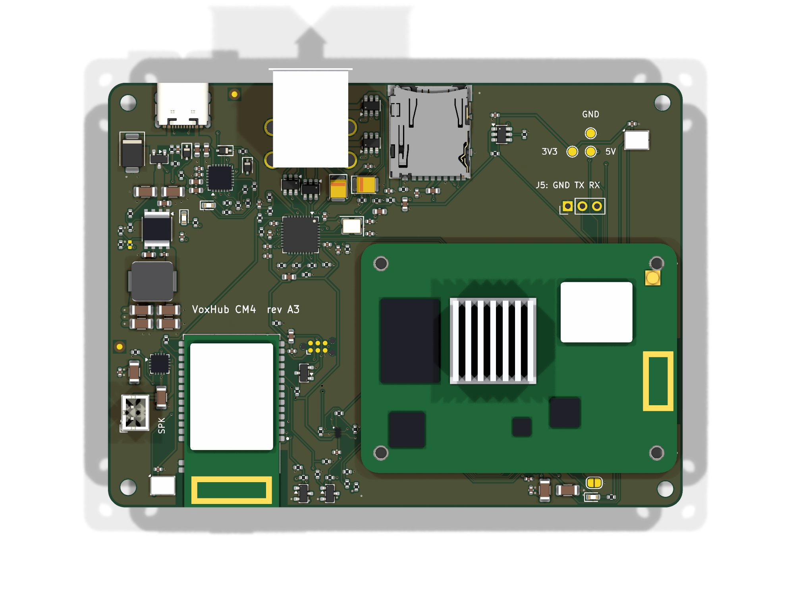

# Hardware: VoxHub CM4 carrier, revision A3

KiCad 10 project (native KiCad 10 files, written with KiCad 10.0.8), **generated entirely from code** (`gen/`). The
project opens in KiCad 10 and can also be edited by hand there: `./build.sh` refuses to regenerate a schematic sheet,
a library, the board or the project file that was changed in KiCad or by hand, and `./build.sh outputs` makes the
fabrication files from the project as it is. For anything that is to stay, change the generator and run
`./build.sh`. How to open the project is in [Opening and editing in KiCad 10](#opening-and-editing-in-kicad-10), how
generated files and manual edits are kept apart in
[Editing the project by hand (KiCad 10)](#editing-the-project-by-hand-kicad-10).

Revision A3 is the revision that is ordered fully assembled from JLCPCB. The order files are in
[`../fab/jlcpcb/`](../fab/jlcpcb), the ordering steps in [`../fab/ORDER_GUIDE.md`](../fab/ORDER_GUIDE.md). Against
revision A2 the placement, the nets and the routing are the same; values, part numbers, three land patterns and the
toolchain changed. What changed and why is in the A3 log at the top of [`../DECISIONS.md`](../DECISIONS.md) (K-1 to
K-10: KiCad 10, C-1 to C-12: fewer part numbers, N-1 to N-6: findings on the existing design, F-1 to F-5: stock
check, K-11 to K-15: editing by hand, R-1 to R-7: review round 1 of 2026-11-21), what changed from A1 to A2 in its
A2 log.

## Opening and editing in KiCad 10

- Open `voxhub.kicad_pro` with KiCad 10. The project is self-contained: its library tables (`sym-lib-table`,
  `fp-lib-table`) name only the project libraries `voxhub.kicad_sym` and `voxhub.pretty`, every symbol and footprint
  link is `voxhub:<name>`, and every 3D model path points into `3dmodels/`. Nothing is taken from the libraries of the
  KiCad installation (DECISIONS.md, K-3). No model is missing in the 3D viewer any more: the sockets J2 / J3 use a
  simplified stand-in, `3dmodels/Connector_Hirose_DF40.3dshapes/Hirose_DF40C-100DS-0.4V_2x50_P0.4mm.step` (envelope
  22.6 x 2.88 x 1.45 mm, 3.38 mm over the contact tails, from the Hirose DF40 catalogue; the inside is a plain trough
  that clears the plug block of the CM4 model; K-15).
- The files are native KiCad 10 files (schematic format 20260306, board and footprints 20260206, symbol library
  20251024). Saving them from both KiCad 10 editors left every tracked file byte-identical, with no conversion notice
  (tested on Linux, K-2). Nothing was tested on Windows itself (K-10); at the first start KiCad shows its own setup
  wizard once. `.gitattributes` keeps the KiCad files and the scripts at LF line endings on a Windows checkout, and
  `.gitignore` covers what KiCad creates beside an opened project (K-9).
- **Generated files are guarded.** `build.sh sch`, `pcb`, `route` and `all` write the schematic sheets, the project
  libraries, the board and the project file again. Since 2026-11-21 such a step stops before it writes anything when
  one of these files was saved from KiCad or edited by hand: it names the files, and only `OVERWRITE=1` discards the
  edits (K-11).
- **`build.sh outputs` works on the project as it is on disk**: it generates nothing, runs the DRC (with schematic
  parity against the schematic on disk), writes Gerbers, drill files, positions, renders and the JLCPCB BOM and CPL
  from that board, and leaves every project file byte for byte as it found it (K-12). It still writes
  `outputs/bom.csv` and `outputs/order_cost.*` from `gen/model_netlist.json`, the part list of the last generator
  run, not from an edited schematic.
- Without Docker, `voxhub.kicad_jobset` makes reports and fabrication files from the KiCad 10 project manager, and
  *File > Plot* writes the same Gerbers as the build, because the board file stores the plot settings of `build.sh`.
  The drill dialog has no project settings: take the drill files from the jobset or from `build.sh outputs` (K-13,
  K-14).
- Not written by the build and edited by hand: `voxhub.kicad_dru`, the two library tables, `voxhub.kicad_jobset`,
  `gen/project_settings.json`, `gen/stock/`, `3dmodels/` (`gen/make_3dmodels.py` is run by hand).
- The build needs Docker and a Linux shell (`bash`, `python3`, `zip`). On Windows that means WSL2 with Docker; Git
  Bash is a second choice. Neither was tested (K-10).

The guard, the jobset, the two dialogs, their limits and what is not tested are described in
[Editing the project by hand (KiCad 10)](#editing-the-project-by-hand-kicad-10).

## Contents

| Path | What |
|---|---|
| `voxhub.kicad_pro`, `voxhub.kicad_sch` + 5 sub-sheets, `voxhub.kicad_pcb` | the KiCad 10 project (generated) |
| `voxhub.kicad_jobset` | KiCad 10 jobset (not generated): ERC, DRC, schematic PDF, Gerbers, drill, position file, STEP and `../fab/jlcpcb/gerbers.zip` from inside KiCad, without Docker (see [Editing the project by hand](#editing-the-project-by-hand-kicad-10)) |
| `sym-lib-table`, `fp-lib-table` | project library tables: the only libraries are the two below |
| `voxhub.kicad_dru` | JLCPCB limits that KiCad's board setup cannot express (component holes, pad to pad) |
| `voxhub.kicad_sym`, `voxhub.pretty/` | project symbol / footprint libraries (generated). `voxhub.pretty` holds every footprint of the board (33): 29 copied from `gen/stock` (three of them with a corrected land pattern), the two CM4 socket footprints derived from the stock Hirose footprint, the radio module and the WLCSP of the PDM converter |
| `3dmodels/` | STEP models used by the footprints (KiCad library copies + simple stand-ins). `Connector_Hirose_DF40.3dshapes/Hirose_DF40C-100DS-0.4V_2x50_P0.4mm.step` is a stand-in for the CM4 sockets J2 / J3 (envelope 22.6 x 2.88 x 1.45 mm, 3.38 mm over the contact tails, from the Hirose DF40 catalogue; the inside is a plain trough that clears the plug block of the CM4 model) |
| `build.sh` | the build (see [Rebuilding](#rebuilding)) |
| `docker/Dockerfile` | the build image `voxhub-kicad:10.0`: the official `kicad/kicad:10.0` image plus `python3-numpy` and `python3-shapely` from the Debian packages |
| `gen/design.py` | **the circuit**: every part, value and net |
| `gen/kisch.py`, `gen/sexpr.py` | schematic writer; `sexpr.py` reproduces KiCad 10's own file layout |
| `gen/stock/` | `stock.kicad_sym` (33 symbols) and `stock.pretty` (30 footprints): the KiCad 9.0.9 library parts the board was designed with, stored in KiCad 10 format. The generators read these and not the libraries of the KiCad installation; a part that is not in here must be added before the generator can use it (K-3) |
| `gen/parts.py` | part catalogue: one entry per purchasable part |
| `gen/jlc_lookup.py`, `gen/sourcing_jlc.json`, `gen/jlc_footprints.json` | live lookups in JLCPCB's assembly library and at LCSC; the stored result (LCSC number, library type, stock, prices and price breaks, minimum and loss quantities, date of the reading); JLCPCB's own footprints of every part |
| `gen/sourcing.py`, `gen/sourcing_live.json`, `gen/make_bom.py` | second sources, DigiKey data of 2026-11-11, system parts with their EU shop, BOM generator |
| `gen/order_cost.py` | parts cost of an order of assembled boards with JLCPCB's minimum quantities, loss quantities and price breaks |
| `gen/make_footprints.py`, `gen/make_3dmodels.py` | project footprint library (the copies from `gen/stock`, three of them patched by `LAND_FIXES`: spacer ring, USB-C contacts, microphone ring; and the footprints drawn here) and coloured stand-in models |
| `gen/guard.py`, `gen/generated.sha256` | guard against overwriting manual edits: SHA-256 record of the generated project files (42 lines) |
| `gen/prewire.py` | **hand-designed copper**: PD input, load switch, buck stage, USB port supplies, all six USB data lines; stack-up and USB geometry |
| `gen/build_pcb.py` | placement, silkscreen legends, pre-wired copper, power fan-out, keep-outs, DSN export, import, patch router, repair, USB length measurement |
| `gen/postroute.sh` | iterate DRC -> repair -> patch until no connection is open and no track or via violates a rule |
| `gen/check_power.py`, `gen/check_df40.py`, `gen/check_vias.py` | build gates: narrowest copper of the high-current paths; foreign copper in the CM4 socket strips; vias in or touching a pad |
| `gen/jlc_impedance.py` | asks JLCPCB's impedance calculator for the USB geometry |
| `gen/make_jlc.py` | JLCPCB BOM, CPL and placement report |
| `gen/project_settings.json` | the project file as the generating build steps install it: board rules, net classes, DRC and ERC severities (see [DRC](#drc-rules-severities-and-waived-checks)), the folder of the Plot dialog |
| `gen/model_netlist.json` | the circuit as data, written by `design.py`: parts, fields and the net of every pin; source of the BOM |
| `gen/routed/voxhub.ses` | autorouter session (Freerouting 2.0.1) the committed board was built from |
| `gen/placement.json` | final part positions (also drives the enclosure model) |
| `outputs/` | reports and fabrication data (below) |

### `outputs/`

| File | Purpose |
|---|---|
| `voxhub_schematic.pdf` | schematic, 6 pages |
| `erc.rpt`, `drc.rpt` | kicad-cli 10.0.8 reports: **0 ERC violations, 0 DRC violations, 0 unconnected, 0 parity issues** |
| `drc_waived_checks_enabled.rpt` | the same DRC with the two waived checks switched on (4 warnings, explained below) |
| `power_paths.txt` | narrowest copper of every high-current path against its requirement |
| `df40_strips.txt` | copper inside Hirose's restricted strips of the CM4 sockets (own net / other net) |
| `via_in_pad.txt` | vias whose land overlaps an SMD pad (allowed only inside the exposed pad of an IC) |
| `usb_impedance.txt` | USB track geometry in JLCPCB's impedance calculator (asked on 2026-11-12; the geometry is unchanged) |
| `routing_stats.txt` | track / via counts; USB lines: pad-to-pad length and skew, the pads each line runs through, copper that is not on that path; SD / I2S / PDM lengths |
| `gerbers/` + `voxhub_gerbers.zip` | Gerbers with Protel extensions: F / In1 / In2 / B copper, mask, paste, silk, Edge.Cuts; Excellon PTH + NPTH drill, drill maps, job file (`../fab/jlcpcb/gerbers.zip` is the same set without maps and job file) |
| `voxhub_pos.csv` | pick-and-place as KiCad exports it (both sides, DNP parts excluded); for JLCPCB use `../fab/jlcpcb/cpl_jlcpcb.csv`. The jobset writes the same content as `voxhub-all-pos.csv` |
| `bom.csv`, `bom_summary.json` | PCB assembly BOM, 44 lines + 2 not populated: MPN, LCSC number, JLCPCB library type, JLCPCB and LCSC stock, JLCPCB prices at 1 / 10 / 100 (live, 2026-11-21), DigiKey second source (2026-11-11), other alternates |
| `order_cost.csv`, `order_cost.json` | parts of an order of 2 assembled boards: per part type whether it is placed by machine or by hand, the quantity needed, JLCPCB's minimum and loss quantity, the resulting quantity, its unit price and the line total. Summary: 44 part types (42 machine-placed, 2 hand-soldered); 79.68 USD for the parts needed, 83.22 USD with the minimum quantities, 84.99 USD with minimum and loss quantities (the rounded lines of the CSV add up to 84.96). A calculation from JLCPCB's parts data, not a quote |
| `bom_system.csv` | module, speaker, heat sink, screws, SD card, charger with EU shop and price (read 2026-11-20) |
| `voxhub_outline.dxf`, `mechanical_positions.csv` | mechanical outline: board edge, mounting holes, CM4 holes / outline, microphone ports, connector envelopes |
| `voxhub_pcb.step` | 3D model of the assembled board |
| `pcb_layers/voxhub.pdf` | layer plots |
| `render_top.png`, `render_bottom.png`, `render_iso.png` | kicad-cli 3D renders |



## Rebuilding

```bash
SKIP_ROUTE=1 hardware/build.sh all         # schematic -> ERC -> netlist -> place -> import -> patch -> DRC -> outputs -> fab/jlcpcb
                                           # the first run builds the Docker image voxhub-kicad:10.0 (KiCad 10.0.8 was used)
# only for a fresh autoroute (Java >= 21); not run under KiCad 10, see below:
wget -P hardware https://github.com/freerouting/freerouting/releases/download/v2.0.1/freerouting-2.0.1.jar
hardware/build.sh all                      # same, but runs the autorouter first
```

Single steps: `hardware/build.sh sch | pcb | route | outputs`. The generating steps (`sch`, `pcb`, `route`, `all`)
stop before they write anything when a generated project file was edited in KiCad or by hand; `outputs` generates
nothing and is never blocked (see [Editing the project by hand](#editing-the-project-by-hand-kicad-10)).

| Environment variable | Meaning |
|---|---|
| `OVERWRITE=1` | discard manual edits of generated files and regenerate them (see [Editing the project by hand](#editing-the-project-by-hand-kicad-10)) |
| `KICAD_IMAGE` | Docker image with KiCad 10, numpy and shapely. Default `voxhub-kicad:10.0`; when the variable is not set and that image does not exist, the build creates it with `docker build -t voxhub-kicad:10.0 hardware/docker`. An image named in the variable is used as it is and never built |
| `KICAD_NATIVE=1` | use `kicad-cli` and `pcbnew` of the host instead of Docker. `kicad-cli version` must report 10.x, otherwise the build stops. The build picks the first of `$KICAD_PYTHON`, `python3`, `python3.13`, `python3.12` that imports `pcbnew`, `numpy` and `shapely`, and takes KiCad's library table templates from `/usr/share/kicad/template/` |
| `FREEROUTING` | path of the Freerouting jar (default `hardware/freerouting-2.0.1.jar`); only read when the autorouter runs |
| `SKIP_ROUTE=1` | re-use the committed autorouter session `gen/routed/voxhub.ses` |

The host needs `bash`, `python3` and `zip` (the BOM and the archives are made on the host; the script checks for `zip`
first), and `docker` unless `KICAD_NATIVE=1` is set. The official KiCad 10 image has the `pcbnew` Python module but
neither numpy nor shapely nor pip, which is why the project image exists (K-1). KiCad 9 is no longer supported: the
generators write KiCad 10 files and use the KiCad 10 API only.

`SKIP_ROUTE=1` re-uses the committed autorouter session and gives the same copper as the committed board (the patch
router is deterministic). The board file and the Gerbers are not byte-identical from run to run, because KiCad
writes items in the order of new random identifiers; the A3 board was compared with the A2 board geometrically (K-7).
A fresh autoroute was not run under KiCad 10 (K-10): KiCad 10 writes the Specctra DSN file differently, so a new
session can differ from the committed one, and a board routed from it would be a new layout that needs the whole
verification again. Under KiCad 9, Freerouting 2.0.1 with one thread produced the same session in every run, which
was not guaranteed on another machine or JRE either. Two quirks the build works around: Freerouting sometimes exits
with an empty session file after routing (the build starts it up to three times and checks the file), and it keeps a
`freerouting.json` in the temp directory (each run gets its own).

Scripts that are run by hand (from `hardware/`):

| Command | What it does |
|---|---|
| `python3 gen/jlc_lookup.py refresh gen/sourcing_jlc.json` | reads every BOM line live from JLCPCB and LCSC and stores stock, library type, prices at 1 / 10 / 100 and all price breaks, minimum order quantity, loss quantity, assembly process and the date of the reading |
| `python3 gen/jlc_lookup.py footprints gen/sourcing_jlc.json gen/jlc_footprints.json` | fetches JLCPCB's footprint of every LCSC part (needed after a part change) |
| `python3 gen/jlc_lookup.py search "<keyword>"`, `... code C12345` | search the assembly library; full record of one part |
| `python3 gen/make_bom.py gen/model_netlist.json outputs` | `bom.csv`, `bom_summary.json`, `bom_system.csv` (run by `build.sh outputs`) |
| `python3 gen/order_cost.py gen/model_netlist.json gen/sourcing_jlc.json outputs 2` | `order_cost.csv` and `order_cost.json` for 2 assembled boards (run by `build.sh outputs`) |
| `python3 gen/jlc_impedance.py outputs/usb_impedance.txt` | USB geometry of `prewire.py` in JLCPCB's impedance calculator |
| `python3 gen/check_power.py voxhub.kicad_pcb outputs/power_paths.txt` | current-path widths (run by `build.sh outputs`; needs `pcbnew` and `shapely`, like the next three) |
| `python3 gen/check_df40.py voxhub.kicad_pcb outputs/df40_strips.txt` | CM4 socket strips (run by `build.sh outputs`) |
| `python3 gen/check_vias.py voxhub.kicad_pcb outputs/via_in_pad.txt` | vias against pads (run by `build.sh outputs`) |
| `python3 gen/make_jlc.py voxhub.kicad_pcb gen/sourcing_jlc.json gen/jlc_footprints.json ../fab/jlcpcb` | JLCPCB BOM, CPL, placement report (run by `build.sh outputs`) |
| `python3 gen/make_3dmodels.py 3dmodels` | coloured stand-in STEP models (needs `cadquery`; not run by the build) |

How the board is produced:

1. `design.py` writes the schematic, the project symbol library (stock symbols come from `gen/stock/stock.kicad_sym`)
   and the circuit as data (`gen/model_netlist.json`); `make_footprints.py` writes `voxhub.pretty` (stock footprints
   from `gen/stock/stock.pretty`); `gen/project_settings.json` is copied to `voxhub.kicad_pro`, so that the ERC runs
   with the severities of that file; `kicad-cli sch erc` must pass; KiCad's netlist of the schematic is exported and
   the board is built from that netlist. For revision A3 the netlist was compared pin by pin with `model_netlist.json`
   (150 components, 100 nets, 512 connected pins, no difference); this comparison is not a step of `build.sh`.
2. `build_pcb.py place`: fixed positions for connectors / ICs / mechanics and for the hand-placed power stage and USB parts,
   a greedy "nearest free spot to the pad it talks to" placer for the other passives; outline; keep-outs; silkscreen
   legends by an occupancy search; then the **pre-wired copper of `prewire.py`** (locked), the scripted fan-out of the
   remaining GND / +5V pads to the inner planes (never a via in or touching a lead pad), the fixed escape pattern of the
   WLCSP and the keep-out areas in the restricted strips of the CM4 sockets. The USB line lengths are measured and the
   lines locked.
3. Freerouting 2.0.1 routes the remaining signals on F.Cu / B.Cu (planes are declared as power layers; locked copper is fixed wiring).
4. `build_pcb.py finish`: import, track ends that miss the centre of a via of their net by less than 0.001 mm are moved
   onto it (K-5), tracks narrower than 0.1 mm are widened to 0.1 mm, GND and +5V planes, GND pours on both outer layers.
5. `postroute.sh`: the patch router (A* on a 0.05 mm grid with rip-up) joins whatever is still open and a DRC-driven
   repair removes offending tracks and vias, until `kicad-cli pcb drc` shows no open connection and no violation that
   names a track or a via. A violation between pads alone cannot be repaired by this step and is left to the final DRC
   (K-8). Locked copper is never touched.
6. `build.sh outputs`: the DRC gates everything; Gerbers, drill, STEP, renders; `stats` fails if a USB pair is more than
   3.8 mm apart or cannot be measured; `check_power.py`, `check_df40.py` and `check_vias.py` fail on a narrow current
   path, on foreign copper in the socket strips or on a via that touches a lead pad; BOM and order cost; `make_jlc.py`
   fails if a rotation fit does not match.

## Editing the project by hand (KiCad 10)

The project opens in KiCad 10 as it is (`voxhub.kicad_pro`); every symbol and footprint comes from the project
libraries. Generated files and manual edits are kept apart by a guard in `build.sh` (DECISIONS.md, K-11 to K-15).
Everything in this section was tested by its author with KiCad 10.0.8 on Linux. Nothing was run on Windows, and an
independent test of the package was still running when this was written.

**What is generated.** `build.sh sch` writes the six sheets (`voxhub`, `power`, `cm4`, `usb`, `audio`, `zigbee`
`.kicad_sch`), `voxhub.kicad_sym`, every footprint in `voxhub.pretty/` (the folder is emptied and written again) and
`voxhub.kicad_pro`. `build.sh pcb` and `build.sh route` write `voxhub.kicad_pcb` and `voxhub.kicad_pro`.
`build.sh all` runs all of them. The project file is a copy of `gen/project_settings.json`: a setting that is to stay
(board rules, net classes, severities) belongs there. `build.sh outputs` generates nothing: it reads the project as
it is on disk, writes only `outputs/` and `../fab/jlcpcb/`, and leaves every project file byte for byte as it found
it. (The project file is changed for the duration of the waived-check DRC run and put back, also when that run
fails. Only a hard kill during the roughly 15 s of that run leaves the two waived checks as warnings in
`voxhub.kicad_pro`; the original is then in `gen/work/voxhub.kicad_pro.keep`.)

**The guard.** `gen/generated.sha256` records the SHA-256 sum of every generated file as the last generating step
left it (42 lines; CR LF counts as LF, so a Windows checkout or a save by KiCad on Windows is not a change). Before a
generating step writes anything it compares the files on disk with that record. If a sheet, the symbol library, a
footprint, the board or the project file was changed, added or deleted - saved from KiCad or edited by hand - the
step stops, names the files and writes nothing:

```text
generated files that differ from what the last build step wrote (edited in KiCad or by hand, or a build was interrupted):
  changed  power.kicad_sch
Nothing was written. Either run
  hardware/build.sh outputs
to produce the fabrication files from the project as it is now (the manual edits are kept), or set
  OVERWRITE=1
for this build step to discard the manual edits and regenerate these files from hardware/gen.
```

- `hardware/build.sh outputs` keeps the manual edit. The DRC with schematic parity gates the run as always. Gerbers,
  drill files, position file, DXF, layer PDF, STEP, renders, the gate reports and the JLCPCB BOM / CPL are made from
  the edited board. Not refreshed by `outputs`: `outputs/erc.rpt` and `outputs/voxhub_schematic.pdf` (only
  `build.sh sch` writes them - run the ERC in KiCad or use the jobset below), and `outputs/bom.csv`,
  `bom_system.csv`, `order_cost.*` (made from the code model `gen/model_netlist.json`, not from an edited schematic).
- `OVERWRITE=1 hardware/build.sh <step>` discards the manual edits of the files that step writes and regenerates
  them. To keep a change for good, make it in the generator (`gen/design.py`, `gen/build_pcb.py`, `gen/prewire.py`,
  `gen/project_settings.json`).

`outputs` is never blocked and never touches the record. Without `gen/generated.sha256` nothing is recorded and
nothing is blocked until the next generating step has written it again. Commit the file together with the
regenerated project files: a checkout whose record does not match its files stops at the first generating step (the
board file is not byte-reproducible, so the record changes with every `route`). KiCad also stores the last used
export paths in `voxhub.kicad_pro`; that counts as a change of the project file. A build step that was killed half
way leaves files the record does not know: run it again with `OVERWRITE=1`. Not guarded, because they cannot be
edited in KiCad: `gen/model_netlist.json`, `gen/placement.json` and the autorouter session `gen/routed/voxhub.ses`.

**Fabrication files from inside KiCad, without Docker: `voxhub.kicad_jobset`.** In the KiCad 10 project manager
double-click `voxhub.kicad_jobset` in the project tree and press *Generate All Destinations* (command line:
`kicad-cli jobset run --file voxhub.kicad_jobset voxhub.kicad_pro`). The first destination writes into `outputs/`:
`erc.rpt` and `drc.rpt` (both jobs fail on any error or warning), `voxhub_schematic.pdf`, `gerbers/` (the 11 Gerbers
with Protel extensions, solder mask subtracted from silkscreen, no X2, no netlist attributes, job file; Excellon PTH
and NPTH files in millimetres, decimal, alternate oval mode, absolute origin; Gerber drill maps),
`voxhub-all-pos.csv` and `voxhub_pcb.step`. The second writes `../fab/jlcpcb/gerbers.zip` with the 13 Gerber and
drill files of the order. The options are those of `build.sh outputs`; on the same board the files are identical
apart from their date lines (compared with kicad-cli and from the KiCad 10.0.8 project manager, on Linux). What the
jobset cannot do:

- It does not stop on a violation. A failed ERC or DRC job marks the first destination with a red sign (kicad-cli:
  exit code 6), but all files and the zip are written all the same. Use them only when the first destination is not
  marked red. Only `build.sh outputs` refuses to plot a board with violations.
- Run with `kicad-cli`, KiCad 10.0.8 skips the schematic parity part of the DRC job ("Failed to fetch schematic
  netlist for parity tests") and still reports the job as successful. From the project manager the parity test runs.
- The position file is named `voxhub-all-pos.csv` (KiCad adds the side to the name); its content equals
  `outputs/voxhub_pos.csv`. Git does not ignore it: it shows up as a new, untracked file.
- BOM, JLCPCB BOM / CPL, DXF, layer PDF, renders, the waived-check report and the gate reports (`power_paths.txt`,
  `df40_strips.txt`, `via_in_pad.txt`, `routing_stats.txt`) come from `build.sh outputs` only.

The jobset is not generated: when a plot or drill option of `build.sh` changes, change it in the jobset as well.

**Plot and drill dialogs.** The board file stores the plot settings of `build.sh` (output directory
`outputs/gerbers/`, the 11 layers, Protel extensions, solder mask subtracted from silkscreen, no X2, no netlist
attributes), so *File > Plot* with its defaults writes the same Gerbers. KiCad does not keep the settings of
*Generate Drill Files* in the project (only the folder and the origin come from the board): with KiCad's own defaults
that dialog writes the four plated slots of J1 as route commands instead of the alternate mode and no drill maps.
Take the drill files from the jobset or from `build.sh outputs`.

**Windows.** Recommended, and the only set-up the build is meant for: WSL2 with Docker (Docker Desktop with WSL
integration, or Docker inside the distribution), `zip` and `python3` installed there, `build.sh` started from the WSL
shell; KiCad 10 for Windows opens the same checkout. Git checks the project out with LF line endings
(`.gitattributes`). KiCad on Windows is expected to save schematic, board, symbol and footprint files with CR LF (it
writes them in text mode - read from the KiCad 10 source, not observed); Git, the guard and `build.sh outputs` accept
that (tested on Linux with the files converted to CR LF). `build.sh` under Git Bash is untested: the `docker run`
call is protected against MSYS path conversion (`MSYS_NO_PATHCONV=1`), but Git for Windows has no `zip`, and
`python3` (and Java for a new autoroute) must be on the PATH.

**Not tested.** Nothing in this repository has been run on Windows: not KiCad's editors, not a save with CR LF, not
the jobset, not the build under WSL2 or Git Bash. Also not tested: `KICAD_NATIVE=1` (no native KiCad 10 on the build
machine), and a fresh autoroute without `SKIP_ROUTE=1` (only the stop of the guard before the autorouter starts was
tried). The checks of the dialogs and of the jobset in the graphical interface were made with KiCad 10.0.8 on Linux.

## Fabrication notes

| Parameter | Value |
|---|---|
| Size | 100.0 x 74.0 mm, 3 mm corner radius, 1.6 mm, FR-4 |
| Layers | 4: F.Cu signal + GND pour / In1.Cu GND plane / In2.Cu +5 V plane / B.Cu signal + GND pour |
| Stack-up | **JLCPCB JLC04161H-3313**: 35 um copper / 0.0994 mm prepreg 3313 / 15.2 um copper / 1.265 mm core / 15.2 um copper / 0.0994 mm prepreg / 35 um copper (written into the board file) |
| USB 2.0 lines | upstream pair 0.14 mm wide, 0.16 mm gap: 89.96 ohm differential in JLCPCB's calculator; downstream lines 0.185 mm: 45.2 ohm each (`outputs/usb_impedance.txt`). With the 7628 default stack-up the same copper would be far off |
| Min. track / space | on the board: 0.12 mm track (patch-router fallback), 0.14 mm USB pair, 0.15 mm signals; net-class clearance 0.12 / 0.15 mm, 0.20 mm for the nets that carry the charger voltage (VBUS, VBUS_SW, PD_GATE, PD_FET_EN). Board rules = JLCPCB limits: 0.09 / 0.09 mm |
| Vias | 286, through, 0.5 mm pad / 0.3 mm drill (signal) and 0.6 / 0.3 mm (power) - JLCPCB's free "0.3 mm / 0.45 mm" class. With the 8 thermal holes of the U2 footprint the board has 294 holes of 0.30 mm |
| Via covering | covered by solder mask on both sides in the Gerbers, except where a via lies in the mask opening of an exposed pad. Order "Epoxy Filled & Capped": the thermal vias inside the exposed pads would otherwise stay open. The free option "Plugged" was worked out for revision A3 and not adopted: JLCPCB never plugs a via in a pad, moving the vias out of the pads makes the regulator and the amplifier hotter (model: +2.9 to +5.5 K at the theoretical peak, +13 K at continuous full power), and the hub and the PD controller would need solder mask strips under their packages (DECISIONS.md, C-11) |
| Via-in-pad | only in exposed pads: U1 (2), U2 (eight, part of the KiCad footprint), U4 (2), U10 (1). No via lies in or touches any other pad (`outputs/via_in_pad.txt`) |
| Plated slots | 4 x 0.6 mm wide (1.4 and 1.7 mm long), shell stakes of the USB-C connector J1 |
| Non-plated holes | 2 x 0.8 mm (microphone ports), 2 x 0.65 mm (J1 locating pegs), 3 x 0.99 mm (Tag-Connect J8), 4 x 2.7 mm (mounting), 4 x 3.7 mm (SMT spacers). No non-plated slots |
| Land patterns corrected in A3 | three stock footprints are patched (`LAND_FIXES` in `gen/make_footprints.py`), so that no copper of the board is closer than 0.2 mm to a non-plated hole (K-6, R-2): the ring land of the SMT spacers H5-H8 runs from 2.10 to 3.00 mm radius (A2: from 1.85 mm, touching the 3.7 mm hole; now 0.25 mm from it); the outer contacts A1 / B12 / A12 / B1 of J1 are 1.11 mm long (A2: 1.15 mm; now 0.21 mm from the 0.65 mm peg holes, pad centres unchanged); and the ground ring of the microphones MK1 / MK2 runs from 0.61 to 1.04 mm radius (until 2026-11-21: from 0.58 mm; the ring is 0.43 mm wide instead of 0.46 mm and now 0.21 mm from the edge of the 0.8 mm sound hole). The spacer keeps 82 % of its land area and its paste apertures. JLCPCB asks for 0.2 mm between copper and a hole without plating and removes closer copper in its own data preparation; with these three patterns there is nothing left for it to cut back, the two microphone holes included |
| Finish | **ENIG** (0.22 mm pads of the 0.4 mm pitch WLCSP, 0.4 mm pitch mezzanine connectors) |
| Mask / silk | green / white; silkscreen is clipped by the mask openings (`--subtract-soldermask`); smallest text 1.0 mm; revision text "VoxHub CM4  rev A3" on the component side and "VoxHub CM4 rev A3 - this side faces the top cover" on the other |
| Copper to board edge | >= 0.45 mm for tracks, vias and pours, along the straight edges and around the rounded corners (edge connectors' own pads excepted: the shield pads of J4 are 0.37 mm from the rear edge). JLCPCB limits: 0.2 mm at a routed edge, 0.4 mm at a V-cut edge |
| Keep-outs | no copper on any layer under the antenna of the radio module (11.75..31.25 x 68.0..74.0) and under the copper-free pocket beside its open end (21.0..31.25 x 64.0..68.0), and under the CM4 antenna (91..100 x 44.5..59.5: the 6.5 x 11 mm "Wireless Cutout" of CM4 datasheet fig. 4 enlarged to the recommended 8 x 15 mm and out to the board edge); no foreign copper on the component side in the strips 0.75..1.19 mm from the centre line of each CM4 socket; no foreign tracks or vias in the two free channels between the lead ring and the exposed pad of the hub U4 (only GND and the hand-designed 3.3 V links run there) |
| Impedance control | not ordered: the stack-up is specified and the geometry comes from JLCPCB's calculator |
| Panel | fiducials FID1-3 are on the board; JLCPCB adds edge rails and its own fiducials. Ask for the rails on the two 74 mm edges: J6 overhangs the rear 100 mm edge by about 2.5 to 2.85 mm, J1 ends flush with it, the radio module ends flush with the front edge and small parts sit 1 to 2 mm from it |

## Assembly notes

- **Side F (component side, "Top" in the files)**: all other parts. **Side B ("Bottom", faces the top cover of the
  enclosure)**: SW1 (mute slide switch) and the status LEDs D7 (green), D8 (blue), D9 (red).
- THT parts: J6 (stacked USB-A) and J7 (JST-PH, speaker) - JLCPCB solders them by hand. J5 (debug header) and C13
  (feed-forward capacitor) are **not populated** and are in neither the BOM nor the CPL.
- J6 is the Jing Extension 907-112A1022D10200 (C29780026) since revision A3; the Wurth 61400826021 is the alternate.
  The footprint is still the one drawn for the Wurth part. The Jing part fits it at nominal dimensions: the pins are
  within 0.12 mm, the shell stakes are 0.0 to 0.1 mm clear in the smallest hole. That is less than the part and hole
  tolerances, so the stakes may need light pressure. JLCPCB's footprint record of the part carries the Wurth pattern:
  it confirms position, rotation and pin 1, and the fit of the real part rests on the Jing drawing alone. That
  drawing states no temperature range, and four of its dimensions are scaled from it, not dimensioned (DECISIONS.md,
  F-2, R-6).
- U4 is ordered as USB2514BT-I/M2 (C510949), the tape-and-reel ordering code of the same device (F-1).
- U9 ADAU7002: WLCSP-8, 0.4 mm pitch, NSMD pads 0.22 mm - X-ray is part of JLCPCB's Standard PCBA for such parts.
- U11 (radio module, MSL 3, at most two reflow passes) and J2 / J3 (0.4 mm mezzanine sockets): reflow only. J2 / J3
  define the CM4 position together with the four SMT spacers H5-H8. The paste layer has 81 % apertures on the socket pads.
- MK1 / MK2 are Infineon IM72D128V01 (C5119248) since revision A3: same footprint and pin-out as the IM69D130V01 of
  A2, which is the alternate (F-3). Bottom-port MEMS microphones: **no washing, no ultrasonic or dry-ice cleaning**
  after reflow; the silkscreen on side B says "MIC - NO WASH" next to both sound holes, and the order remark repeats
  it. C43 / C44 at their supply pins are 1 uF 25 V X5R 0402 (the data sheet of the new microphone asks for 1 uF).
  The new microphone allows 3.6 V on any pin (the old one 4.0 V); for that reason R41, the series resistor of the PDM
  clock, is 75 ohm since review round 1 (UNI-ROYAL 0402WGF750JTCE, C25133; R-1).
- H5-H8: Wurth 9774015151R SMT spacers (reflow). The CM4 is then fixed with 4 x M2.5 x 5 mm screws.
- LEDs, all Hubei KENTO 0603: red KT-0603R (D4, D9), green KT-0603G (D6, D7, D10), blue KT-0603B (D8). JLCPCB's
  footprint of the red LED (C2286) numbers its pads the other way round (pad 1 = anode); `make_jlc.py` fits it by
  pin name, and the placement report says "terminals swapped by pin name" for D4 and D9 (C-6).
- Polarised parts: C38, C41 (polymer tantalum), D1 (TVS, cathode to VBUS), D5 (Zener, cathode to VBUS), LEDs - all
  checked pad by pad against JLCPCB's footprints in `../fab/jlcpcb/placement_report.csv` (136 of 136 placements "ok").
- JP1 (solder jumper, open by default): only for USB boot of a CM4 with eMMC; never needed with the Lite module.
- Test pads on side F, labelled on the silkscreen: +5V, +3V3, GND (around x 84, y 10 mm from the rear-left corner). There is
  no test pad for the charger voltage on purpose: VBUS is measured on the cathode pad of D1, VBUS_SW on C8 / C9.
- Pick-and-place for JLCPCB: `../fab/jlcpcb/cpl_jlcpcb.csv` (JLCPCB's rotation convention and footprint centres).
  `outputs/voxhub_pos.csv` is the plain KiCad export for any other assembler.

Programming and test of an assembled board: [`../fab/ASSEMBLY_AND_TEST.md`](../fab/ASSEMBLY_AND_TEST.md). The radio
module is flashed from the CM4 with [`../tools/flash_zigbee.sh`](../tools/flash_zigbee.sh) (ROM serial boot loader on
UART4, strap GPIO25, reset GPIO24 - **high = reset**; OpenOCD JTAG on GPIO22 / 23 / 17 / 7 as the fallback,
`../tools/voxhub-cc2652-jtag.cfg`).

## DRC: rules, severities and waived checks

The board rules in `gen/project_settings.json` are JLCPCB's limits as published on 2026-11-12, the net classes are
stricter. `voxhub.kicad_dru` adds what the board setup cannot express:

| Rule | Limit |
|---|---|
| component hole to component hole | 0.45 mm |
| component hole to copper of another net | 0.28 mm (0.30 mm on inner layers) |
| annular ring of component holes | 0.15 mm |
| non-plated hole | >= 0.5 mm |
| pad to pad of different nets | 0.15 mm |
| (board setup) track / space, via pad / drill, via ring, hole to hole, hole to copper, copper to edge | 0.09 / 0.09 mm, 0.45 / 0.3 mm, 0.075 mm, 0.2 mm, 0.2 mm, 0.2 mm |
| (board setup) silkscreen line / text height / distance to pads | 0.15 mm / 1.0 mm / 0.15 mm |

KiCad 10 tests the hole-to-copper limit in both directions of a pad pair, which KiCad 9 did not; the two land patterns
that this brought up were corrected in copper, not waived (fabrication notes above, K-6). The third, the ground ring
of the microphones, was not reported by KiCad's DRC: it does not test this ring pad against the sound hole of its own
footprint (the reason was not investigated). The check for the order guide found it on 2026-11-21, and it was
corrected in copper as well (R-2).

**Severities.** `gen/project_settings.json` gives each of KiCad 10's 62 DRC checks a severity. Since 2026-11-21 every
check is an error except three that are ignored, so that a warning can no longer pass unnoticed (K-14):

| Severity | Checks |
|---|---|
| error: 59 | `annular_width`, `clearance`, `connection_width`, `copper_edge_clearance`, `copper_sliver`, `courtyards_overlap`, `creepage`, `diff_pair_gap_out_of_range`, `diff_pair_uncoupled_length_too_long`, `drill_out_of_range`, `duplicate_footprints`, `extra_footprint`, `footprint`, `footprint_symbol_field_mismatch`, `footprint_symbol_mismatch`, `hole_clearance`, `hole_to_hole`, `holes_co_located`, `invalid_outline`, `isolated_copper`, `item_on_disabled_layer`, `items_not_allowed`, `length_out_of_range`, `lib_footprint_issues`, `malformed_courtyard`, `microvia_drill_out_of_range`, `mirrored_text_on_front_layer`, `missing_courtyard`, `missing_footprint`, `missing_tuning_profile`, `net_conflict`, `nonmirrored_text_on_back_layer`, `npth_inside_courtyard`, `padstack`, `pth_inside_courtyard`, `shorting_items`, `silk_edge_clearance`, `silk_over_copper`, `silk_overlap`, `skew_out_of_range`, `solder_mask_bridge`, `starved_thermal`, `text_height`, `text_on_edge_cuts`, `text_thickness`, `through_hole_pad_without_hole`, `too_many_vias`, `track_angle`, `track_dangling`, `track_not_centered_on_via`, `track_on_post_machined_layer`, `track_segment_length`, `track_width`, `tracks_crossing`, `tuning_profile_track_geometries`, `unconnected_items`, `unresolved_variable`, `via_dangling`, `zones_intersect`. 26 of them are "warning" or "ignore" in a new KiCad 10 project and are raised here: 17 since the migration (K-5) and 9 since 2026-11-21 (K-14: the five schematic parity checks, the two mirrored-text checks, `missing_courtyard` and `lib_footprint_issues`). The six checks that are new in KiCad 10 are among the 59 |
| ignore: 3 | `lib_footprint_mismatch` and `footprint_type_mismatch` (the two waived checks below), `footprint_filters_mismatch` |

The build runs the DRC with `--severity-all --exit-code-violations`: anything a check reports is written to
`outputs/drc.rpt` and stops the build. The report shows 0 violations. The ERC is run the same way; of its 47 checks
46 are errors and one is ignored (`footprint_filter`); `outputs/erc.rpt` shows 0 errors and 0 warnings.

**Waived checks.** Two of the three ignored checks compare the board with the project library and with the footprint
type. The build runs the DRC a second time with these two at "warning"; `outputs/drc_waived_checks_enabled.rpt` shows
what they report (4 warnings):

| Check | Count | Why it is waived |
|---|---|---|
| `footprint_type_mismatch` | 1 | U2 uses KiCad's `...HSOP-8-1EP..._ThermalVias` footprint: an SMD part whose exposed pad contains plated thermal vias, which KiCad classifies as "through hole". Intentional |
| `lib_footprint_mismatch` | 3 | J4 and J6: the board copies differ from the footprints in `voxhub.pretty` only in silkscreen that the generator removes at the board edge (J4: 9 of 15 silkscreen items left, J6: 4 of 11); C13 is not populated and has no paste apertures. No copper is affected: size, position and drill of every pad of the three equal the library. J1, which was in this list in A2, no longer differs |

That report is written by `build.sh outputs` but is not a gate of the build: after a change to a footprint or to the
board writer, compare its count with the 4 above (K-14).

The third ignored check, `footprint_filters_mismatch`, and its ERC counterpart `footprint_filter` are not part of
that report. In a run with the DRC check at "warning" on a copy of the A3 board (kicad-cli 10.0.8, 2026-11-21, not a
build step) it reported 6 footprints that do not match the footprint filter of their symbol (H5-H8, J5, J7). The
filter of the two connector symbols names a KiCad library (`Connector*:*_1x??_*`), while every footprint link of
this project is `voxhub:<name>`; the filter of the mounting-hole symbol (`MountingHole*Pad*`) does not fit the name
of the Wurth spacer footprint. `missing_courtyard` and `lib_footprint_issues`, which reported nothing in that run,
are errors now.

## Known limitations (read before ordering)

- **Signals are autorouted.** Power and USB copper are designed by hand and locked; everything else is electrically
  complete and rule-clean but not hand-optimised.
- **Nothing is measured.** The USB impedance is JLCPCB's calculated value for the specified stack-up, without the paid
  impedance test. Verify with a USB 2.0 high-speed device on both ports.
- **The downstream USB lines are two uncoupled 45 ohm lines per port, not a coupled pair** (10.8 and 16.2 mm long; the
  2.0 mm connector pin pitch and the flow-through ESD parts leave no room for a coupled section worth having). The
  upstream pair is coupled for 90 % of its length (28.6 of 31.8 mm). All six lines: no vias, no stubs, skew 0.00 mm.
- SD card lines are 60-111 mm long with up to 51 mm mismatch: fine for 50 MHz high-speed mode (about 0.35 ns against a
  20 ns period); UHS-I SDR104 is not guaranteed.
- Two BOM lines were below 200 pieces at JLCPCB on 2026-11-21 and have no alternate: ADAU7002ACBZ-R7 (63) and
  RF-BM-2652P2 (126); two boards need 2 of each. Reserve them first - see the order guide (DECISIONS.md, F-4).
- Findings on the existing design that revision A3 documents and does not change (DECISIONS.md, N-1 to N-6):
  - N-1: the input capacitors of the port switches U5 / U6 (C37, C40) are 10.9 and 16.7 mm from the IN pins and the
    current-limit resistors R37 / R39 have 14 and 20 mm of track, where TI asks for "as close as possible" and "as
    short as possible". Assessed as low risk; the current limit can be slightly less accurate than the 1.19 to 1.39 A
    computed.
  - N-2: the theoretical peak load cannot be held continuously inside the closed enclosure, and on a 9 V contract the
    load switch Q1 is the limiting part (figures corrected in review round 1, R-5). Regulator: TI's efficiency curves
    give 1.34 W (9 V input) to 1.63 W (20 V input) at 3.45 A. These are losses at a junction of about 70 C; at the
    junction temperature the model predicts they are about 1.6 to 1.9 W (TI Fig. 9-4). The conduction model then
    gives a junction of about 150 to 165 C at 50 C around the board, against the 125 C rating and the 150 C absolute
    maximum: at a sustained theoretical peak the regulator is expected to cycle through its thermal shutdown (165 C
    off, 148 C on). At the realistic maximum of 12 W it gives about 100 to 113 C, at typical load about 76 C.
    Q1 (AO3401A, SOT-23) has no thermal protection. On a 9 V contract it dissipates 0.14 to 0.22 W at 12 W and 0.4 to
    0.6 W at the theoretical peak. The model gives a junction of about 100 to 120 C at 12 W, 115 to 150 C at 13.9 W
    and above the 150 C absolute maximum at the theoretical peak. On 12 / 15 / 20 V contracts the theoretical peak
    gives 128 to 144 / 116 to 124 / 110 to 113 C. On a 9 V contract keep the 5 V rail at or below about 12 W. All of
    this is a model with an assumed cooling coefficient: measure the regulator, the inductor and Q1 on the first
    board, Q1 on a 9 V contract at about 12 W.
  - N-3: the power budget was corrected (`../README.md`): about 19.6 W at the connector at the theoretical peak, 9 %
    above an 18 W contract. The charger advice was corrected in review round 1 (R-5): for loads above about 12 W the
    charger must offer a fixed 12 V, 15 V or 20 V profile of at least 2 A - in practice 30 W or more, or a 27 W unit
    with 12 V / 2.25 A. A charger whose highest profile of 2 A or more is 9 V is for loads up to about 12 W only.
  - N-4: at 3.45 A the worst-case inductor peak is 4.51 A against a minimum current limit of 4.8 A; at the regulator's
    rated 4 A it would be 5.06 A. The stage is not a guaranteed 4 A supply at 20 V input. The 3.45 A budget counts
    both USB-A ports together at about 1 A (2 x 500 mA): the 1.3 A limit per port is short-circuit protection, not an
    allowance, and restarts with USB devices that draw more are not cured by a larger charger (R-6).
  - N-5: the hub U4 has two vias in its exposed pad, which is its only ground connection; Microchip asks for "multiple
    vias". Two is the minimum reading of that.
  - N-6: the switch-on surge of the load switch (simulated: 7.2 A with the A2 values at a 20 V contract) is reduced
    in A3 by C7 = 100 nF, not removed (wording corrected in review round 1, R-6). Its rate of change is now inside
    the USB PD limit, and the peak falls from about 7 to 8 A to about 3 A (3.3 A in the authors' simulation). That is
    still above the requested 2 A for about 50 us at a 20 V contract (about 2 A at 15 V, below 1 A at 9 V);
    accepted. A simulation with the typical curve of the transistor, not a measurement.
- New in revision A3 and not tested on hardware: the microphone with SELECT = VDD (MK2, right channel) puts a
  constant level of typically -40 dBFS into its data (F-3). The VoxHub Assistant add-on removes it since version
  0.1.1; the two-device path (Linux Voice Assistant) behaved the same with and without the level in a simulation (W-1).
- New in revision A3 and only simulated: the PDM clock at the microphones. The IM72D128V01 allows 3.6 V on any pin
  (the IM69D130: 4.0 V), and its data sheet gives no hysteresis figure. R41, the series resistor of the clock, is
  therefore 75 ohm since review round 1 (R-1); the earlier value had been sized against 4.0 V. Three independent
  simulations with assumed driver and input data agree. The authors' model, without track loss, gives a peak of
  3.41 V nominal and 3.53 / 3.54 V at MK1 / MK2 in the fast corner at a 3.30 V rail, and 3.62 / 3.63 V in the fast
  corner at the 3.3825 V top of the rail tolerance (the verifier's model with track loss: 3.55 V). Edges are at most
  12.0 ns against the 13 ns limit of the microphone. Not removed by 75 ohm: with a 0.5 ns driver edge the rising edge
  at MK1 is not monotonic (a reversal of about 0.3 V inside the threshold band). The clock line cannot be repaired
  on assembled boards. Measure it at MK1 / MK2 with an oscilloscope of about 1 GHz and a short ground spring; noise,
  drop-outs or a wrong level on one microphone channel point to the clock line (DECISIONS.md, open item 12).
- The activity LED D10 runs from 3.3 V through 1k: it lights on every board, but its brightness varies about 10 : 1
  between boards (C-6).
- The project was not opened on Windows, the build was not run under WSL2 or Git Bash, a fresh autoroute was not run
  under KiCad 10, and the image was not built without the layer cache of the build machine (K-10). The guard, the
  jobset and the Plot dialog were tested by their author with KiCad 10.0.8 on Linux only; the jobset on Windows and
  `KICAD_NATIVE=1` were not tried, and an independent test of the local-editing package was still running on
  2026-11-21 (K-11 to K-15).
- The plug of the speaker (Adafruit 3351) has to be checked on delivery: the maker's data sheet names an XH 2.5 mm plug, the
  shops sell it with the JST-PH 2.0 mm plug that J7 needs.
- No hardware has been built or measured.
