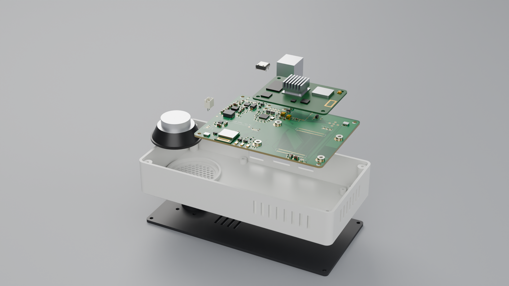

# Showcase animation

| File | What |
|---|---|
| `voxhub_showcase.mp4` | product animation, 1920 x 1080, 60 fps, 21 s (H.264) |
| `voxhub_exploded.png` | still of the exploded view (96 samples) |
| `render_showcase.py` | the Blender script: imports the models, builds materials, studio, camera path, animation and title, renders |
| `step_to_glb.py` | STEP -> GLB with OpenCascade (assembly tree, names and colours are kept) |
| `make_pcb_texture.py` | board surface textures (copper, solder mask, pads, silkscreen) from KiCad layer plots |
| `build_showcase.sh` | runs everything: conversion, textures, render, ffmpeg |



**Status: the video and the still show revision A1** (round 40 mm speaker, MGM240P radio module, reverse-mount status
LEDs, A1 routing). They were not rendered again for revision A2 (skipped on the owner's decision; a test still of the
A2 exploded view was rendered then and looked right) and not for revision A3. Against A2, revision A3 changes little
that a render shows: the revision text on the silkscreen, two land patterns (the rings of the four spacers, four
contacts of the USB-C socket), the stand-in model of the stacked USB-A connector and its window in the shell. A run of
`media/build_showcase.sh` renders all 1260 frames in about 3 hours. The text below describes the A1 render.

Since revision A3 the scripts use KiCad 10 (KiCad 9 cannot load the board file any more). `build_showcase.sh` was run
on the A3 files up to the render: the STEP to GLB conversion (board, enclosure assembly, 27 part models) and the board
textures from the image `voxhub-kicad:10.0` (four images of 3200 x 2368 px; the four mounting holes lie within 0.001 mm
of their board positions in them) finish. Blender and the encoding were not run.

KiCad 10 plots a page that is the bounding box of the board outline, so the corner of the texture is the corner of the
board; the script stops when the page has another size. KiCad 10 also draws the 15 non-plated holes of the board as
filled discs where KiCad 9 left them open; the textures show them as gold, but they lie in holes of the board solid and
are not seen in a render.

KiCad 9 made the page the bounding box of everything on the board, and the script took the board to be in the middle of
it. Run again for this check with the image `kicad/kicad:9.0` (KiCad 9.0.9), the script as it was in revision A2 puts
the texture of the A2 board 0.24 mm in x and 1.6 mm in y off the parts (A1 board: 0.24 mm and 1.4 mm). Whether the
frames of the video carry this shift was not measured.

A1 history: the video was first rendered before the review moved 53 of the 151
footprints (the buck power stage, the two USB ESD parts, small parts around the PD controller and the hub) and re-routed
the board. The 866 frames in which the PCB is visible (frames 150 to 1015) were rendered again from the final board
(1 h 54 min); the 394 frames of the closed device at the start and at the end are from the first render - the printed
parts did not change (`voxhub_shell.stl` and `voxhub_base.stl` are byte-identical) and the PCB is inside the closed case;
five of them rendered again from the final board match the kept ones to within 3 of 255 on single pixels. A run of
`build_showcase.sh` from scratch renders all 1260 frames.

## What you see

| Time | Shot |
|---|---|
| 0.0 - 2.5 s | closed device on a studio floor, soft area lights, slow camera move |
| 2.5 - 4.2 s | the device lifts off, the base plate drops away |
| 4.1 - 5.7 s | the upper half turns over - the PCB hangs component side down under the top plate, exactly as it is assembled |
| 5.7 - 7.1 s | PCB and speaker lift out of the shell |
| 6.9 - 8.6 s | CM4 with heat sink, stacked USB-A, USB-C, microSD socket and speaker header separate from the PCB |
| 8.6 - 13.6 s | slow orbit around the exploded PCB |
| 13.6 - 16.8 s | everything reassembles |
| 16.8 - 21.0 s | turntable shot of the closed device, "VoxHub" title |

## Where the geometry comes from

Only STEP files that the hardware and enclosure builds of this repository produce:

- `hardware/outputs/voxhub_pcb.step` - KiCad's export of the assembled board: position and reference of every part;
- `hardware/3dmodels/**/*.step` - the part models (KiCad library models and the coloured stand-ins written by
  `hardware/gen/make_3dmodels.py`). KiCad's board export drops model colours, so the script takes the geometry of each
  part from its own model file and only the placement from the board export;
- `enclosure/voxhub_assembly.step` - shell, base plate and speaker in their assembled position.

The board itself is a plain slab in STEP. Its copper, solder mask and silkscreen are a texture that
`make_pcb_texture.py` composes from KiCad's layer plots of the same board file, so traces and pads are the real layout.

## Rebuilding

```bash
pip install cadquery pymupdf pillow numpy
sudo apt install ffmpeg
docker build -t voxhub-kicad:10.0 hardware/docker                 # KiCad 10 image; built by the scripts when it is missing
BLENDER=/path/to/blender-4.5/blender media/build_showcase.sh      # frames go to media/work (not tracked)
```

| Environment variable | Meaning |
|---|---|
| `BLENDER` | path of the Blender binary (4.2 - 4.5) |
| `PYTHON` | interpreter with cadquery, pymupdf, pillow and numpy (default `python3`) |
| `KICAD_IMAGE` | Docker image with KiCad 10 for the board textures (default `voxhub-kicad:10.0`, built from `hardware/docker` when it is missing) |
| `KICAD_NATIVE=1` | plot the board textures with the host's `kicad-cli` instead of the Docker image; it must be KiCad 10 |
| `SAMPLES`, `THREADS` | Cycles samples per pixel (default 4), render threads (default all) |
| `FRAMES="start end"` | render only this frame range |
| `KEEP_VIDEO=<mp4>` | together with `FRAMES`: take the frames outside the range from this earlier video (only valid while the printed parts and everything else visible in those frames are unchanged) |

Blender 4.2 to 4.5 is required (tested with 4.5.16 LTS; Blender 5 changed the animation API and the script refuses to
start there). Blender runs headless (`blender -b -P render_showcase.py -- ...`), Cycles on the CPU: 4 samples per pixel +
OpenImageDenoise, fixed noise seed, 3 bounces, no motion blur. Measured on 4 cores: about 9 s per frame on average (7 to 13 s),
3 h 10 min for the 1260 frames. The script always renders on the CPU (`cycles.device = "CPU"`), so raising
`SAMPLES` raises the render time proportionally. `render_showcase.py --stills 0,5,10 --scale 25` renders quick checks of
single moments, `--still <t> out.png` one frame, `--start / --end` a frame range. Finished frames are skipped (a frame
counts as finished when the PNG ends with its IEND chunk), so an interrupted render can simply be restarted;
`build_showcase.sh` refuses to encode while a frame is missing, and it throws the frames of an earlier render away when
the board, the enclosure, a part model, the scripts or `SAMPLES` changed since (fingerprint in `frames/.inputs`).

The MP4 is H.264 High, yuv420p, converted with the BT.709 matrix and tagged as such (limited range), `+faststart`.
