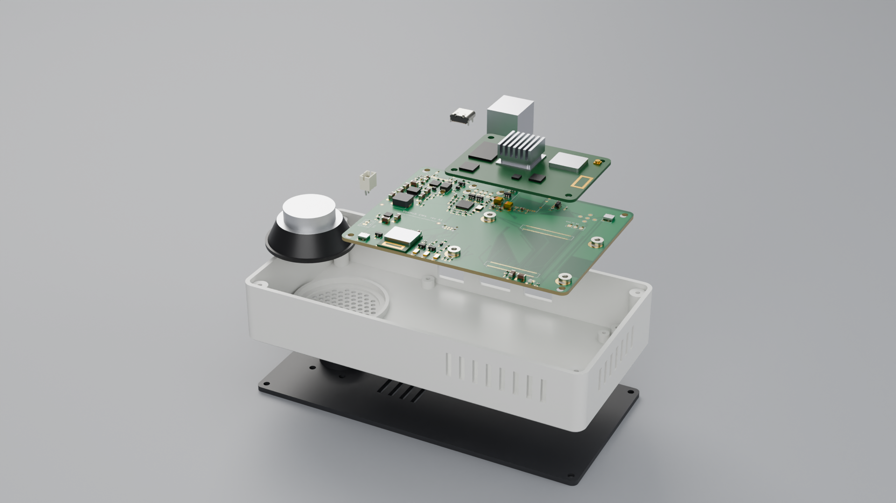

# Showcase animation

| File | What |
|---|---|
| `voxhub_showcase.mp4` | product animation, 1920 x 1080, 60 fps, 21 s (H.264) |
| `voxhub_exploded.png` | still of the exploded view (96 samples) |
| `render_showcase.py` | the Blender script: imports the models, builds materials, studio, camera path, animation and title, renders |
| `step_to_glb.py` | STEP -> GLB with OpenCascade (assembly tree, names and colours are kept) |
| `make_pcb_texture.py` | board surface textures (copper, solder mask, pads, silkscreen) from KiCad layer plots |
| `build_showcase.sh` | runs everything: conversion, textures, render, ffmpeg |



## What you see

| Time | Shot |
|---|---|
| 0.0 - 2.5 s | closed device on a studio floor, soft area lights, slow camera move |
| 2.5 - 4.2 s | the device lifts off, the base plate drops away |
| 4.1 - 5.7 s | the upper half turns over - the PCB hangs component side down under the top plate, exactly as it is assembled |
| 5.7 - 7.1 s | PCB and speaker lift out of the shell |
| 6.9 - 8.6 s | CM4 with heat sink, stacked USB-A, USB-C, microSD socket and speaker header separate from the PCB |
| 8.6 - 13.6 s | slow orbit around the exploded PCB |
| 13.6 - 16.8 s | everything reassembles |
| 16.8 - 21.0 s | turntable shot of the closed device, "VoxHub" title |

## Where the geometry comes from

Only STEP files that the hardware and enclosure builds of this repository produce:

- `hardware/outputs/voxhub_pcb.step` - KiCad's export of the assembled board: position and reference of every part;
- `hardware/3dmodels/**/*.step` - the part models (KiCad library models and the coloured stand-ins written by
  `hardware/gen/make_3dmodels.py`). KiCad's board export drops model colours, so the script takes the geometry of each
  part from its own model file and only the placement from the board export;
- `enclosure/voxhub_assembly.step` - shell, base plate and speaker in their assembled position.

The board itself is a plain slab in STEP. Its copper, solder mask and silkscreen are a texture that
`make_pcb_texture.py` composes from KiCad's layer plots of the same board file, so traces and pads are the real layout.

## Rebuilding

```bash
pip install cadquery pymupdf pillow numpy
docker pull kicad/kicad:9.0
BLENDER=/path/to/blender-4.5/blender media/build_showcase.sh      # frames go to media/work (not tracked)
```

Blender runs headless (`blender -b -P render_showcase.py -- ...`), Cycles on the CPU: 4 samples per pixel +
OpenImageDenoise, fixed noise seed, 3 bounces, no motion blur. That is about 15 s per frame on 4 cores (5 to 6 hours
for the 1260 frames); with a GPU raise `SAMPLES`. `render_showcase.py --stills 0,5,10 --scale 25` renders quick checks
of single moments, `--still <t> out.png` one frame, `--start / --end` a frame range (existing frames are skipped, so
an interrupted render can simply be restarted).
